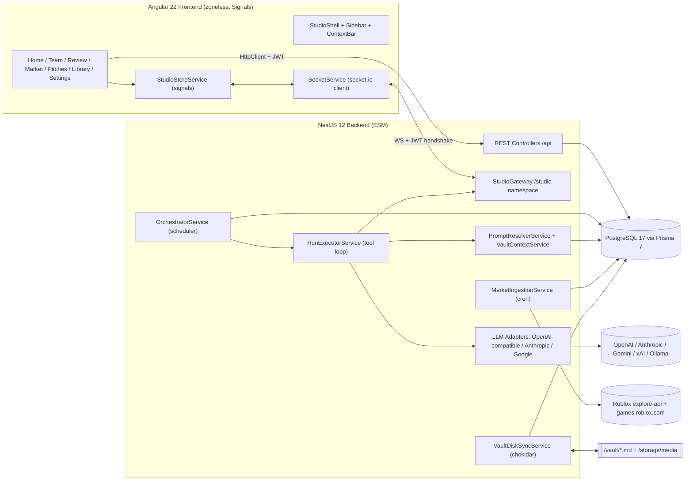

# RobDev Control Room — Master Architecture & Phased Implementation Blueprint

> **Audience:** Gemini Argon 4.0 (autonomous coding model), executing verbatim.
> **Author role:** Principal Full-Stack Systems Architect.
> **Status:** Draft for operator approval. After approval this document is split into `/docs/blueprint/*.md` inside the repo, and its code blocks (Prisma schema, SCSS design system, shared contracts) are compile-validated.

**RobDev Control Room** is a multi-agent AI game-development studio dashboard for Roblox. Fifteen specialised LLM agents (Lead + 14 specialists) take tasks, read studio rules from a Markdown **Knowledge Vault**, stream their work live over WebSockets, and hand creative output (icons, thumbnails, publish stages) to a human **review queue**. A **market intelligence** module ingests live Roblox chart data, which the `Pulse` agent turns into data-backed game **pitches**.

---

## User Review Required

> [!IMPORTANT]
> **Decisions locked from your answers**
> 1. **Real LLMs only.** No simulated engine. The providers are **OpenAI (GPT), Anthropic (Claude), Google (Gemini), xAI (Grok)**, plus **local** models via **Ollama** or any **OpenAI-compatible** server (LM Studio, vLLM). API keys are entered per studio in the UI and stored encrypted. Without a bound model, an agent shows `OFFLINE` and its queued tasks wait.
> 2. **Live Roblox ingestion** from the public, undocumented `explore-api` plus the `games.roblox.com` endpoints, with rate limiting, schema-drift detection and stale-data banners.
> 3. **JWT auth**: users, studios and memberships (`OWNER`/`ADMIN`/`PRODUCER`/`VIEWER`), a refresh-token cookie and a login/register view.

> [!WARNING]
> **Environment blockers found on this machine**
> - **Node.js must be upgraded.** Angular 22.2 requires `^22.22.3 || ^24.15.0 || >=26`. You have **v22.20.0**. The blueprint pins `"engines": { "node": ">=24.15.0" }` and an `.nvmrc` of `24`.
> - **TypeScript is pinned to `~6.0.3`** across the monorepo. Angular 22's compiler peer range is `>=6.0 <6.1`, so TS 7.0 (the current `latest`) must **not** be installed.
> - **Prisma is pinned to `7.10.1`.** npm's `latest` tag currently points at `8.0.0-rc.25` (a release candidate).

> [!CAUTION]
> **Scope boundaries (honest limits Argon must not fake)**
> - **Roblox Studio automation.** `Playtest`, `108 Tester` and the "Studio lanes" cannot drive Roblox Studio; no public API allows it. Lanes are modelled as a **database mutex** that agents acquire and release. These agents produce structured test plans, viewport checklists and `FIX FIRST` blockers, and raise `TRY IT` human requests for verification inside Studio. A future "Studio Bridge" plugin is out of scope.
> - **Video trailers.** No provider offers a common video API, so `Splash` produces **trailer storyboards** (shot list plus keyframe images). Real `.mp4` trailers enter the review queue through manual upload.
> - **Publishing and asset upload to Roblox (Open Cloud)** are out of scope. Builds are recorded manually or by agents as version numbers.
> - **Explore API fragility.** `apis.roblox.com/explore-api` is undocumented. The ingestion layer validates loosely, records `SCHEMA_DRIFT` failures, keeps the last good data and shows a staleness banner, so it never crashes.
> - **Token spend.** On boot, interrupted `RUNNING` tasks are **re-queued**. If a model is bound, the 2 seeded in-flight tasks will make real API calls. Set `ORCHESTRATOR_AUTOSTART=false` to boot the studio paused.

## Open Questions (defaults applied unless you say otherwise)

| # | Question | Default in this blueprint |
|---|----------|---------------------------|
| 1 | Postgres via Docker or your local PostgreSQL 18? | `docker-compose.yml` runs `postgres:17-alpine` on **port 5433**, so it can't clash with your local PG18 on 5432. `DATABASE_URL` can point at either. |
| 2 | Open registration? | `ALLOW_REGISTRATION=true` in dev. When `false`, only existing OWNER/ADMINs can add members (by email, for existing users). |
| 3 | Default model per agent? | **No hard-coded model IDs anywhere in code.** The Settings → Models page lists models **live** from each provider's list-models API. The seed binds agents only if `SEED_LLM_CONNECTION` and `SEED_LLM_MODEL` are set. |
| 4 | Horizontal scaling? | Single backend process; the orchestrator holds in-memory abort handles. Claiming uses `FOR UPDATE SKIP LOCKED`, so a later move to multiple workers is safe, but Redis/BullMQ is out of scope. |

---

## System Overview

### Pinned Technology Versions

| Layer | Package | Version |
|---|---|---|
| Runtime | Node.js | `>=24.15.0` (LTS) |
| Package manager | pnpm (workspaces) | `10.18.x` |
| Language | `typescript` | `~6.0.3` (all packages) |
| Frontend | `@angular/*`, `@angular/cli`, `@angular/build` | `^22.2.3` |
| Frontend | `socket.io-client` | `^4.8.4` |
| Frontend | `marked` / `dompurify` | `^18.1.1` / `^3.4.17` |
| Frontend | `sass` | `^1.106.1` |
| Frontend fonts | `@fontsource-variable/inter`, `@fontsource-variable/jetbrains-mono` | latest 5.x (font files only — not a UI library) |
| Backend | `@nestjs/core`, `common`, `platform-express`, `websockets`, `platform-socket.io` | `^12.2.0` |
| Backend | `@nestjs/config` / `@nestjs/jwt` / `@nestjs/schedule` / `@nestjs/throttler` | `^12.0.1` / `^12.0.3` / `^12.0.2` / `^6.7.1` |
| Backend | `socket.io` | `^4.8.4` |
| ORM | `prisma`, `@prisma/client`, `@prisma/adapter-pg` | `7.10.1` (exact) |
| Validation | `zod` (shared, FE + BE) | `^4.6.7` |
| Auth | `@node-rs/argon2` | `^2.2.2` |
| LLM | `openai` / `@anthropic-ai/sdk` / `@google/genai` | `^7.42.0` / `^1.1.0` / `^2.30.0` |
| Media | `sharp` | `^0.35.5` |
| Vault sync | `chokidar` | `^6.0.0` |
| Security | `helmet` / `cookie-parser` | `^8.3.0` / `^1.4.7` |
| Tests | `vitest` (+ `unplugin-swc` on backend) | latest 4.x |
| Dev | `tsx`, `concurrently` | `^4.23.15`, `^10.0.6` |
