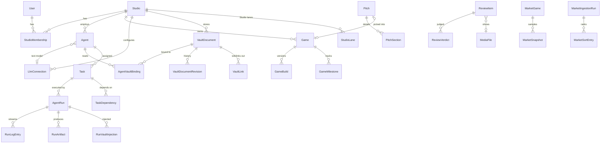

# Section 2 — Database Schema & Shared Contracts

## 2.1 Entity Relationship Overview



## 2.2 `backend/prisma/schema.prisma` (complete, exact)

```prisma
// RobDev Control Room — Prisma 7 schema
// Datasource URL lives in prisma.config.ts (Prisma 7 convention).

generator client {
  provider     = "prisma-client"
  output       = "../src/generated/prisma"
  moduleFormat = "esm"
  runtime      = "nodejs"
}

datasource db {
  provider = "postgresql"
}

// ───────────────────────────── Enums ─────────────────────────────

enum MembershipRole {
  OWNER
  ADMIN
  PRODUCER
  VIEWER
}

enum LlmProvider {
  OPENAI
  ANTHROPIC
  GOOGLE
  XAI
  OLLAMA
  OPENAI_COMPATIBLE
}

enum AgentKey {
  lead
  pulse
  architect
  builder
  frame
  scenic
  balance
  librarian
  splash
  producer
  liveops
  merchant
  playtest
  tester108
  reviewer
}

enum AgentStatus {
  IDLE
  WORKING
  WAITING_ON_HUMAN
  BLOCKED
  PAUSED
  ERROR
  OFFLINE
}

enum AgentTool {
  vault_search
  vault_read
  vault_update_document
  delegate_task
  request_human
  save_artifact
  market_query
  create_pitch
  generate_image
  submit_for_review
  flag_blocker
  acquire_studio_lane
  release_studio_lane
  record_build
  update_milestone
}

enum TaskStatus {
  QUEUED
  RUNNING
  NEEDS_HUMAN
  BLOCKED
  PAUSED
  DONE
  FAILED
  CANCELLED
}

enum TaskPriority {
  LOW
  NORMAL
  HIGH
  URGENT
}

enum TaskOrigin {
  USER
  LEAD_DELEGATION
  AGENT_DELEGATION
  SYSTEM
  REVIEW_FEEDBACK
}

enum RunStatus {
  RUNNING
  SUCCEEDED
  FAILED
  CANCELLED
  INTERRUPTED
  AWAITING_HUMAN
}

enum LogEntryKind {
  SYSTEM
  CONTEXT
  TEXT
  TOOL_CALL
  TOOL_RESULT
  HANDOFF
  ERROR
  USAGE
}

enum MessageAuthor {
  USER
  AGENT
  SYSTEM
}

enum HumanRequestKind {
  PICK_NEXT_GAME
  TRY_IT
  DECISION
  INFO
}

enum HumanRequestStatus {
  OPEN
  RESOLVED
  DISMISSED
}

enum ReviewKind {
  ICON
  THUMBNAIL
  TRAILER
  STORYBOARD
  STAGE
  PUBLISH
}

enum ReviewTab {
  IMAGES_VIDEO
  STAGES_PUBLISH
}

enum ReviewStatus {
  TO_REVIEW
  CHANGES_ASKED
  APPROVED
  REJECTED
}

enum Verdict {
  APPROVE
  ASK_CHANGES
  REJECT
}

enum BlockerSeverity {
  FIX_FIRST
  SHOULD_FIX
  NIT
}

enum BlockerStatus {
  OPEN
  RESOLVED
  WAIVED
}

enum GameStatus {
  CONCEPT
  BLUEPRINT
  BUILDING
  TESTING
  LIVE
  PAUSED
}

enum BuildKind {
  SAVED
  PUBLISHED
}

enum MobilePassStatus {
  NOT_STARTED
  QUEUED
  RUNNING
  PASSED
  FAILED
}

enum MilestoneStatus {
  TODO
  IN_PROGRESS
  DONE
}

enum PitchStatus {
  DRAFT
  PROPOSED
  CHANGES_REQUESTED
  PICKED
  ARCHIVED
}

enum PitchSectionKey {
  FIRST_60_SECONDS
  FIVE_MINUTE_LOOP
  MINUTES_10_30
  MONETIZATION
  COMPETITORS
  RISKS
}

enum MarketSort {
  TOP_EARNING     @map("top-earning")
  TOP_PLAYING_NOW @map("top-playing-now")
  UP_AND_COMING   @map("up-and-coming")
  TOP_RATED       @map("top-rated")
}

enum DataSource {
  LIVE
  SEED
  COMPUTED
}

enum IngestionStatus {
  RUNNING
  SUCCEEDED
  PARTIAL
  FAILED
}

enum AuthorKind {
  USER
  AGENT
  DISK
  SEED
}

enum StudioAssetKind {
  MESH
  AUDIO
  DECAL
  IMAGE
  ANIMATION
  OTHER
}

// ─────────────────────────── Identity ───────────────────────────

model User {
  id               String                  @id @default(cuid())
  email            String                  @unique
  passwordHash     String
  displayName      String
  avatarColor      String                  @default("#7C3AED")
  createdAt        DateTime                @default(now())
  updatedAt        DateTime                @updatedAt
  memberships      StudioMembership[]
  refreshTokens    RefreshToken[]
  tasksCreated     Task[]                  @relation("TaskCreatedByUser")
  messages         AgentMessage[]
  verdicts         ReviewVerdict[]
  vaultRevisions   VaultDocumentRevision[]
  resolvedRequests HumanRequest[]          @relation("HumanRequestResolvedBy")
  buildsRecorded   GameBuild[]
}

model RefreshToken {
  id           String    @id @default(cuid())
  userId       String
  tokenHash    String    @unique
  familyId     String
  expiresAt    DateTime
  revokedAt    DateTime?
  replacedById String?
  userAgent    String?
  createdAt    DateTime  @default(now())
  user         User      @relation(fields: [userId], references: [id], onDelete: Cascade)

  @@index([userId])
  @@index([familyId])
}

model Studio {
  id             String             @id @default(cuid())
  slug           String             @unique
  name           String
  workspaceLabel String             @default("robdev")
  isPaused       Boolean            @default(false)
  pausedAt       DateTime?
  createdAt      DateTime           @default(now())
  updatedAt      DateTime           @updatedAt
  memberships    StudioMembership[]
  llmConnections LlmConnection[]
  agents         Agent[]
  games          Game[]
  lanes          StudioLane[]
  tasks          Task[]
  runs           AgentRun[]
  messages       AgentMessage[]
  humanRequests  HumanRequest[]
  media          MediaFile[]
  reviewItems    ReviewItem[]
  blockers       Blocker[]
  pitches        Pitch[]
  vaultFolders   VaultFolder[]
  vaultDocuments VaultDocument[]
  assets         StudioAsset[]
}

model StudioMembership {
  id        String         @id @default(cuid())
  studioId  String
  userId    String
  role      MembershipRole
  createdAt DateTime       @default(now())
  studio    Studio         @relation(fields: [studioId], references: [id], onDelete: Cascade)
  user      User           @relation(fields: [userId], references: [id], onDelete: Cascade)

  @@unique([studioId, userId])
  @@index([userId])
}

// ─────────────────────────── LLM config ───────────────────────────

model LlmConnection {
  id               String      @id @default(cuid())
  studioId         String
  provider         LlmProvider
  label            String
  baseUrl          String?
  apiKeyCiphertext String?
  apiKeyIv         String?
  apiKeyTag        String?
  apiKeyLast4      String?
  isEnabled        Boolean     @default(true)
  lastVerifiedAt   DateTime?
  lastError        String?
  createdAt        DateTime    @default(now())
  updatedAt        DateTime    @updatedAt
  studio           Studio      @relation(fields: [studioId], references: [id], onDelete: Cascade)
  textAgents       Agent[]     @relation("AgentTextConnection")
  imageAgents      Agent[]     @relation("AgentImageConnection")

  @@unique([studioId, label])
}

// ─────────────────────────── Agents ───────────────────────────

model Agent {
  id                String                  @id @default(cuid())
  studioId          String
  key               AgentKey
  name              String
  title             String
  description       String
  color             String
  glyph             String
  sortOrder         Int
  systemPrompt      String                  @db.Text
  tools             AgentTool[]
  status            AgentStatus             @default(OFFLINE)
  isEnabled         Boolean                 @default(true)
  llmConnectionId   String?
  modelId           String?
  temperature       Float                   @default(0.4)
  maxOutputTokens   Int                     @default(4096)
  imageConnectionId String?
  imageModelId      String?
  currentTaskId     String?
  currentRunId      String?
  lastActivityAt    DateTime?
  lastSnippet       String?
  lastErrorCode     String?
  lastErrorMessage  String?
  createdAt         DateTime                @default(now())
  updatedAt         DateTime                @updatedAt
  studio            Studio                  @relation(fields: [studioId], references: [id], onDelete: Cascade)
  llmConnection     LlmConnection?          @relation("AgentTextConnection", fields: [llmConnectionId], references: [id], onDelete: SetNull)
  imageConnection   LlmConnection?          @relation("AgentImageConnection", fields: [imageConnectionId], references: [id], onDelete: SetNull)
  tasks             Task[]                  @relation("TaskAssignee")
  tasksCreated      Task[]                  @relation("TaskCreatedByAgent")
  runs              AgentRun[]
  vaultBindings     AgentVaultBinding[]
  messages          AgentMessage[]
  humanRequests     HumanRequest[]
  reviewItems       ReviewItem[]
  blockers          Blocker[]
  pitches           Pitch[]
  builds            GameBuild[]
  lanesHeld         StudioLane[]
  vaultRevisions    VaultDocumentRevision[]
  assetsCurated     StudioAsset[]

  @@unique([studioId, key])
}

model AgentVaultBinding {
  id         String        @id @default(cuid())
  agentId    String
  documentId String
  priority   Int
  agent      Agent         @relation(fields: [agentId], references: [id], onDelete: Cascade)
  document   VaultDocument @relation(fields: [documentId], references: [id], onDelete: Cascade)

  @@unique([agentId, documentId])
  @@index([documentId])
}

// ─────────────────────────── Games ───────────────────────────

model Game {
  id                     String          @id @default(cuid())
  studioId               String
  slug                   String
  name                   String
  genre                  String
  description            String          @default("")
  status                 GameStatus      @default(CONCEPT)
  accentColor            String          @default("#A855F7")
  robloxUniverseId       BigInt?
  robloxPlaceId          BigInt?
  iconMediaId            String?
  latestSavedVersion     Int?
  latestPublishedVersion Int?
  createdFromPitchId     String?         @unique
  createdAt              DateTime        @default(now())
  updatedAt              DateTime        @updatedAt
  studio                 Studio          @relation(fields: [studioId], references: [id], onDelete: Cascade)
  iconMedia              MediaFile?      @relation("GameIcon", fields: [iconMediaId], references: [id], onDelete: SetNull)
  createdFromPitch       Pitch?          @relation(fields: [createdFromPitchId], references: [id], onDelete: SetNull)
  milestones             GameMilestone[]
  builds                 GameBuild[]
  tasks                  Task[]
  humanRequests          HumanRequest[]
  reviewItems            ReviewItem[]
  blockers               Blocker[]
  lanesHeld              StudioLane[]

  @@unique([studioId, slug])
}

model GameMilestone {
  id          String          @id @default(cuid())
  gameId      String
  key         String
  title       String
  sortOrder   Int
  status      MilestoneStatus @default(TODO)
  completedAt DateTime?
  game        Game            @relation(fields: [gameId], references: [id], onDelete: Cascade)

  @@unique([gameId, key])
}

model GameBuild {
  id               String           @id @default(cuid())
  gameId           String
  version          Int
  kind             BuildKind
  notes            String           @default("")
  createdByAgentId String?
  createdByUserId  String?
  mobilePassA      MobilePassStatus @default(NOT_STARTED)
  mobilePassB      MobilePassStatus @default(NOT_STARTED)
  createdAt        DateTime         @default(now())
  game             Game             @relation(fields: [gameId], references: [id], onDelete: Cascade)
  createdByAgent   Agent?           @relation(fields: [createdByAgentId], references: [id], onDelete: SetNull)
  createdByUser    User?            @relation(fields: [createdByUserId], references: [id], onDelete: SetNull)

  @@unique([gameId, version, kind])
  @@index([gameId, createdAt(sort: Desc)])
}

model StudioLane {
  id            String    @id @default(cuid())
  studioId      String
  name          String
  sortOrder     Int
  heldByAgentId String?
  heldForGameId String?
  heldByRunId   String?
  heldSince     DateTime?
  studio        Studio    @relation(fields: [studioId], references: [id], onDelete: Cascade)
  heldByAgent   Agent?    @relation(fields: [heldByAgentId], references: [id], onDelete: SetNull)
  heldForGame   Game?     @relation(fields: [heldForGameId], references: [id], onDelete: SetNull)

  @@unique([studioId, name])
}

// ─────────────────────────── Tasks & runs ───────────────────────────

model Task {
  id               String           @id @default(cuid())
  studioId         String
  gameId           String?
  agentId          String
  parentTaskId     String?
  createdByUserId  String?
  createdByAgentId String?
  origin           TaskOrigin
  title            String
  brief            String           @db.Text
  status           TaskStatus       @default(QUEUED)
  priority         TaskPriority     @default(NORMAL)
  tags             String[]
  attempts         Int              @default(0)
  resultSummary    String?          @db.Text
  metadata         Json?
  queuedAt         DateTime         @default(now())
  startedAt        DateTime?
  completedAt      DateTime?
  createdAt        DateTime         @default(now())
  updatedAt        DateTime         @updatedAt
  studio           Studio           @relation(fields: [studioId], references: [id], onDelete: Cascade)
  game             Game?            @relation(fields: [gameId], references: [id], onDelete: SetNull)
  agent            Agent            @relation("TaskAssignee", fields: [agentId], references: [id], onDelete: Cascade)
  parent           Task?            @relation("TaskTree", fields: [parentTaskId], references: [id], onDelete: SetNull)
  children         Task[]           @relation("TaskTree")
  createdByUser    User?            @relation("TaskCreatedByUser", fields: [createdByUserId], references: [id], onDelete: SetNull)
  createdByAgent   Agent?           @relation("TaskCreatedByAgent", fields: [createdByAgentId], references: [id], onDelete: SetNull)
  dependencies     TaskDependency[] @relation("TaskDeps")
  dependents       TaskDependency[] @relation("TaskDependents")
  runs             AgentRun[]
  messages         AgentMessage[]
  humanRequests    HumanRequest[]
  reviewItems      ReviewItem[]
  blockers         Blocker[]

  @@index([studioId, status])
  @@index([agentId, status])
  @@index([gameId])
  @@index([parentTaskId])
}

model TaskDependency {
  taskId      String
  dependsOnId String
  task        Task   @relation("TaskDeps", fields: [taskId], references: [id], onDelete: Cascade)
  dependsOn   Task   @relation("TaskDependents", fields: [dependsOnId], references: [id], onDelete: Cascade)

  @@id([taskId, dependsOnId])
}

model AgentRun {
  id            String              @id @default(cuid())
  studioId      String
  taskId        String
  agentId       String
  status        RunStatus           @default(RUNNING)
  provider      LlmProvider
  modelId       String
  attempt       Int                 @default(1)
  startedAt     DateTime            @default(now())
  finishedAt    DateTime?
  heartbeatAt   DateTime            @default(now())
  inputTokens   Int                 @default(0)
  outputTokens  Int                 @default(0)
  toolCallCount Int                 @default(0)
  summary       String?             @db.Text
  errorCode     String?
  errorMessage  String?             @db.Text
  studio        Studio              @relation(fields: [studioId], references: [id], onDelete: Cascade)
  task          Task                @relation(fields: [taskId], references: [id], onDelete: Cascade)
  agent         Agent               @relation(fields: [agentId], references: [id], onDelete: Cascade)
  entries       RunLogEntry[]
  artifacts     RunArtifact[]
  injections    RunVaultInjection[]
  reviewItems   ReviewItem[]
  blockers      Blocker[]
  pitches       Pitch[]

  @@index([agentId, startedAt(sort: Desc)])
  @@index([taskId])
  @@index([studioId, status])
}

model RunLogEntry {
  id        String       @id @default(cuid())
  runId     String
  seq       Int
  kind      LogEntryKind
  content   String       @db.Text
  meta      Json?
  createdAt DateTime     @default(now())
  updatedAt DateTime     @updatedAt
  run       AgentRun     @relation(fields: [runId], references: [id], onDelete: Cascade)

  @@unique([runId, seq])
}

model RunArtifact {
  id        String   @id @default(cuid())
  runId     String
  path      String
  language  String
  content   String   @db.Text
  bytes     Int
  createdAt DateTime @default(now())
  run       AgentRun @relation(fields: [runId], references: [id], onDelete: Cascade)

  @@index([runId])
}

model RunVaultInjection {
  id              String        @id @default(cuid())
  runId           String
  documentId      String
  documentVersion Int
  estimatedTokens Int
  truncated       Boolean       @default(false)
  createdAt       DateTime      @default(now())
  run             AgentRun      @relation(fields: [runId], references: [id], onDelete: Cascade)
  document        VaultDocument @relation(fields: [documentId], references: [id], onDelete: Cascade)

  @@index([documentId, createdAt(sort: Desc)])
  @@index([runId])
}

model AgentMessage {
  id        String        @id @default(cuid())
  studioId  String
  agentId   String
  author    MessageAuthor
  userId    String?
  taskId    String?
  body      String        @db.Text
  createdAt DateTime      @default(now())
  studio    Studio        @relation(fields: [studioId], references: [id], onDelete: Cascade)
  agent     Agent         @relation(fields: [agentId], references: [id], onDelete: Cascade)
  user      User?         @relation(fields: [userId], references: [id], onDelete: SetNull)
  task      Task?         @relation(fields: [taskId], references: [id], onDelete: SetNull)

  @@index([agentId, createdAt(sort: Desc)])
}

// ─────────────────────── Human-in-the-loop ───────────────────────

model HumanRequest {
  id           String             @id @default(cuid())
  studioId     String
  kind         HumanRequestKind
  status       HumanRequestStatus @default(OPEN)
  title        String
  body         String             @db.Text
  gameId       String?
  agentId      String?
  taskId       String?
  options      Json?
  pitchIds     String[]
  buildVersion Int?
  resolution   String?            @db.Text
  resolvedById String?
  resolvedAt   DateTime?
  createdAt    DateTime           @default(now())
  studio       Studio             @relation(fields: [studioId], references: [id], onDelete: Cascade)
  game         Game?              @relation(fields: [gameId], references: [id], onDelete: SetNull)
  agent        Agent?             @relation(fields: [agentId], references: [id], onDelete: SetNull)
  task         Task?              @relation(fields: [taskId], references: [id], onDelete: SetNull)
  resolvedBy   User?              @relation("HumanRequestResolvedBy", fields: [resolvedById], references: [id], onDelete: SetNull)

  @@index([studioId, status])
}

model MediaFile {
  id          String        @id @default(cuid())
  studioId    String
  storageKey  String        @unique
  mimeType    String
  width       Int?
  height      Int?
  bytes       Int
  durationSec Float?
  sha256      String
  createdAt   DateTime      @default(now())
  studio      Studio        @relation(fields: [studioId], references: [id], onDelete: Cascade)
  reviewItems ReviewItem[]
  gameIcons   Game[]        @relation("GameIcon")
  assets      StudioAsset[]
}

model ReviewItem {
  id             String          @id @default(cuid())
  studioId       String
  gameId         String?
  kind           ReviewKind
  tab            ReviewTab
  status         ReviewStatus    @default(TO_REVIEW)
  title          String
  description    String          @default("") @db.Text
  madeByAgentId  String?
  mediaId        String?
  taskId         String?
  runId          String?
  payload        Json?
  iteration      Int             @default(1)
  previousItemId String?
  createdAt      DateTime        @default(now())
  updatedAt      DateTime        @updatedAt
  studio         Studio          @relation(fields: [studioId], references: [id], onDelete: Cascade)
  game           Game?           @relation(fields: [gameId], references: [id], onDelete: SetNull)
  madeByAgent    Agent?          @relation(fields: [madeByAgentId], references: [id], onDelete: SetNull)
  media          MediaFile?      @relation(fields: [mediaId], references: [id], onDelete: SetNull)
  task           Task?           @relation(fields: [taskId], references: [id], onDelete: SetNull)
  run            AgentRun?       @relation(fields: [runId], references: [id], onDelete: SetNull)
  previousItem   ReviewItem?     @relation("ReviewIteration", fields: [previousItemId], references: [id], onDelete: SetNull)
  nextItems      ReviewItem[]    @relation("ReviewIteration")
  verdicts       ReviewVerdict[]
  blockers       Blocker[]

  @@index([studioId, tab, status])
  @@index([gameId])
}

model ReviewVerdict {
  id           String     @id @default(cuid())
  reviewItemId String
  userId       String
  verdict      Verdict
  feedback     String?    @db.Text
  createdAt    DateTime   @default(now())
  reviewItem   ReviewItem @relation(fields: [reviewItemId], references: [id], onDelete: Cascade)
  user         User       @relation(fields: [userId], references: [id], onDelete: Cascade)

  @@index([reviewItemId])
}

model Blocker {
  id           String          @id @default(cuid())
  studioId     String
  gameId       String?
  taskId       String?
  runId        String?
  reviewItemId String?
  agentId      String?
  severity     BlockerSeverity
  status       BlockerStatus   @default(OPEN)
  title        String
  detail       String          @db.Text
  buildVersion Int?
  createdAt    DateTime        @default(now())
  resolvedAt   DateTime?
  studio       Studio          @relation(fields: [studioId], references: [id], onDelete: Cascade)
  game         Game?           @relation(fields: [gameId], references: [id], onDelete: SetNull)
  task         Task?           @relation(fields: [taskId], references: [id], onDelete: SetNull)
  run          AgentRun?       @relation(fields: [runId], references: [id], onDelete: SetNull)
  reviewItem   ReviewItem?     @relation(fields: [reviewItemId], references: [id], onDelete: SetNull)
  agent        Agent?          @relation(fields: [agentId], references: [id], onDelete: SetNull)

  @@index([studioId, status])
  @@index([reviewItemId])
}

// ─────────────────────────── Pitches ───────────────────────────

model Pitch {
  id               String         @id @default(cuid())
  studioId         String
  title            String
  logline          String         @db.Text
  genre            String
  status           PitchStatus    @default(PROPOSED)
  createdByAgentId String?
  runId            String?
  metrics          Json
  whatChanged      String         @db.Text
  howDifferent     String         @db.Text
  comparables      Json
  feedback         String?        @db.Text
  pickedAt         DateTime?
  createdAt        DateTime       @default(now())
  updatedAt        DateTime       @updatedAt
  studio           Studio         @relation(fields: [studioId], references: [id], onDelete: Cascade)
  createdByAgent   Agent?         @relation(fields: [createdByAgentId], references: [id], onDelete: SetNull)
  run              AgentRun?      @relation(fields: [runId], references: [id], onDelete: SetNull)
  sections         PitchSection[]
  game             Game?

  @@index([studioId, status])
}

model PitchSection {
  id        String          @id @default(cuid())
  pitchId   String
  key       PitchSectionKey
  markdown  String          @db.Text
  sortOrder Int
  pitch     Pitch           @relation(fields: [pitchId], references: [id], onDelete: Cascade)

  @@unique([pitchId, key])
}

// ─────────────────── Market intelligence (global) ───────────────────

model MarketGame {
  id          String            @id @default(cuid())
  universeId  BigInt            @unique
  rootPlaceId BigInt?
  name        String
  creatorName String
  creatorType String?
  genreL1     String?
  genreL2     String?
  iconUrl     String?
  source      DataSource
  firstSeenAt DateTime          @default(now())
  lastSeenAt  DateTime          @default(now())
  snapshots   MarketSnapshot[]
  sortEntries MarketSortEntry[]
}

model MarketSnapshot {
  id             String              @id @default(cuid())
  marketGameId   String
  ingestionRunId String?
  capturedAt     DateTime
  playing        Int
  visits         BigInt
  favoritedCount BigInt
  upVotes        Int
  downVotes      Int
  maxPlayers     Int?
  marketGame     MarketGame          @relation(fields: [marketGameId], references: [id], onDelete: Cascade)
  ingestionRun   MarketIngestionRun? @relation(fields: [ingestionRunId], references: [id], onDelete: SetNull)

  @@index([marketGameId, capturedAt(sort: Desc)])
}

model MarketSortEntry {
  id             String             @id @default(cuid())
  ingestionRunId String
  sort           MarketSort
  rank           Int
  marketGameId   String
  source         DataSource
  ingestionRun   MarketIngestionRun @relation(fields: [ingestionRunId], references: [id], onDelete: Cascade)
  marketGame     MarketGame         @relation(fields: [marketGameId], references: [id], onDelete: Cascade)

  @@unique([ingestionRunId, sort, rank])
  @@index([marketGameId])
}

model MarketIngestionRun {
  id           String            @id @default(cuid())
  status       IngestionStatus   @default(RUNNING)
  source       DataSource
  startedAt    DateTime          @default(now())
  finishedAt   DateTime?
  sortsFetched String[]
  gamesFetched Int               @default(0)
  requestCount Int               @default(0)
  errorCode    String?
  errorMessage String?           @db.Text
  warnings     String[]
  snapshots    MarketSnapshot[]
  sortEntries  MarketSortEntry[]

  @@index([status, startedAt(sort: Desc)])
}

// ─────────────────────────── Vault ───────────────────────────

model VaultFolder {
  id        String          @id @default(cuid())
  studioId  String
  parentId  String?
  name      String
  path      String
  sortOrder Int
  studio    Studio          @relation(fields: [studioId], references: [id], onDelete: Cascade)
  parent    VaultFolder?    @relation("VaultFolderTree", fields: [parentId], references: [id], onDelete: Cascade)
  children  VaultFolder[]   @relation("VaultFolderTree")
  documents VaultDocument[]

  @@unique([studioId, path])
}

model VaultDocument {
  id               String                  @id @default(cuid())
  studioId         String
  folderId         String
  path             String
  title            String
  markdown         String                  @db.Text
  version          Int                     @default(1)
  wordCount        Int                     @default(0)
  charCount        Int                     @default(0)
  tags             String[]
  alwaysInject     Boolean                 @default(false)
  contentHash      String
  diskMtime        DateTime?
  updatedByKind    AuthorKind              @default(SEED)
  updatedByUserId  String?
  updatedByAgentId String?
  createdAt        DateTime                @default(now())
  updatedAt        DateTime                @updatedAt
  studio           Studio                  @relation(fields: [studioId], references: [id], onDelete: Cascade)
  folder           VaultFolder             @relation(fields: [folderId], references: [id], onDelete: Cascade)
  revisions        VaultDocumentRevision[]
  outgoingLinks    VaultLink[]             @relation("LinkFrom")
  incomingLinks    VaultLink[]             @relation("LinkTo")
  agentBindings    AgentVaultBinding[]
  injections       RunVaultInjection[]

  @@unique([studioId, path])
}

model VaultDocumentRevision {
  id            String        @id @default(cuid())
  documentId    String
  version       Int
  markdown      String        @db.Text
  authorKind    AuthorKind
  authorUserId  String?
  authorAgentId String?
  reason        String?
  createdAt     DateTime      @default(now())
  document      VaultDocument @relation(fields: [documentId], references: [id], onDelete: Cascade)
  authorUser    User?         @relation(fields: [authorUserId], references: [id], onDelete: SetNull)
  authorAgent   Agent?        @relation(fields: [authorAgentId], references: [id], onDelete: SetNull)

  @@unique([documentId, version])
}

model VaultLink {
  id             String         @id @default(cuid())
  fromDocumentId String
  toDocumentId   String?
  targetPath     String
  fromDocument   VaultDocument  @relation("LinkFrom", fields: [fromDocumentId], references: [id], onDelete: Cascade)
  toDocument     VaultDocument? @relation("LinkTo", fields: [toDocumentId], references: [id], onDelete: SetNull)

  @@unique([fromDocumentId, targetPath])
  @@index([toDocumentId])
}

model StudioAsset {
  id               String          @id @default(cuid())
  studioId         String
  kind             StudioAssetKind
  name             String
  tags             String[]
  mediaId          String?
  robloxAssetId    BigInt?
  notes            String          @default("")
  curatedByAgentId String?
  createdAt        DateTime        @default(now())
  studio           Studio          @relation(fields: [studioId], references: [id], onDelete: Cascade)
  media            MediaFile?      @relation(fields: [mediaId], references: [id], onDelete: SetNull)
  curatedByAgent   Agent?          @relation(fields: [curatedByAgentId], references: [id], onDelete: SetNull)

  @@index([studioId, kind])
}
```

**Schema rules for Argon**
- `Agent.currentTaskId` and `Agent.currentRunId` are deliberately **scalar pointers without relations**, which avoids cyclic required relations. `AgentStatusService` keeps them consistent.
- Convert every `BigInt` to `string` in DTOs with `common/serialization/bigint.ts`. `JSON.stringify` throws on BigInt.
- Run the initial migration with `pnpm db:migrate -- --name init`. Never hand-edit SQL, except for one follow-up migration `add_vault_search_trgm`:
  ```sql
  CREATE EXTENSION IF NOT EXISTS pg_trgm;
  CREATE INDEX IF NOT EXISTS vault_document_title_trgm ON "VaultDocument" USING gin (title gin_trgm_ops);
  CREATE INDEX IF NOT EXISTS vault_document_markdown_trgm ON "VaultDocument" USING gin (markdown gin_trgm_ops);
  ```
  Create it with `prisma migrate dev --create-only --name add_vault_search_trgm` and paste the SQL in.

---

## 2.3 Shared Contracts (`/shared/src`)

The shared package has **no dependency on Prisma**. The enum string values are **identical** to the Prisma enum values, so the backend can assign Prisma enums to shared types directly. A `satisfies` check in the backend (`src/common/serialization/enum-parity.ts`) asserts parity at compile time:
```ts
import type { AgentStatus as PrismaAgentStatus } from '../../generated/prisma/enums.js';
import type { AgentStatus } from '@robdev/shared';
type Same<A, B> = [A] extends [B] ? ([B] extends [A] ? true : false) : false;
const _agentStatusParity: Same<PrismaAgentStatus, AgentStatus> = true;
// Repeat one line per enum listed in enums.ts.
```

### `shared/src/enums.ts`
```ts
const values = <T extends string>(...v: readonly T[]) => Object.freeze(Object.fromEntries(v.map((x) => [x, x])) as { readonly [K in T]: K });

export const MembershipRole = values('OWNER', 'ADMIN', 'PRODUCER', 'VIEWER');
export type MembershipRole = keyof typeof MembershipRole;
export const ROLE_RANK: Record<MembershipRole, number> = { VIEWER: 0, PRODUCER: 1, ADMIN: 2, OWNER: 3 };

export const LlmProvider = values('OPENAI', 'ANTHROPIC', 'GOOGLE', 'XAI', 'OLLAMA', 'OPENAI_COMPATIBLE');
export type LlmProvider = keyof typeof LlmProvider;

export const AgentKey = values(
  'lead', 'pulse', 'architect', 'builder', 'frame', 'scenic', 'balance', 'librarian',
  'splash', 'producer', 'liveops', 'merchant', 'playtest', 'tester108', 'reviewer',
);
export type AgentKey = keyof typeof AgentKey;

export const AgentStatus = values('IDLE', 'WORKING', 'WAITING_ON_HUMAN', 'BLOCKED', 'PAUSED', 'ERROR', 'OFFLINE');
export type AgentStatus = keyof typeof AgentStatus;

export const AgentTool = values(
  'vault_search', 'vault_read', 'vault_update_document', 'delegate_task', 'request_human',
  'save_artifact', 'market_query', 'create_pitch', 'generate_image', 'submit_for_review',
  'flag_blocker', 'acquire_studio_lane', 'release_studio_lane', 'record_build', 'update_milestone',
);
export type AgentTool = keyof typeof AgentTool;

export const TaskStatus = values('QUEUED', 'RUNNING', 'NEEDS_HUMAN', 'BLOCKED', 'PAUSED', 'DONE', 'FAILED', 'CANCELLED');
export type TaskStatus = keyof typeof TaskStatus;
export const OPEN_TASK_STATUSES: readonly TaskStatus[] = ['QUEUED', 'RUNNING', 'NEEDS_HUMAN', 'BLOCKED', 'PAUSED'];

export const TaskPriority = values('LOW', 'NORMAL', 'HIGH', 'URGENT');
export type TaskPriority = keyof typeof TaskPriority;

export const TaskOrigin = values('USER', 'LEAD_DELEGATION', 'AGENT_DELEGATION', 'SYSTEM', 'REVIEW_FEEDBACK');
export type TaskOrigin = keyof typeof TaskOrigin;

export const RunStatus = values('RUNNING', 'SUCCEEDED', 'FAILED', 'CANCELLED', 'INTERRUPTED', 'AWAITING_HUMAN');
export type RunStatus = keyof typeof RunStatus;

export const LogEntryKind = values('SYSTEM', 'CONTEXT', 'TEXT', 'TOOL_CALL', 'TOOL_RESULT', 'HANDOFF', 'ERROR', 'USAGE');
export type LogEntryKind = keyof typeof LogEntryKind;

export const MessageAuthor = values('USER', 'AGENT', 'SYSTEM');
export type MessageAuthor = keyof typeof MessageAuthor;

export const HumanRequestKind = values('PICK_NEXT_GAME', 'TRY_IT', 'DECISION', 'INFO');
export type HumanRequestKind = keyof typeof HumanRequestKind;
export const HumanRequestStatus = values('OPEN', 'RESOLVED', 'DISMISSED');
export type HumanRequestStatus = keyof typeof HumanRequestStatus;

export const ReviewKind = values('ICON', 'THUMBNAIL', 'TRAILER', 'STORYBOARD', 'STAGE', 'PUBLISH');
export type ReviewKind = keyof typeof ReviewKind;
export const ReviewTab = values('IMAGES_VIDEO', 'STAGES_PUBLISH');
export type ReviewTab = keyof typeof ReviewTab;
export const REVIEW_KIND_TAB: Record<ReviewKind, ReviewTab> = {
  ICON: 'IMAGES_VIDEO', THUMBNAIL: 'IMAGES_VIDEO', TRAILER: 'IMAGES_VIDEO', STORYBOARD: 'IMAGES_VIDEO',
  STAGE: 'STAGES_PUBLISH', PUBLISH: 'STAGES_PUBLISH',
};
export const ReviewStatus = values('TO_REVIEW', 'CHANGES_ASKED', 'APPROVED', 'REJECTED');
export type ReviewStatus = keyof typeof ReviewStatus;
export const Verdict = values('APPROVE', 'ASK_CHANGES', 'REJECT');
export type Verdict = keyof typeof Verdict;
export const VERDICT_TO_STATUS: Record<Verdict, ReviewStatus> = { APPROVE: 'APPROVED', ASK_CHANGES: 'CHANGES_ASKED', REJECT: 'REJECTED' };

export const BlockerSeverity = values('FIX_FIRST', 'SHOULD_FIX', 'NIT');
export type BlockerSeverity = keyof typeof BlockerSeverity;
export const BlockerStatus = values('OPEN', 'RESOLVED', 'WAIVED');
export type BlockerStatus = keyof typeof BlockerStatus;

export const GameStatus = values('CONCEPT', 'BLUEPRINT', 'BUILDING', 'TESTING', 'LIVE', 'PAUSED');
export type GameStatus = keyof typeof GameStatus;
export const BuildKind = values('SAVED', 'PUBLISHED');
export type BuildKind = keyof typeof BuildKind;
export const MobilePassStatus = values('NOT_STARTED', 'QUEUED', 'RUNNING', 'PASSED', 'FAILED');
export type MobilePassStatus = keyof typeof MobilePassStatus;
export const MilestoneStatus = values('TODO', 'IN_PROGRESS', 'DONE');
export type MilestoneStatus = keyof typeof MilestoneStatus;

export const PitchStatus = values('DRAFT', 'PROPOSED', 'CHANGES_REQUESTED', 'PICKED', 'ARCHIVED');
export type PitchStatus = keyof typeof PitchStatus;
export const PitchSectionKey = values('FIRST_60_SECONDS', 'FIVE_MINUTE_LOOP', 'MINUTES_10_30', 'MONETIZATION', 'COMPETITORS', 'RISKS');
export type PitchSectionKey = keyof typeof PitchSectionKey;
export const PITCH_SECTION_TITLES: Record<PitchSectionKey, string> = {
  FIRST_60_SECONDS: 'First 60 seconds', FIVE_MINUTE_LOOP: '5-minute loop', MINUTES_10_30: 'Minutes 10-30',
  MONETIZATION: 'Monetization', COMPETITORS: 'Competitors', RISKS: 'Risks',
};

/** Prisma stores TOP_EARNING etc. and maps them to these Roblox sortIds in the DB. API/DTOs use the Roblox sortId strings. */
export const MarketSortId = values('top-earning', 'top-playing-now', 'up-and-coming', 'top-rated');
export type MarketSortId = keyof typeof MarketSortId;
export const MARKET_SORT_LABELS: Record<MarketSortId, string> = {
  'top-earning': 'Top earning', 'top-playing-now': 'Top playing now', 'up-and-coming': 'Up and coming', 'top-rated': 'Top rated',
};

export const DataSource = values('LIVE', 'SEED', 'COMPUTED');
export type DataSource = keyof typeof DataSource;
export const IngestionStatus = values('RUNNING', 'SUCCEEDED', 'PARTIAL', 'FAILED');
export type IngestionStatus = keyof typeof IngestionStatus;
export const AuthorKind = values('USER', 'AGENT', 'DISK', 'SEED');
export type AuthorKind = keyof typeof AuthorKind;

export const AgentKeyTuple = Object.values(AgentKey) as [AgentKey, ...AgentKey[]];
export const TaskStatusTuple = Object.values(TaskStatus) as [TaskStatus, ...TaskStatus[]];
export const PitchSectionKeyTuple = Object.values(PitchSectionKey) as [PitchSectionKey, ...PitchSectionKey[]];
export const MarketSortIdTuple = Object.values(MarketSortId) as [MarketSortId, ...MarketSortId[]];
```
> [!NOTE]
> Prisma's TS enum for `MarketSort` uses the **names** (`TOP_EARNING`), while the database stores the `@map` values. The backend converts between them with `MARKET_SORT_TO_ID: Record<PrismaMarketSort, MarketSortId>` and its inverse, defined in `market.service.ts`. This is the **only** enum without direct parity.

### `shared/src/agents/agent-roster.ts`
```ts
import type { AgentKey, AgentTool } from '../enums.js';

export interface AgentRosterEntry {
  key: AgentKey;
  name: string;          // display name
  title: string;         // one-line role
  color: string;         // avatar background
  glyph: string;         // 2–3 chars shown in avatar
  order: number;         // 1..15 matrix order (row-major, 4 columns)
  defaultTools: readonly AgentTool[];
}

const BASE: readonly AgentTool[] = ['vault_search', 'vault_read', 'request_human'];

export const AGENT_ROSTER: readonly AgentRosterEntry[] = [
  { key: 'lead',      name: 'Lead',       title: 'Orchestrator · decomposes & delegates',          color: '#7C3AED', glyph: 'LD',  order: 1,  defaultTools: [...BASE, 'delegate_task'] },
  { key: 'pulse',     name: 'Pulse',      title: 'Market analyst · data-backed pitches',           color: '#EC4899', glyph: 'PU',  order: 2,  defaultTools: [...BASE, 'market_query', 'create_pitch'] },
  { key: 'architect', name: 'Architect',  title: '12-step technical & design blueprint',          color: '#3B82F6', glyph: 'AR',  order: 3,  defaultTools: [...BASE, 'save_artifact', 'update_milestone'] },
  { key: 'builder',   name: 'Builder',    title: 'Luau server/client systems & combat',           color: '#F97316', glyph: 'BU',  order: 4,  defaultTools: [...BASE, 'save_artifact', 'acquire_studio_lane', 'release_studio_lane', 'record_build'] },
  { key: 'frame',     name: 'Frame',      title: '2D UI/HUD layouts with viewport rules',         color: '#06B6D4', glyph: 'FR',  order: 5,  defaultTools: [...BASE, 'save_artifact'] },
  { key: 'scenic',    name: 'Scenic',     title: '3D map zones & environmental lighting',         color: '#10B981', glyph: 'SC',  order: 6,  defaultTools: [...BASE, 'save_artifact', 'acquire_studio_lane', 'release_studio_lane'] },
  { key: 'balance',   name: 'Balance',    title: 'Progression curves, rarity odds, economy math', color: '#EAB308', glyph: 'BA',  order: 7,  defaultTools: [...BASE, 'save_artifact'] },
  { key: 'librarian', name: 'Librarian',  title: 'Curates & tags meshes, audio, decals',          color: '#A78BFA', glyph: 'LI',  order: 8,  defaultTools: [...BASE, 'vault_update_document', 'save_artifact'] },
  { key: 'splash',    name: 'Splash',     title: 'Icons 1:1, thumbnails 16:9, trailer boards',    color: '#F43F5E', glyph: 'SP',  order: 9,  defaultTools: [...BASE, 'generate_image', 'submit_for_review'] },
  { key: 'producer',  name: 'Producer',   title: 'End-to-end flow checks & milestones',           color: '#14B8A6', glyph: 'PR',  order: 10, defaultTools: [...BASE, 'update_milestone', 'submit_for_review', 'delegate_task', 'record_build'] },
  { key: 'liveops',   name: 'Liveops',    title: 'Events, update cadence, retention loops',       color: '#84CC16', glyph: 'LO',  order: 11, defaultTools: [...BASE, 'save_artifact'] },
  { key: 'merchant',  name: 'Merchant',   title: 'Gamepasses, dev products, shop ladders',        color: '#F59E0B', glyph: 'ME',  order: 12, defaultTools: [...BASE, 'save_artifact', 'market_query'] },
  { key: 'playtest',  name: 'Playtest',   title: 'Multi-client server & party test plans',        color: '#6366F1', glyph: 'PT',  order: 13, defaultTools: [...BASE, 'acquire_studio_lane', 'release_studio_lane', 'flag_blocker'] },
  { key: 'tester108', name: '108 Tester', title: 'Mobile viewport stress tests ×2 per build',     color: '#0EA5E9', glyph: '108', order: 14, defaultTools: [...BASE, 'acquire_studio_lane', 'release_studio_lane', 'flag_blocker'] },
  { key: 'reviewer',  name: 'Reviewer',   title: 'Pre-publish QA · flags FIX FIRST blockers',     color: '#D946EF', glyph: 'RV',  order: 15, defaultTools: [...BASE, 'flag_blocker', 'submit_for_review'] },
] as const;

export const AGENT_BY_KEY: Readonly<Record<AgentKey, AgentRosterEntry>> =
  Object.freeze(Object.fromEntries(AGENT_ROSTER.map((a) => [a.key, a])) as Record<AgentKey, AgentRosterEntry>);
```

### `shared/src/agents/agent-tools.ts`
```ts
import { z } from 'zod';
import { AgentKey, AgentTool, BlockerSeverity, HumanRequestKind, MarketSortId, ReviewKind, TaskPriority } from '../enums.js';

const agentKey = z.enum(Object.values(AgentKey) as [AgentKey, ...AgentKey[]]);

export const ToolArgs = {
  vault_search: z.object({ query: z.string().min(2).max(200), limit: z.number().int().min(1).max(10).default(5) }),
  vault_read: z.object({ path: z.string().min(1).max(300) }),
  vault_update_document: z.object({ path: z.string().min(1).max(300), markdown: z.string().min(1).max(200_000), reason: z.string().min(3).max(300) }),
  delegate_task: z.object({
    agentKey: agentKey.refine((k) => k !== 'lead', 'Lead cannot delegate to itself'),
    title: z.string().min(4).max(140),
    brief: z.string().min(20).max(8000),
    gameId: z.string().nullable().default(null),
    priority: z.enum(Object.values(TaskPriority) as [TaskPriority, ...TaskPriority[]]).default('NORMAL'),
    dependsOnTaskIds: z.array(z.string()).max(10).default([]),
    tags: z.array(z.string().max(32)).max(8).default([]),
  }),
  request_human: z.object({
    kind: z.enum(Object.values(HumanRequestKind) as [HumanRequestKind, ...HumanRequestKind[]]),
    title: z.string().min(4).max(140),
    body: z.string().min(10).max(4000),
    options: z.array(z.object({ id: z.string().min(1).max(40), label: z.string().min(1).max(80) })).max(6).default([]),
    buildVersion: z.number().int().positive().nullable().default(null),
  }),
  save_artifact: z.object({
    path: z.string().min(3).max(240).regex(/^[\w\-./ ]+$/, 'Path may contain letters, digits, - _ . / and spaces'),
    language: z.enum(['luau', 'lua', 'json', 'markdown', 'ascii', 'csv', 'text']),
    content: z.string().min(1).max(200_000),
  }),
  market_query: z.object({
    sort: z.enum(Object.values(MarketSortId) as [MarketSortId, ...MarketSortId[]]),
    limit: z.number().int().min(1).max(50).default(20),
    genre: z.string().max(60).nullable().default(null),
  }),
  create_pitch: z.object({
    title: z.string().min(3).max(80),
    logline: z.string().min(20).max(400),
    genre: z.string().min(2).max(60),
    metrics: z.array(z.object({ label: z.string().max(40), value: z.string().max(24), tone: z.enum(['neutral', 'positive', 'warning']) })).min(2).max(4),
    whatChanged: z.string().min(20).max(1200),
    howDifferent: z.string().min(20).max(1200),
    comparables: z.array(z.object({ universeId: z.string(), name: z.string() })).max(6),
    sections: z.object({
      FIRST_60_SECONDS: z.string().min(40), FIVE_MINUTE_LOOP: z.string().min(40), MINUTES_10_30: z.string().min(40),
      MONETIZATION: z.string().min(40), COMPETITORS: z.string().min(40), RISKS: z.string().min(40),
    }),
  }),
  generate_image: z.object({
    kind: z.enum(['ICON', 'THUMBNAIL', 'STORYBOARD']),
    title: z.string().min(3).max(120),
    prompt: z.string().min(20).max(4000),
  }),
  submit_for_review: z.object({
    kind: z.enum(Object.values(ReviewKind) as [ReviewKind, ...ReviewKind[]]),
    title: z.string().min(3).max(140),
    description: z.string().max(4000).default(''),
    mediaId: z.string().nullable().default(null),
    buildVersion: z.number().int().positive().nullable().default(null),
    checklist: z.array(z.object({ label: z.string().max(140), done: z.boolean() })).max(30).default([]),
  }),
  flag_blocker: z.object({
    severity: z.enum(Object.values(BlockerSeverity) as [BlockerSeverity, ...BlockerSeverity[]]),
    title: z.string().min(4).max(140),
    detail: z.string().min(10).max(4000),
    buildVersion: z.number().int().positive().nullable().default(null),
  }),
  acquire_studio_lane: z.object({ reason: z.string().min(3).max(200) }),
  release_studio_lane: z.object({ note: z.string().max(200).default('') }),
  record_build: z.object({
    version: z.number().int().positive(),
    kind: z.enum(['SAVED', 'PUBLISHED']),
    notes: z.string().max(2000).default(''),
  }),
  update_milestone: z.object({
    key: z.string().min(2).max(60),
    title: z.string().min(2).max(120).optional(),
    status: z.enum(['TODO', 'IN_PROGRESS', 'DONE']),
  }),
} as const satisfies Record<AgentTool, z.ZodType>;

export type ToolArgsOf<T extends AgentTool> = z.infer<(typeof ToolArgs)[T]>;

export interface AgentToolDefinition<T extends AgentTool = AgentTool> {
  name: T;
  label: string;        // UI label in log stream
  description: string;  // sent to the LLM
  args: (typeof ToolArgs)[T];
}

export const AGENT_TOOL_DEFINITIONS: { readonly [T in AgentTool]: AgentToolDefinition<T> } = {
  vault_search: { name: 'vault_search', label: 'Searched the vault', args: ToolArgs.vault_search,
    description: 'Full-text search over the studio Knowledge Vault. Returns up to `limit` hits with path, title and a 240-char snippet.' },
  vault_read: { name: 'vault_read', label: 'Read a vault doc', args: ToolArgs.vault_read,
    description: 'Read the full Markdown of a vault document by path, e.g. "05 UI and HUD/05 UI and HUD.md".' },
  vault_update_document: { name: 'vault_update_document', label: 'Updated a vault doc', args: ToolArgs.vault_update_document,
    description: 'Replace a vault document with new Markdown. Creates a new revision. Use only for curation tasks.' },
  delegate_task: { name: 'delegate_task', label: 'Delegated a task', args: ToolArgs.delegate_task,
    description: 'Create a task for a specialist agent. Returns the new taskId so later delegations can depend on it.' },
  request_human: { name: 'request_human', label: 'Asked the human', args: ToolArgs.request_human,
    description: 'Pause this task and ask the human operator. The run ends; the task resumes when the human replies.' },
  save_artifact: { name: 'save_artifact', label: 'Saved an artifact', args: ToolArgs.save_artifact,
    description: 'Persist a file produced by this run (Luau script, JSON config, ASCII wireframe, Markdown doc). Paths mirror the Roblox hierarchy, e.g. "ServerScriptService/Combat/BossPhase2.server.luau".' },
  market_query: { name: 'market_query', label: 'Queried the market', args: ToolArgs.market_query,
    description: 'Read the latest ingested Roblox leaderboard for a sort with CCU, 7-day CCU delta %, like ratio and genre.' },
  create_pitch: { name: 'create_pitch', label: 'Wrote a pitch', args: ToolArgs.create_pitch,
    description: 'Create a structured game pitch for human approval. Every metric must cite a market_query result.' },
  generate_image: { name: 'generate_image', label: 'Generated an image', args: ToolArgs.generate_image,
    description: 'Generate an image with the configured image model. ICON = 1:1 (512×512), THUMBNAIL = 16:9 (1920×1080), STORYBOARD = 16:9 keyframe. Returns mediaId, width, height, bytes.' },
  submit_for_review: { name: 'submit_for_review', label: 'Sent to review', args: ToolArgs.submit_for_review,
    description: 'Put an asset (mediaId) or a stage/publish checkpoint into the human review queue.' },
  flag_blocker: { name: 'flag_blocker', label: 'Flagged a blocker', args: ToolArgs.flag_blocker,
    description: 'Record a QA finding. FIX_FIRST blocks publish approval until resolved.' },
  acquire_studio_lane: { name: 'acquire_studio_lane', label: 'Took a Studio lane', args: ToolArgs.acquire_studio_lane,
    description: 'Acquire an exclusive Roblox Studio lane for this task\'s game. Fails with LANE_BUSY if none are free.' },
  release_studio_lane: { name: 'release_studio_lane', label: 'Released the Studio lane', args: ToolArgs.release_studio_lane,
    description: 'Release the Studio lane held by this run.' },
  record_build: { name: 'record_build', label: 'Recorded a build', args: ToolArgs.record_build,
    description: 'Record a saved or published build version for this task\'s game.' },
  update_milestone: { name: 'update_milestone', label: 'Updated a milestone', args: ToolArgs.update_milestone,
    description: 'Create or update a milestone on this task\'s game by key.' },
};
```
The backend converts each `args` schema to JSON Schema with `z.toJSONSchema(def.args, { target: 'draft-7' })` and passes it to the provider adapters.

### `shared/src/dto/common.dto.ts`
```ts
export type Id = string;
export type IsoDateString = string;

export interface Paginated<T> { items: T[]; nextCursor: string | null; }

export type ErrorCode =
  | 'VALIDATION_FAILED' | 'UNAUTHENTICATED' | 'FORBIDDEN' | 'NOT_FOUND' | 'CONFLICT'
  | 'VERSION_CONFLICT' | 'RATE_LIMITED' | 'REGISTRATION_DISABLED' | 'INVALID_CREDENTIALS'
  | 'NO_MODEL_BINDING' | 'PROVIDER_AUTH_FAILED' | 'PROVIDER_UNAVAILABLE' | 'PROVIDER_BAD_REQUEST'
  | 'NO_IMAGE_MODEL' | 'STUDIO_PAUSED' | 'LANE_BUSY' | 'FIX_FIRST_BLOCKERS_OPEN'
  | 'INGESTION_IN_PROGRESS' | 'SCHEMA_DRIFT' | 'RUN_TIMEOUT' | 'TOOL_LOOP_LIMIT' | 'INTERNAL';

export interface ApiErrorBody {
  statusCode: number;
  code: ErrorCode;
  message: string;
  details?: Record<string, unknown> | Array<{ path: string; message: string }>;
}
```

### `shared/src/dto/auth.dto.ts`
```ts
import type { Id, IsoDateString } from './common.dto.js';
import type { MembershipRole } from '../enums.js';

export interface UserDto { id: Id; email: string; displayName: string; avatarColor: string; createdAt: IsoDateString; }
export interface MembershipDto { studioId: Id; studioSlug: string; studioName: string; workspaceLabel: string; role: MembershipRole; }
export interface AuthSessionDto {
  accessToken: string;
  accessTokenExpiresAt: IsoDateString;
  user: UserDto;
  memberships: MembershipDto[];
}
export type MeDto = Omit<AuthSessionDto, 'accessToken' | 'accessTokenExpiresAt'>;
/** JWT payload */
export interface AccessTokenClaims { sub: Id; email: string; name: string; iat: number; exp: number; }
```

### `shared/src/dto/studio.dto.ts`
```ts
import type { Id, IsoDateString } from './common.dto.js';
import type { AgentKey, MembershipRole } from '../enums.js';
import type { GameDto } from './game.dto.js';
import type { AgentDto } from './agent.dto.js';
import type { LiveRunDto } from './run.dto.js';
import type { StudioLaneDto } from './lane.dto.js';
import type { HumanRequestDto } from './human-request.dto.js';
import type { ReviewCountsDto } from './review.dto.js';

export interface StudioDto { id: Id; slug: string; name: string; workspaceLabel: string; isPaused: boolean; pausedAt: IsoDateString | null; }
export interface StudioSummaryDto extends StudioDto { role: MembershipRole; }
export interface StudioCountsDto {
  needsYou: number;      // OPEN human requests
  working: number;       // agents with status WORKING
  queued: number;        // tasks QUEUED (incl. waiting on deps)
  openTasks: number;     // tasks in OPEN_TASK_STATUSES
  review: ReviewCountsDto;
}
export interface StudioSetupDto { hasAnyLlmConnection: boolean; unboundAgentKeys: AgentKey[]; }
export interface StudioSnapshotDto {
  studio: StudioDto;
  myRole: MembershipRole;
  games: GameDto[];
  agents: AgentDto[];
  liveRuns: LiveRunDto[];
  lanes: StudioLaneDto[];
  humanRequests: HumanRequestDto[]; // OPEN only, newest first
  counts: StudioCountsDto;
  setup: StudioSetupDto;
  serverTime: IsoDateString;
}
export interface MemberDto { userId: Id; email: string; displayName: string; avatarColor: string; role: MembershipRole; joinedAt: IsoDateString; }
```

### `shared/src/dto/game.dto.ts`
```ts
import type { Id, IsoDateString } from './common.dto.js';
import type { AgentKey, BuildKind, GameStatus, MilestoneStatus, MobilePassStatus } from '../enums.js';

export interface GameDto {
  id: Id; slug: string; name: string; genre: string; status: GameStatus; accentColor: string;
  iconUrl: string | null;
  latestSavedVersion: number | null;
  latestPublishedVersion: number | null;
  milestonesDone: number; milestonesTotal: number; progressPct: number; // 0..100 integer
  currentStage: string | null;     // title of first IN_PROGRESS milestone, else next TODO
  laneName: string | null;         // Studio lane currently held for this game
  laneAgentKey: AgentKey | null;
  robloxPlaceId: string | null;
  playUrl: string | null;          // https://www.roblox.com/games/{placeId}
  updatedAt: IsoDateString;
}
export interface GameMilestoneDto { id: Id; key: string; title: string; sortOrder: number; status: MilestoneStatus; completedAt: IsoDateString | null; }
export interface GameBuildDto {
  id: Id; version: number; kind: BuildKind; notes: string; createdByAgentKey: AgentKey | null; createdByUserName: string | null;
  mobilePassA: MobilePassStatus; mobilePassB: MobilePassStatus; createdAt: IsoDateString;
}
export interface GameDetailDto extends GameDto { description: string; robloxUniverseId: string | null; milestones: GameMilestoneDto[]; recentBuilds: GameBuildDto[]; }
```

### `shared/src/dto/agent.dto.ts`
```ts
import type { Id, IsoDateString } from './common.dto.js';
import type { AgentKey, AgentStatus, AgentTool, LlmProvider, MessageAuthor } from '../enums.js';

export interface AgentDto {
  id: Id; key: AgentKey; name: string; title: string; color: string; glyph: string; order: number;
  status: AgentStatus; isEnabled: boolean;
  currentTaskId: Id | null; currentTaskTitle: string | null; currentRunId: Id | null; currentGameId: Id | null;
  lastActivityAt: IsoDateString | null; lastSnippet: string | null;
  modelLabel: string | null;          // e.g. "Anthropic · <modelId>" or null when unbound
  lastErrorCode: string | null;
}
export interface AgentVaultBindingDto { documentId: Id; path: string; title: string; priority: number; }
export interface AgentDetailDto extends AgentDto {
  description: string; systemPrompt: string; tools: AgentTool[];
  llmConnectionId: Id | null; provider: LlmProvider | null; modelId: string | null; temperature: number; maxOutputTokens: number;
  imageConnectionId: Id | null; imageModelId: string | null;
  vaultBindings: AgentVaultBindingDto[];
}
export interface AgentMessageDto {
  id: Id; agentKey: AgentKey; author: MessageAuthor; userDisplayName: string | null; body: string; taskId: Id | null; createdAt: IsoDateString;
}
```

### `shared/src/dto/task.dto.ts`, `run.dto.ts`, `lane.dto.ts`, `human-request.dto.ts`
```ts
// task.dto.ts
import type { Id, IsoDateString } from './common.dto.js';
import type { AgentKey, TaskOrigin, TaskPriority, TaskStatus } from '../enums.js';
import type { AgentRunSummaryDto } from './run.dto.js';
export interface TaskDto {
  id: Id; title: string; brief: string; status: TaskStatus; priority: TaskPriority; origin: TaskOrigin;
  agentKey: AgentKey; gameId: Id | null; parentTaskId: Id | null; tags: string[]; dependsOn: Id[];
  waitingOnDependencies: boolean; attempts: number;
  createdAt: IsoDateString; queuedAt: IsoDateString; startedAt: IsoDateString | null; completedAt: IsoDateString | null;
  resultSummary: string | null; latestRunId: Id | null; openHumanRequestId: Id | null;
}
export interface TaskDetailDto extends TaskDto { subtasks: TaskDto[]; runs: AgentRunSummaryDto[]; }

// run.dto.ts
import type { Id, IsoDateString } from './common.dto.js';
import type { AgentKey, AgentTool, LlmProvider, LogEntryKind, RunStatus } from '../enums.js';
export interface InjectedDocRef { documentId: Id; path: string; version: number; estimatedTokens: number; truncated: boolean; }
export interface RunLogMeta {
  tool?: AgentTool; toolCallId?: string; args?: unknown; ok?: boolean; durationMs?: number;
  errorCode?: string; docs?: InjectedDocRef[]; handoffTaskId?: Id; handoffAgentKey?: AgentKey;
  usage?: { inputTokens: number; outputTokens: number };
}
export interface RunLogEntryDto { id: Id; runId: Id; seq: number; kind: LogEntryKind; content: string; meta: RunLogMeta | null; createdAt: IsoDateString; }
export interface RunArtifactDto { id: Id; path: string; language: string; content: string; bytes: number; createdAt: IsoDateString; }
export interface AgentRunSummaryDto {
  id: Id; taskId: Id; taskTitle: string; agentKey: AgentKey; status: RunStatus; provider: LlmProvider; modelId: string; attempt: number;
  startedAt: IsoDateString; finishedAt: IsoDateString | null; inputTokens: number; outputTokens: number; toolCallCount: number;
  summary: string | null; errorCode: string | null; errorMessage: string | null;
}
export interface AgentRunDetailDto extends AgentRunSummaryDto { entries: RunLogEntryDto[]; artifacts: RunArtifactDto[]; injectedDocs: InjectedDocRef[]; }
export interface LiveRunDto { runId: Id; taskId: Id; taskTitle: string; agentKey: AgentKey; gameId: Id | null; startedAt: IsoDateString; lastSnippet: string | null; laneName: string | null; }

// lane.dto.ts
import type { Id, IsoDateString } from './common.dto.js';
import type { AgentKey } from '../enums.js';
export interface StudioLaneDto { id: Id; name: string; sortOrder: number; heldByAgentKey: AgentKey | null; heldForGameId: Id | null; heldByRunId: Id | null; heldSince: IsoDateString | null; }

// human-request.dto.ts
import type { Id, IsoDateString } from './common.dto.js';
import type { AgentKey, HumanRequestKind, HumanRequestStatus } from '../enums.js';
export interface HumanRequestOption { id: string; label: string; }
export interface HumanRequestDto {
  id: Id; kind: HumanRequestKind; status: HumanRequestStatus; title: string; body: string;
  gameId: Id | null; agentKey: AgentKey | null; taskId: Id | null;
  options: HumanRequestOption[]; pitchIds: Id[]; buildVersion: number | null;
  resolution: string | null; createdAt: IsoDateString; resolvedAt: IsoDateString | null;
}
```

### `shared/src/dto/review.dto.ts`
```ts
import type { Id, IsoDateString } from './common.dto.js';
import type { AgentKey, BlockerSeverity, BlockerStatus, ReviewKind, ReviewStatus, ReviewTab, Verdict } from '../enums.js';

export interface MediaDto { id: Id; url: string; mimeType: string; width: number | null; height: number | null; bytes: number; durationSec: number | null; }
export interface ReviewItemDto {
  id: Id; kind: ReviewKind; tab: ReviewTab; status: ReviewStatus; title: string;
  gameId: Id | null; gameName: string | null; madeByAgentKey: AgentKey | null;
  media: MediaDto | null; iteration: number; openBlockers: number; openFixFirst: number;
  createdAt: IsoDateString; updatedAt: IsoDateString;
}
export interface StageChecklistItem { label: string; done: boolean; }
export interface StagePayload { buildVersion: number | null; checklist: StageChecklistItem[]; }
export interface ReviewVerdictDto { id: Id; verdict: Verdict; feedback: string | null; userDisplayName: string; createdAt: IsoDateString; }
export interface BlockerDto { id: Id; severity: BlockerSeverity; status: BlockerStatus; title: string; detail: string; agentKey: AgentKey | null; buildVersion: number | null; createdAt: IsoDateString; }
export interface ReviewItemDetailDto extends ReviewItemDto {
  description: string; payload: StagePayload | null; verdicts: ReviewVerdictDto[]; blockers: BlockerDto[];
  previousIterations: Array<{ id: Id; iteration: number; status: ReviewStatus; createdAt: IsoDateString }>;
  taskId: Id | null; runId: Id | null;
}
export interface ReviewCountsDto {
  toReview: number; changesAsked: number; approved: number; rejected: number; all: number;
  byTab: Record<ReviewTab, { toReview: number; all: number }>;
}
```

### `shared/src/dto/pitch.dto.ts`, `market.dto.ts`
```ts
// pitch.dto.ts
import type { Id, IsoDateString } from './common.dto.js';
import type { AgentKey, PitchSectionKey, PitchStatus } from '../enums.js';
export interface PitchMetric { label: string; value: string; tone: 'neutral' | 'positive' | 'warning'; }
export interface PitchComparable { universeId: string; name: string; }
export interface PitchSectionDto { key: PitchSectionKey; title: string; markdown: string; sortOrder: number; }
export interface PitchDto {
  id: Id; title: string; logline: string; genre: string; status: PitchStatus; createdByAgentKey: AgentKey | null;
  metrics: PitchMetric[]; whatChanged: string; howDifferent: string; comparables: PitchComparable[];
  feedback: string | null; pickedGameId: Id | null; createdAt: IsoDateString; updatedAt: IsoDateString;
}
export interface PitchDetailDto extends PitchDto { sections: PitchSectionDto[]; }

// market.dto.ts
import type { Id, IsoDateString } from './common.dto.js';
import type { DataSource, IngestionStatus, MarketSortId } from '../enums.js';
export interface MarketRowDto {
  rank: number; universeId: string; rootPlaceId: string | null; name: string; creatorName: string; genre: string | null;
  iconUrl: string | null; playing: number; visits: number; favoritedCount: number;
  upVotes: number; downVotes: number; likeRatio: number | null;   // 0..1
  delta7dPct: number | null;  // e.g. 12.4 means +12.4 %
  sparkline: number[];        // up to 8 daily-average CCU points, oldest → newest
  updatedAt: IsoDateString;
}
export interface MarketLeaderboardDto {
  sort: MarketSortId; source: DataSource; capturedAt: IsoDateString | null; isStale: boolean;
  lastError: string | null; genres: string[]; rows: MarketRowDto[];
}
export interface MarketHistoryPointDto { capturedAt: IsoDateString; playing: number; upVotes: number; downVotes: number; }
export interface MarketIngestionRunDto {
  id: Id; status: IngestionStatus; source: DataSource; startedAt: IsoDateString; finishedAt: IsoDateString | null;
  sortsFetched: string[]; gamesFetched: number; requestCount: number; errorCode: string | null; errorMessage: string | null; warnings: string[];
}
```

### `shared/src/dto/vault.dto.ts`, `llm.dto.ts`, `search.dto.ts`
```ts
// vault.dto.ts
import type { Id, IsoDateString } from './common.dto.js';
import type { AgentKey, AuthorKind } from '../enums.js';
export interface VaultTreeNodeDto {
  type: 'folder' | 'document'; id: Id; name: string; path: string; sortOrder: number;
  wordCount?: number; children?: VaultTreeNodeDto[];
}
export interface VaultLinkRefDto { documentId: Id; path: string; title: string; }
export interface VaultOutlinkDto { targetPath: string; resolvedDocumentId: Id | null; }
export interface VaultLinkedAgentDto { agentKey: AgentKey; priority: number | null; source: 'BINDING' | 'ALWAYS' | 'RECENT_INJECTION'; lastInjectedAt: IsoDateString | null; }
export interface VaultDocumentDto {
  id: Id; folderId: Id; path: string; title: string; markdown: string; version: number;
  wordCount: number; charCount: number; tags: string[]; alwaysInject: boolean; updatedAt: IsoDateString;
  updatedBy: { kind: AuthorKind; label: string };
  backlinks: VaultLinkRefDto[]; outlinks: VaultOutlinkDto[]; linkedAgents: VaultLinkedAgentDto[];
}
export interface VaultRevisionDto { version: number; authorKind: AuthorKind; authorLabel: string; reason: string | null; createdAt: IsoDateString; wordCount: number; }
export interface VaultSearchHitDto { documentId: Id; path: string; title: string; snippet: string; score: number; }

// llm.dto.ts
import type { Id, IsoDateString } from './common.dto.js';
import type { LlmProvider } from '../enums.js';
export interface LlmConnectionDto {
  id: Id; provider: LlmProvider; label: string; baseUrl: string | null; hasApiKey: boolean; apiKeyLast4: string | null;
  isEnabled: boolean; lastVerifiedAt: IsoDateString | null; lastError: string | null; boundAgentCount: number; createdAt: IsoDateString;
}
export interface LlmModelInfoDto { id: string; displayName: string; contextWindow: number | null; supportsTools: boolean | null; supportsImageOutput: boolean | null; }
export interface TestConnectionResultDto { ok: boolean; latencyMs: number; modelCount: number; error: string | null; }

// search.dto.ts
import type { Id } from './common.dto.js';
export type QuickJumpType = 'route' | 'agent' | 'game' | 'doc' | 'pitch' | 'task';
export interface QuickJumpResultDto { type: QuickJumpType; id: Id; label: string; sublabel: string; route: string; }
```

### `shared/src/schemas/*.ts` (zod request bodies — exhaustive)
```ts
// auth.schema.ts
export const RegisterRequestSchema = z.object({
  email: z.email().max(200).transform((e) => e.toLowerCase()),
  password: z.string().min(10).max(200),
  displayName: z.string().trim().min(2).max(60),
  studioName: z.string().trim().min(2).max(80).optional(),
});
export const LoginRequestSchema = z.object({ email: z.email().transform((e) => e.toLowerCase()), password: z.string().min(1).max(200) });

// studio.schema.ts
export const CreateStudioSchema = z.object({ name: z.string().trim().min(2).max(80), slug: z.string().regex(/^[a-z0-9-]{3,40}$/) });
export const UpdateStudioSchema = z.object({ name: z.string().trim().min(2).max(80) });
export const AddMemberSchema = z.object({ email: z.email(), role: z.enum(['ADMIN', 'PRODUCER', 'VIEWER']) });
export const UpdateMemberSchema = z.object({ role: z.enum(['OWNER', 'ADMIN', 'PRODUCER', 'VIEWER']) });

// game.schema.ts
export const CreateGameSchema = z.object({ name: z.string().trim().min(2).max(80), genre: z.string().trim().min(2).max(60), accentColor: z.string().regex(/^#[0-9A-Fa-f]{6}$/).default('#A855F7'), description: z.string().max(2000).default('') });
export const UpdateGameSchema = CreateGameSchema.partial().extend({
  status: z.enum(['CONCEPT', 'BLUEPRINT', 'BUILDING', 'TESTING', 'LIVE', 'PAUSED']).optional(),
  robloxUniverseId: z.string().regex(/^\d{1,20}$/).nullable().optional(),
  robloxPlaceId: z.string().regex(/^\d{1,20}$/).nullable().optional(),
});
export const RecordBuildSchema = z.object({ version: z.number().int().positive(), kind: z.enum(['SAVED', 'PUBLISHED']), notes: z.string().max(2000).default('') });
export const UpdateMilestoneSchema = z.object({ status: z.enum(['TODO', 'IN_PROGRESS', 'DONE']) });

// agent.schema.ts
export const UpdateAgentSchema = z.object({
  systemPrompt: z.string().min(50).max(20_000).optional(),
  isEnabled: z.boolean().optional(),
  llmConnectionId: z.string().nullable().optional(),
  modelId: z.string().min(1).max(200).nullable().optional(),
  temperature: z.number().min(0).max(2).optional(),
  maxOutputTokens: z.number().int().min(256).max(64_000).optional(),
  imageConnectionId: z.string().nullable().optional(),
  imageModelId: z.string().min(1).max(200).nullable().optional(),
});
export const PutVaultBindingsSchema = z.object({ bindings: z.array(z.object({ documentId: z.string(), priority: z.number().int().min(1).max(99) })).max(30) });
export const PostAgentMessageSchema = z.object({ body: z.string().trim().min(1).max(8000), gameId: z.string().nullable().default(null) });

// task.schema.ts
export const CreateTaskSchema = z.object({
  agentKey: z.enum(AgentKeyTuple), title: z.string().trim().min(4).max(140), brief: z.string().trim().min(10).max(8000),
  gameId: z.string().nullable().default(null), priority: z.enum(['LOW', 'NORMAL', 'HIGH', 'URGENT']).default('NORMAL'),
  tags: z.array(z.string().max(32)).max(8).default([]),
});
export const UpdateTaskSchema = z.object({ title: z.string().trim().min(4).max(140).optional(), brief: z.string().trim().min(10).max(8000).optional(), priority: z.enum(['LOW', 'NORMAL', 'HIGH', 'URGENT']).optional() });
export const ListTasksQuerySchema = z.object({ status: z.enum(TaskStatusTuple).optional(), agentKey: z.enum(AgentKeyTuple).optional(), gameId: z.string().optional(), cursor: z.string().optional(), limit: z.coerce.number().int().min(1).max(100).default(50) });
export const LeadAskSchema = z.object({ prompt: z.string().trim().min(3).max(8000), gameId: z.string().nullable().default(null) });

// human-request.schema.ts
export const ReplyHumanRequestSchema = z.object({ body: z.string().trim().min(1).max(8000), optionId: z.string().max(40).optional() });
export const ResolveHumanRequestSchema = z.object({ outcome: z.enum(['RESOLVED', 'DISMISSED']).default('RESOLVED'), note: z.string().max(2000).optional() });

// review.schema.ts
export const ListReviewQuerySchema = z.object({ tab: z.enum(['IMAGES_VIDEO', 'STAGES_PUBLISH']).default('IMAGES_VIDEO'), status: z.enum(['TO_REVIEW', 'CHANGES_ASKED', 'APPROVED', 'REJECTED', 'ALL']).default('TO_REVIEW'), gameId: z.string().optional() });
export const VerdictRequestSchema = z.discriminatedUnion('verdict', [
  z.object({ verdict: z.literal('APPROVE'), feedback: z.string().max(4000).optional() }),
  z.object({ verdict: z.literal('ASK_CHANGES'), feedback: z.string().trim().min(3).max(4000) }),
  z.object({ verdict: z.literal('REJECT'), feedback: z.string().max(4000).optional() }),
]);
export const UploadReviewMetaSchema = z.object({ gameId: z.string().nullable().default(null), kind: z.enum(['ICON', 'THUMBNAIL', 'TRAILER']), title: z.string().trim().min(3).max(140) });
export const UpdateBlockerSchema = z.object({ status: z.enum(['OPEN', 'RESOLVED', 'WAIVED']) });

// pitch.schema.ts
export const GeneratePitchesSchema = z.object({ focusGenre: z.string().max(60).nullable().default(null), notes: z.string().max(2000).default('') });
export const UpdatePitchSchema = z.object({
  title: z.string().trim().min(3).max(80).optional(), logline: z.string().trim().min(20).max(400).optional(),
  whatChanged: z.string().min(20).max(1200).optional(), howDifferent: z.string().min(20).max(1200).optional(),
  sections: z.array(z.object({ key: z.enum(PitchSectionKeyTuple), markdown: z.string().min(1).max(20_000) })).max(6).optional(),
});
export const PickPitchSchema = z.object({ gameName: z.string().trim().min(2).max(80).optional(), accentColor: z.string().regex(/^#[0-9A-Fa-f]{6}$/).optional() });
export const RequestPitchChangesSchema = z.object({ feedback: z.string().trim().min(5).max(4000) });

// market.schema.ts
export const LeaderboardQuerySchema = z.object({ sort: z.enum(MarketSortIdTuple).default('top-earning'), genre: z.string().max(60).optional(), search: z.string().max(80).optional(), limit: z.coerce.number().int().min(1).max(100).default(100) });
export const HistoryQuerySchema = z.object({ days: z.coerce.number().int().min(1).max(30).default(14) });

// vault.schema.ts
export const CreateVaultDocumentSchema = z.object({ folderId: z.string(), title: z.string().trim().min(1).max(120).regex(/^[^/\\:*?"<>|]+$/), markdown: z.string().max(200_000).default('') });
export const SaveVaultDocumentSchema = z.object({ markdown: z.string().max(200_000), baseVersion: z.number().int().positive(), title: z.string().trim().min(1).max(120).regex(/^[^/\\:*?"<>|]+$/).optional(), tags: z.array(z.string().max(32)).max(20).optional(), alwaysInject: z.boolean().optional() });
export const CreateVaultFolderSchema = z.object({ parentId: z.string().nullable().default(null), name: z.string().trim().min(1).max(80).regex(/^[^/\\:*?"<>|]+$/) });
export const VaultSearchQuerySchema = z.object({ q: z.string().trim().min(2).max(200), limit: z.coerce.number().int().min(1).max(30).default(10) });

// llm.schema.ts
export const CreateLlmConnectionSchema = z.object({
  provider: z.enum(['OPENAI', 'ANTHROPIC', 'GOOGLE', 'XAI', 'OLLAMA', 'OPENAI_COMPATIBLE']),
  label: z.string().trim().min(2).max(60),
  baseUrl: z.url().nullable().default(null),
  apiKey: z.string().min(8).max(400).nullable().default(null),
}).superRefine((v, ctx) => {
  const needsKey = ['OPENAI', 'ANTHROPIC', 'GOOGLE', 'XAI'].includes(v.provider);
  if (needsKey && !v.apiKey) ctx.addIssue({ code: 'custom', path: ['apiKey'], message: 'API key required for this provider' });
  if (v.provider === 'OPENAI_COMPATIBLE' && !v.baseUrl) ctx.addIssue({ code: 'custom', path: ['baseUrl'], message: 'Base URL required' });
});
export const UpdateLlmConnectionSchema = z.object({ label: z.string().trim().min(2).max(60).optional(), baseUrl: z.url().nullable().optional(), apiKey: z.string().min(8).max(400).optional(), isEnabled: z.boolean().optional() });
```
`AgentKeyTuple`, `TaskStatusTuple`, `PitchSectionKeyTuple` and `MarketSortIdTuple` are exported from `enums.ts` as `Object.values(X) as [X, ...X[]]`. Every schema file exports `export type XRequest = z.infer<typeof XSchema>`.

### `shared/src/realtime/events.ts` (WebSocket contract — complete)
```ts
import type { Id, IsoDateString } from '../dto/common.dto.js';
import type { AgentKey, AgentStatus, LogEntryKind, ReviewStatus, Verdict } from '../enums.js';
import type { RunLogEntryDto, RunLogMeta, LiveRunDto, AgentRunSummaryDto } from '../dto/run.dto.js';
import type { TaskDto } from '../dto/task.dto.js';
import type { ReviewItemDto, ReviewCountsDto } from '../dto/review.dto.js';
import type { HumanRequestDto } from '../dto/human-request.dto.js';
import type { StudioLaneDto } from '../dto/lane.dto.js';
import type { GameDto } from '../dto/game.dto.js';
import type { PitchDto } from '../dto/pitch.dto.js';
import type { AgentMessageDto } from '../dto/agent.dto.js';
import type { StudioCountsDto } from '../dto/studio.dto.js';

export const WS_NAMESPACE = '/studio';

interface Envelope { studioId: Id; at: IsoDateString; }

export interface AgentStatusEvent extends Envelope {
  agentKey: AgentKey; status: AgentStatus; currentTaskId: Id | null; currentTaskTitle: string | null;
  currentRunId: Id | null; currentGameId: Id | null; lastSnippet: string | null; lastErrorCode: string | null;
}
/** Streamed to room run:{runId}. `delta` is set for TEXT appends; `entry` is set when an entry is created or finalized. */
export interface AgentLogChunkEvent extends Envelope {
  runId: Id; agentKey: AgentKey; entryId: Id; seq: number; kind: LogEntryKind;
  delta: string | null; entry: RunLogEntryDto | null; meta: RunLogMeta | null;
}
/** Throttled (≤1/s per agent) to studio room for list snippets. */
export interface AgentActivityEvent extends Envelope { agentKey: AgentKey; runId: Id; snippet: string; }
export interface RunLifecycleEvent extends Envelope { run: AgentRunSummaryDto; live: LiveRunDto | null; }
export interface TaskUpdatedEvent extends Envelope { task: TaskDto; change: 'created' | 'updated' | 'deleted'; }
export interface ReviewItemEvent extends Envelope { item: ReviewItemDto; change: 'created' | 'updated'; }
export interface ReviewVerdictEvent extends Envelope {
  reviewItemId: Id; verdict: Verdict; status: ReviewStatus; feedback: string | null; byUserName: string; followUpTaskId: Id | null;
}
export interface CountsEvent extends Envelope { counts: StudioCountsDto; }
export interface HumanRequestEvent extends Envelope { request: HumanRequestDto; change: 'created' | 'updated'; }
export interface LaneEvent extends Envelope { lane: StudioLaneDto; }
export interface StudioPausedEvent extends Envelope { isPaused: boolean; byUserName: string; }
export interface GameUpdatedEvent extends Envelope { game: GameDto; }
export interface PitchEvent extends Envelope { pitch: PitchDto; change: 'created' | 'updated'; }
export interface AgentMessageEvent extends Envelope { message: AgentMessageDto; }
export interface VaultDocumentEvent extends Envelope { documentId: Id; path: string; version: number; byLabel: string; }
export interface MarketIngestedEvent { at: IsoDateString; ingestionRunId: Id; status: 'SUCCEEDED' | 'PARTIAL' | 'FAILED'; gamesFetched: number; }

export interface ServerToClientEvents {
  'agent:status': (e: AgentStatusEvent) => void;
  'agent:log-chunk': (e: AgentLogChunkEvent) => void;
  'agent:activity': (e: AgentActivityEvent) => void;
  'agent:message': (e: AgentMessageEvent) => void;
  'run:started': (e: RunLifecycleEvent) => void;
  'run:finished': (e: RunLifecycleEvent) => void;
  'task:updated': (e: TaskUpdatedEvent) => void;
  'review:item': (e: ReviewItemEvent) => void;
  'review:verdict': (e: ReviewVerdictEvent) => void;
  'studio:counts': (e: CountsEvent) => void;
  'studio:paused': (e: StudioPausedEvent) => void;
  'human-request:updated': (e: HumanRequestEvent) => void;
  'lane:updated': (e: LaneEvent) => void;
  'game:updated': (e: GameUpdatedEvent) => void;
  'pitch:updated': (e: PitchEvent) => void;
  'vault:document-updated': (e: VaultDocumentEvent) => void;
  'market:ingested': (e: MarketIngestedEvent) => void;
}

export type Ack<T = undefined> = (res: { ok: true; data: T } | { ok: false; code: string; message: string }) => void;

export interface ClientToServerEvents {
  'studio:join': (p: { studioId: Id }, ack: Ack<{ joinedAt: IsoDateString }>) => void;
  'studio:leave': (p: { studioId: Id }, ack: Ack) => void;
  'run:subscribe': (p: { studioId: Id; runId: Id }, ack: Ack<{ lastSeq: number }>) => void;
  'run:unsubscribe': (p: { runId: Id }, ack: Ack) => void;
}

export interface SocketData { userId: Id; displayName: string; studioIds: Id[]; }
export const studioRoom = (studioId: Id) => `studio:${studioId}`;
export const runRoom = (runId: Id) => `run:${runId}`;
export const MARKET_ROOM = 'market';
```

### `shared/src/vault/vault-structure.ts`
```ts
export interface VaultFolderSpec { name: string; order: number; alwaysInject: boolean; tags: string[]; }
export const VAULT_FOLDERS: readonly VaultFolderSpec[] = [
  { name: '00 For Any AI', order: 0, alwaysInject: true, tags: ['meta', 'rules'] },
  { name: '00 Start Here', order: 1, alwaysInject: false, tags: ['meta', 'onboarding'] },
  { name: '01 The First Five Minutes', order: 2, alwaysInject: false, tags: ['design', 'onboarding', 'ftue'] },
  { name: '02 The Core Loop', order: 3, alwaysInject: false, tags: ['design', 'loop'] },
  { name: '03 Rarity and RNG', order: 4, alwaysInject: false, tags: ['design', 'rng', 'math'] },
  { name: '04 Progression and Economy', order: 5, alwaysInject: false, tags: ['design', 'economy', 'math'] },
  { name: '05 UI and HUD', order: 6, alwaysInject: false, tags: ['ui', 'hud', 'mobile'] },
  { name: '06 World and Look', order: 7, alwaysInject: false, tags: ['art', 'world', 'lighting'] },
  { name: '07 Characters, VFX and Assets', order: 8, alwaysInject: false, tags: ['art', 'vfx', 'assets'] },
  { name: '08 Mobile', order: 9, alwaysInject: false, tags: ['mobile', 'ui', 'performance'] },
  { name: '09 Shops and Monetisation', order: 10, alwaysInject: false, tags: ['monetisation', 'shop'] },
  { name: '10 Retention and Social', order: 11, alwaysInject: false, tags: ['retention', 'social'] },
  { name: '11 Thumbnails, Icons and the Store Page', order: 12, alwaysInject: false, tags: ['marketing', 'art'] },
  { name: '12 Live Ops and Launch', order: 13, alwaysInject: false, tags: ['liveops', 'launch'] },
  { name: '13 Building It Right', order: 14, alwaysInject: false, tags: ['engineering', 'luau', 'qa'] },
  { name: 'Claude Design prompts', order: 15, alwaysInject: false, tags: ['prompts', 'ui'] },
  { name: 'Our assets', order: 16, alwaysInject: false, tags: ['assets', 'library'] },
  { name: 'Skills', order: 17, alwaysInject: false, tags: ['meta', 'skills'] },
];
/** Folder note convention: each folder contains "<folder>.md" as its primary document. */
export const folderNotePath = (folder: string) => `${folder}/${folder}.md`;
```

### `shared/src/utils/text-stats.ts` and `wikilinks.ts`
```ts
// text-stats.ts — used by backend (stored counts) AND frontend (live telemetry); identical results guaranteed.
const FENCE = /```[\s\S]*?```/g;
export function countWords(markdown: string): number {
  const prose = markdown.replace(FENCE, (block) => block.replace(/[^\s]+/g, 'w')); // code tokens count as words
  const m = prose.match(/[\p{L}\p{N}][\p{L}\p{N}'’\-_]*/gu);
  return m ? m.length : 0;
}
export function countChars(markdown: string): number { return [...markdown].length; } // code points, not UTF-16 units
export function estimateTokens(text: string): number { return Math.ceil(countChars(text) / 4); }

// wikilinks.ts — Obsidian syntax: [[Target]], [[Target|Alias]], [[Target#Heading]]
export interface ParsedWikilink { raw: string; target: string; heading: string | null; alias: string | null; }
const WIKILINK = /\[\[([^\]|#\n]+)(?:#([^\]|\n]+))?(?:\|([^\]\n]+))?\]\]/g;
export function parseWikilinks(markdown: string): ParsedWikilink[] {
  const withoutCode = markdown.replace(/```[\s\S]*?```/g, '').replace(/`[^`\n]*`/g, '');
  const out: ParsedWikilink[] = [];
  for (const m of withoutCode.matchAll(WIKILINK)) {
    out.push({ raw: m[0], target: m[1]!.trim(), heading: m[2]?.trim() ?? null, alias: m[3]?.trim() ?? null });
  }
  return out;
}
/** Resolve "[[05 UI and HUD]]" → "05 UI and HUD/05 UI and HUD.md"; "[[08 Mobile/Safe Zones]]" → "08 Mobile/Safe Zones.md". */
export function normalizeVaultPath(target: string): string {
  const t = target.replace(/\\/g, '/').replace(/^\/+/, '').replace(/\.md$/i, '');
  return t.includes('/') ? `${t}.md` : `${t}/${t}.md`;
}
```
**Resolution rule:** a link resolves if `normalizeVaultPath(target)` matches a `VaultDocument.path`. Failing that, it resolves to the first document whose `title` equals `target` (case-insensitive). Anything else stays unresolved, with `toDocumentId = null`, and renders as a dashed "missing" link.
