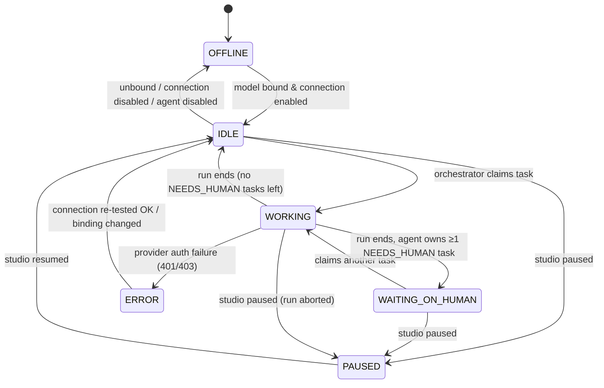
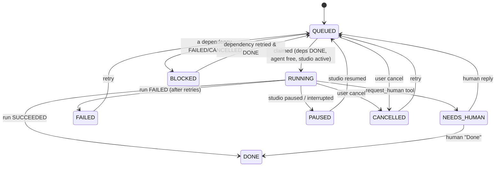
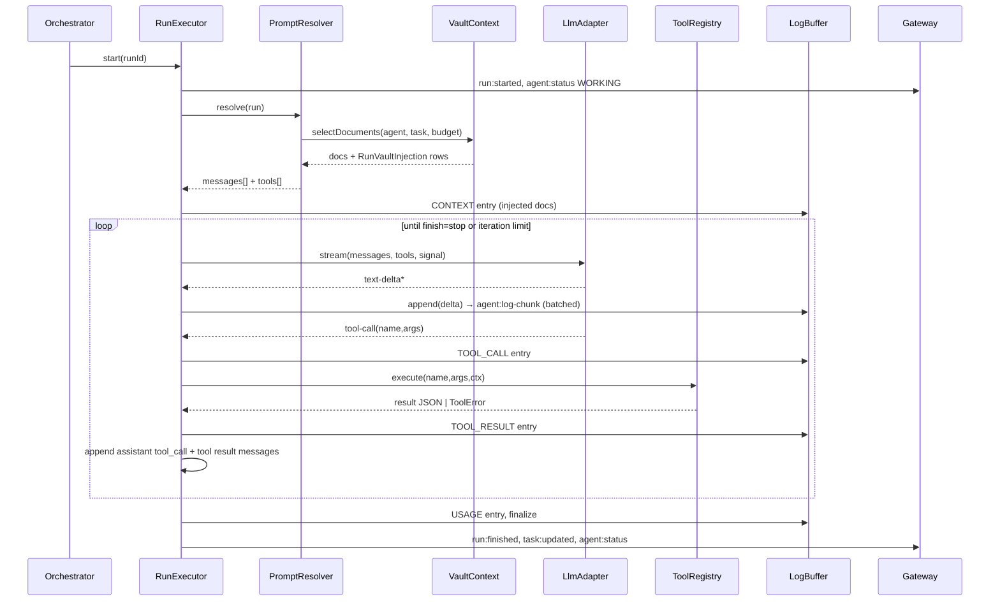

# Section 4 — Backend Architecture (NestJS 12, ESM)

## 4.1 Module Map

| Module | Responsibility | Depends on |
|---|---|---|
| `PrismaModule` (global) | `PrismaService extends PrismaClient` with the `PrismaPg` adapter; `onModuleInit` → `$connect`, `onModuleDestroy` → `$disconnect` | config |
| `RealtimeModule` (global) | `StudioGateway` (socket.io `/studio` namespace) and `RealtimeService` (typed emit helpers) | auth (JwtService) |
| `AuthModule` | register/login/refresh/logout/me, argon2id hashing, refresh-token rotation | prisma |
| `StudiosModule` | studios CRUD, membership, pause/resume, `SnapshotService` | agents, games, review, lanes |
| `GamesModule` | games, milestones, builds; auto-enqueues 108 Tester passes | tasks |
| `AgentsModule` | agent config, model binding, vault bindings, messages, `AgentStatusService` | llm, tasks |
| `TasksModule` | tasks CRUD/retry/cancel, `POST /lead/ask` | agents, orchestrator (cancel) |
| `OrchestratorModule` | scheduler, run executor, prompt/vault context, tool registry | llm, vault, review, pitches, market, lanes, games, media |
| `LlmModule` | connections CRUD (encrypted keys), adapter factory, model listing, connection tests | prisma, crypto |
| `HumanRequestsModule` | "Needs you" cards: list, reply (resumes task), resolve | tasks, agents |
| `ReviewModule` | review queue, verdicts, uploads, blockers | media, tasks |
| `MediaModule` | file storage, sharp probing, HMAC-signed URLs | config |
| `PitchesModule` | list/detail/edit/pick/request-changes/generate | tasks, games |
| `MarketModule` | leaderboard queries, history, ingestion cron + manual refresh | prisma, schedule |
| `VaultModule` | tree, documents, revisions, links/backlinks, search, disk sync | prisma |
| `LanesModule` | Studio lane mutex (acquire/release/force-release) | prisma |
| `SearchModule` | Ctrl+K quick-jump across agents/games/docs/pitches/tasks | prisma |
| `HealthModule` | `GET /api/health` (DB ping) | prisma |

## 4.2 Bootstrap — `src/main.ts`
```ts
import 'reflect-metadata';
import { NestFactory } from '@nestjs/core';
import type { NestExpressApplication } from '@nestjs/platform-express';
import cookieParser from 'cookie-parser';
import helmet from 'helmet';
import { AppModule } from './app.module.js';
import { AllExceptionsFilter } from './common/filters/all-exceptions.filter.js';
import { AppConfigService } from './config/app-config.service.js';

async function bootstrap(): Promise<void> {
  const app = await NestFactory.create<NestExpressApplication>(AppModule, { bufferLogs: false });
  const config = app.get(AppConfigService);
  app.setGlobalPrefix('api');
  app.use(helmet({ crossOriginResourcePolicy: { policy: 'same-site' } }));
  app.use(cookieParser());
  app.enableCors({ origin: config.frontendOrigin, credentials: true });
  app.useGlobalFilters(new AllExceptionsFilter());
  app.enableShutdownHooks();
  await app.listen(config.port);
}
void bootstrap();
```
`AppModule` imports `ConfigModule.forRoot({ isGlobal: true, validate: (raw) => EnvSchema.parse(raw) })`, `ScheduleModule.forRoot()`, `ThrottlerModule.forRoot([{ ttl: 60_000, limit: 120 }])`, and every module in §4.1. It registers `APP_GUARD` → `JwtAuthGuard` and then `ThrottlerGuard`. The auth routes get `@Throttle({ default: { limit: 10, ttl: 60_000 } })`.

### `src/config/env.schema.ts`
```ts
import { z } from 'zod';
const bool = z.enum(['true', 'false']).transform((v) => v === 'true');
export const EnvSchema = z.object({
  NODE_ENV: z.enum(['development', 'test', 'production']).default('development'),
  PORT: z.coerce.number().int().default(3000),
  FRONTEND_ORIGIN: z.url(),
  DATABASE_URL: z.string().startsWith('postgresql://'),
  JWT_ACCESS_SECRET: z.string().min(32),
  JWT_ACCESS_TTL_SECONDS: z.coerce.number().int().min(60).default(900),
  REFRESH_TOKEN_TTL_DAYS: z.coerce.number().int().min(1).max(90).default(14),
  ALLOW_REGISTRATION: bool.default(true),
  COOKIE_SECURE: bool.default(false),
  SECRETS_MASTER_KEY: z.string().refine((v) => Buffer.from(v, 'base64').length === 32, 'Must be base64 of 32 bytes'),
  MEDIA_URL_SIGNING_SECRET: z.string().min(32),
  ORCHESTRATOR_AUTOSTART: bool.default(true),
  ORCHESTRATOR_TICK_MS: z.coerce.number().int().min(500).default(2000),
  MAX_CONCURRENT_RUNS_PER_STUDIO: z.coerce.number().int().min(1).max(15).default(4),
  AGENT_MAX_TOOL_ITERATIONS: z.coerce.number().int().min(1).max(40).default(12),
  AGENT_RUN_TIMEOUT_MS: z.coerce.number().int().min(30_000).default(600_000),
  VAULT_TOKEN_BUDGET: z.coerce.number().int().min(2000).default(24_000),
  MEDIA_STORAGE_ROOT: z.string().default('./storage/media'),
  VAULT_DISK_ROOT: z.string().default('./vault'),
  VAULT_DISK_SYNC: bool.default(true),
  MARKET_INGEST_ENABLED: bool.default(true),
  MARKET_INGEST_CRON: z.string().default('*/30 * * * *'),
  MARKET_INGEST_ON_BOOT: bool.default(true),
  ROBLOX_REQUESTS_PER_SECOND: z.coerce.number().min(0.2).max(5).default(1),
  ROBLOX_USER_AGENT: z.string().min(5),
});
export type Env = z.infer<typeof EnvSchema>;
```
The seed-only variables (`*_API_KEY`, `SEED_*`, `OLLAMA_BASE_URL`) are read **only** by `prisma/seed/*.ts` and are not part of `EnvSchema`.

## 4.3 Authentication, Authorization & Errors

- **Passwords:** `@node-rs/argon2` `hash(pw, { algorithm: Algorithm.Argon2id, memoryCost: 19456, timeCost: 2, parallelism: 1 })`.
- **Access token:** a JWT (HS256) signed with `JWT_ACCESS_SECRET`, claims `{ sub, email, name }`, TTL `JWT_ACCESS_TTL_SECONDS`. Returned in the JSON body only. The frontend keeps it **in memory** and never in localStorage.
- **Refresh token:** 32 random bytes, base64url. It is stored as a `sha256` hash in `RefreshToken`, inside an httpOnly cookie `rd_refresh` (`SameSite=Lax`, `Path=/api/auth`, `Secure=COOKIE_SECURE`, `Max-Age=REFRESH_TOKEN_TTL_DAYS`). **Rotation:** every refresh revokes the presented token, issues a new one in the same `familyId` and sets `replacedById`. **Reuse detection:** presenting an already-revoked token revokes the whole family and returns `401 UNAUTHENTICATED`.
- **Registration:** if `ALLOW_REGISTRATION=false`, respond `403 REGISTRATION_DISABLED`. If `studioName` is provided, create a Studio (slug = kebab-case + 4-char random suffix on collision) with the user as `OWNER`, then call `StudioProvisioningService.provision(studioId)`. That creates the 15 agents from `AGENT_ROSTER` and `agent-personas.ts`, two Studio lanes and the vault folders/documents copied from `prisma/seed/vault`. The seed calls the same service.
- **Guards:**
  - `JwtAuthGuard` (global) verifies `Authorization: Bearer`, attaches `req.user = { id, email, displayName }`, and skips routes marked `@Public()`.
  - `StudioAccessGuard` is applied at controller level to every `/studios/:studioId/**` controller. It loads the membership (`404 NOT_FOUND` if not a member, so studio IDs are not leaked) and attaches `req.studio = { id, slug, role }`. With `@StudioRoles('ADMIN')` it requires `ROLE_RANK[role] >= ROLE_RANK['ADMIN']`, else `403 FORBIDDEN`.
  - **Role matrix:** `VIEWER` = read-only. `PRODUCER` = can create tasks, message agents, give verdicts, edit the vault and pick pitches. `ADMIN` = adds LLM connections, agent config, pause/resume, market refresh, member management (except OWNER changes) and vault deletes. `OWNER` = everything, including role changes to/from OWNER.
- **`AppError`:** `new AppError(code: ErrorCode, status: HttpStatus, message, details?)`. `AllExceptionsFilter` maps `AppError`, `ZodError` (→ 400 `VALIDATION_FAILED` with `details: [{path, message}]`), `HttpException`, and Prisma `P2002` (→ 409 `CONFLICT`) / `P2025` (→ 404 `NOT_FOUND`) to `ApiErrorBody`. Anything unknown becomes 500 `INTERNAL`, logged with a stack trace, while the client gets a generic message.
- **`ZodValidationPipe`:** `@Body(new ZodValidationPipe(LoginRequestSchema)) body: LoginRequest`. The same pattern applies to `@Query`.

## 4.4 REST API (prefix `/api`; 🔓 = `@Public`; role = minimum role)

### Auth & health
| Method | Route | Body / Query | Response | Notes |
|---|---|---|---|---|
| GET | `/health` 🔓 | – | `{ ok: true, db: 'up', time }` | |
| POST | `/auth/register` 🔓 | `RegisterRequest` | `AuthSessionDto` + cookie | 409 if email exists |
| POST | `/auth/login` 🔓 | `LoginRequest` | `AuthSessionDto` + cookie | 401 `INVALID_CREDENTIALS` (constant-time) |
| POST | `/auth/refresh` 🔓 | cookie `rd_refresh` | `AuthSessionDto` + rotated cookie | |
| POST | `/auth/logout` 🔓 | cookie | `204` | revokes the token, clears the cookie |
| GET | `/auth/me` | – | `MeDto` | |

### Studios & members
| Method | Route | Body / Query | Response | Role |
|---|---|---|---|---|
| GET | `/studios` | – | `StudioSummaryDto[]` | any member |
| POST | `/studios` | `CreateStudioRequest` | `StudioSummaryDto` (provisioned) | any user |
| GET | `/studios/:studioId/snapshot` | – | `StudioSnapshotDto` | VIEWER |
| PATCH | `/studios/:studioId` | `UpdateStudioRequest` | `StudioDto` | ADMIN |
| POST | `/studios/:studioId/pause` | – | `StudioDto` | ADMIN |
| POST | `/studios/:studioId/resume` | – | `StudioDto` | ADMIN |
| GET | `/studios/:studioId/members` | – | `MemberDto[]` | VIEWER |
| POST | `/studios/:studioId/members` | `AddMemberRequest` | `MemberDto` | ADMIN (404 if the user doesn't exist) |
| PATCH | `/studios/:studioId/members/:userId` | `UpdateMemberRequest` | `MemberDto` | ADMIN; OWNER for OWNER changes; the last OWNER can't be demoted (409) |
| DELETE | `/studios/:studioId/members/:userId` | – | `204` | ADMIN |

### Games
| Method | Route | Body / Query | Response | Role |
|---|---|---|---|---|
| GET | `/studios/:studioId/games` | – | `GameDto[]` | VIEWER |
| POST | `/studios/:studioId/games` | `CreateGameRequest` | `GameDto` | PRODUCER |
| GET | `/studios/:studioId/games/:gameId` | – | `GameDetailDto` | VIEWER |
| PATCH | `/studios/:studioId/games/:gameId` | `UpdateGameRequest` | `GameDto` | PRODUCER |
| GET | `/studios/:studioId/games/:gameId/builds` | `?cursor&limit` | `Paginated<GameBuildDto>` | VIEWER |
| POST | `/studios/:studioId/games/:gameId/builds` | `RecordBuildRequest` | `GameBuildDto` | PRODUCER |
| PATCH | `/studios/:studioId/games/:gameId/milestones/:milestoneId` | `UpdateMilestoneRequest` | `GameMilestoneDto` | PRODUCER |

### Agents, runs & messages
| Method | Route | Body / Query | Response | Role |
|---|---|---|---|---|
| GET | `/studios/:studioId/agents` | – | `AgentDto[]` (sorted by order) | VIEWER |
| GET | `/studios/:studioId/agents/:agentKey` | – | `AgentDetailDto` | VIEWER |
| PATCH | `/studios/:studioId/agents/:agentKey` | `UpdateAgentRequest` | `AgentDetailDto` | ADMIN |
| PUT | `/studios/:studioId/agents/:agentKey/vault-bindings` | `PutVaultBindingsRequest` | `AgentVaultBindingDto[]` | ADMIN |
| GET | `/studios/:studioId/agents/:agentKey/runs` | `?cursor&limit=20` | `Paginated<AgentRunSummaryDto>` | VIEWER |
| GET | `/studios/:studioId/agents/:agentKey/messages` | `?cursor&limit=50` | `Paginated<AgentMessageDto>` (newest first) | VIEWER |
| POST | `/studios/:studioId/agents/:agentKey/messages` | `PostAgentMessageRequest` | `{ message: AgentMessageDto; task: TaskDto }` | PRODUCER |
| GET | `/studios/:studioId/runs/:runId` | – | `AgentRunDetailDto` | VIEWER |
| POST | `/studios/:studioId/runs/:runId/cancel` | – | `AgentRunSummaryDto` | PRODUCER |

**Message semantics:** posting a message to an agent creates `AgentMessage(author=USER)`.
- If the agent has a task in `NEEDS_HUMAN` whose open human request came from this agent, the message is treated as the reply: request → `RESOLVED`, task → `QUEUED`.
- Otherwise a new task is created: `origin=USER`, `title = first 80 chars of body` (word-boundary trimmed, `…` appended), `brief = body`. For `lead` this is identical to `/lead/ask`.

### Tasks & Lead
| Method | Route | Body / Query | Response | Role |
|---|---|---|---|---|
| GET | `/studios/:studioId/tasks` | `ListTasksQuery` | `Paginated<TaskDto>` | VIEWER |
| POST | `/studios/:studioId/tasks` | `CreateTaskRequest` | `TaskDto` | PRODUCER |
| GET | `/studios/:studioId/tasks/:taskId` | – | `TaskDetailDto` | VIEWER |
| PATCH | `/studios/:studioId/tasks/:taskId` | `UpdateTaskRequest` | `TaskDto` | PRODUCER (only while `QUEUED`/`PAUSED`) |
| POST | `/studios/:studioId/tasks/:taskId/cancel` | – | `TaskDto` | PRODUCER (aborts the run if `RUNNING`) |
| POST | `/studios/:studioId/tasks/:taskId/retry` | – | `TaskDto` | PRODUCER (only from `FAILED`/`CANCELLED`) |
| POST | `/studios/:studioId/lead/ask` | `LeadAskRequest` | `{ message: AgentMessageDto; task: TaskDto }` | PRODUCER |

### Human requests ("Needs you")
| Method | Route | Body | Response | Role |
|---|---|---|---|---|
| GET | `/studios/:studioId/human-requests` | `?status=OPEN` | `HumanRequestDto[]` | VIEWER |
| POST | `/studios/:studioId/human-requests/:id/reply` | `ReplyHumanRequest` | `HumanRequestDto` | PRODUCER |
| POST | `/studios/:studioId/human-requests/:id/resolve` | `ResolveHumanRequest` | `HumanRequestDto` | PRODUCER |

- **Reply:** writes `AgentMessage(USER, body [+ "Chosen option: <label>"])`, sets the request to `RESOLVED` with `resolution=body`, and moves the linked task from `NEEDS_HUMAN` to `QUEUED`.
- **Resolve ("Done"):** sets the request to `RESOLVED`/`DISMISSED`. A linked `NEEDS_HUMAN` task becomes `DONE` with `resultSummary = "Closed by <user>: <note|Done>"`.
- **`PICK_NEXT_GAME`:** resolved automatically when a referenced pitch is picked.

### Review
| Method | Route | Body / Query | Response | Role |
|---|---|---|---|---|
| GET | `/studios/:studioId/review-items` | `ListReviewQuery` | `ReviewItemDto[]` (newest first) | VIEWER |
| GET | `/studios/:studioId/review-items/counts` | `?gameId` | `ReviewCountsDto` | VIEWER |
| GET | `/studios/:studioId/review-items/:id` | – | `ReviewItemDetailDto` | VIEWER |
| POST | `/studios/:studioId/review-items/:id/verdict` | `VerdictRequest` | `ReviewItemDetailDto` | PRODUCER |
| POST | `/studios/:studioId/review-items/upload` | multipart: `file` (png/jpeg/webp ≤ 10 MB, mp4/webm ≤ 200 MB) + `UploadReviewMeta` fields | `ReviewItemDto` | PRODUCER |
| PATCH | `/studios/:studioId/blockers/:blockerId` | `UpdateBlockerRequest` | `BlockerDto` | PRODUCER |
| GET | `/media/:mediaId` 🔓 | `?exp=<unix>&sig=<hex>` | file stream with `Cache-Control: private, max-age=3600` | signature check |

**Verdict rules (`ReviewService.applyVerdict`)**
1. Only `TO_REVIEW` or `CHANGES_ASKED` items accept verdicts. Anything else → 409 `CONFLICT`.
2. `APPROVE` on a `STAGE`/`PUBLISH` item with open `FIX_FIRST` blockers → 409 `FIX_FIRST_BLOCKERS_OPEN`.
3. Write the `ReviewVerdict` and set `status = VERDICT_TO_STATUS[verdict]`.
4. `ASK_CHANGES` with `madeByAgentId` set: create a follow-up task for that agent. Origin `REVIEW_FEEDBACK`, title `Revise: <item.title>`, brief contains the feedback, original prompt context and item id, `metadata = { revisesReviewItemId }`. When that task later calls `submit_for_review`, the new item gets `iteration = prev + 1` and `previousItemId = prev.id`.
5. `APPROVE` on a `PUBLISH` item with `payload.buildVersion`: mark that build's game milestone `publish-approved` `DONE` (created if missing).
6. Emit `review:verdict`, `review:item` and `studio:counts`.

### Pitches
| Method | Route | Body | Response | Role |
|---|---|---|---|---|
| GET | `/studios/:studioId/pitches` | `?status` | `PitchDto[]` | VIEWER |
| GET | `/studios/:studioId/pitches/:id` | – | `PitchDetailDto` | VIEWER |
| POST | `/studios/:studioId/pitches/generate` | `GeneratePitchesRequest` | `TaskDto` (Pulse task) | PRODUCER |
| PATCH | `/studios/:studioId/pitches/:id` | `UpdatePitchRequest` | `PitchDetailDto` | PRODUCER |
| POST | `/studios/:studioId/pitches/:id/pick` | `PickPitchRequest` | `{ pitch: PitchDetailDto; game: GameDto; task: TaskDto }` | PRODUCER |
| POST | `/studios/:studioId/pitches/:id/request-changes` | `RequestPitchChanges` | `{ pitch: PitchDetailDto; task: TaskDto }` | PRODUCER |

**Pick** (in one transaction):
1. Pitch → `PICKED` with `pickedAt`.
2. Create a `Game` (`status=BLUEPRINT`; slug from name; the 8 default milestones from §6.5 in `TODO`; `createdFromPitchId`).
3. Create an Architect task `12-step blueprint: <game>` (`priority=HIGH`) whose brief contains the full pitch Markdown.
4. Resolve every OPEN `PICK_NEXT_GAME` request whose `pitchIds` contains this pitch.
5. Archive the other `PROPOSED` pitches referenced by that same request.

**Edit & approve** = `PATCH` followed by `pick`. The frontend chains the two calls.

### Market (global data, auth required)
| Method | Route | Query | Response | Role |
|---|---|---|---|---|
| GET | `/market/leaderboard` | `LeaderboardQuery` | `MarketLeaderboardDto` | any authed |
| GET | `/market/games/:universeId/history` | `HistoryQuery` | `MarketHistoryPointDto[]` | any authed |
| GET | `/market/ingestion-runs` | `?limit=10` | `MarketIngestionRunDto[]` | any authed |
| POST | `/market/refresh` | – | `MarketIngestionRunDto` (202) | ADMIN of **any** studio; 409 `INGESTION_IN_PROGRESS` |

### Vault
| Method | Route | Body / Query | Response | Role |
|---|---|---|---|---|
| GET | `/studios/:studioId/vault/tree` | – | `VaultTreeNodeDto[]` | VIEWER |
| GET | `/studios/:studioId/vault/documents/:docId` | – | `VaultDocumentDto` | VIEWER |
| GET | `/studios/:studioId/vault/by-path` | `?path=` | `VaultDocumentDto` | VIEWER |
| POST | `/studios/:studioId/vault/documents` | `CreateVaultDocumentRequest` | `VaultDocumentDto` | PRODUCER |
| PUT | `/studios/:studioId/vault/documents/:docId` | `SaveVaultDocumentRequest` | `VaultDocumentDto` | PRODUCER; 409 `VERSION_CONFLICT` with `details: { currentVersion, currentMarkdown }` |
| DELETE | `/studios/:studioId/vault/documents/:docId` | – | `204` | ADMIN |
| POST | `/studios/:studioId/vault/folders` | `CreateVaultFolderRequest` | `VaultTreeNodeDto` | PRODUCER |
| GET | `/studios/:studioId/vault/documents/:docId/revisions` | – | `VaultRevisionDto[]` | VIEWER |
| GET | `/studios/:studioId/vault/documents/:docId/revisions/:version` | – | `{ version; markdown }` | VIEWER |
| GET | `/studios/:studioId/vault/search` | `VaultSearchQuery` | `VaultSearchHitDto[]` | VIEWER |
| POST | `/studios/:studioId/vault/sync` | – | `{ exported: number; imported: number }` | ADMIN |

### LLM connections
| Method | Route | Body | Response | Role |
|---|---|---|---|---|
| GET | `/studios/:studioId/llm/connections` | – | `LlmConnectionDto[]` | ADMIN |
| POST | `/studios/:studioId/llm/connections` | `CreateLlmConnectionRequest` | `LlmConnectionDto` | ADMIN |
| PATCH | `/studios/:studioId/llm/connections/:id` | `UpdateLlmConnectionRequest` | `LlmConnectionDto` | ADMIN |
| DELETE | `/studios/:studioId/llm/connections/:id` | – | `204` (bound agents → unbound, status `OFFLINE`) | ADMIN |
| POST | `/studios/:studioId/llm/connections/:id/test` | – | `TestConnectionResultDto` | ADMIN |
| GET | `/studios/:studioId/llm/connections/:id/models` | – | `LlmModelInfoDto[]` | ADMIN |

### Lanes & search
| Method | Route | Response | Role |
|---|---|---|---|
| GET | `/studios/:studioId/lanes` | `StudioLaneDto[]` | VIEWER |
| POST | `/studios/:studioId/lanes/:laneId/release` | `StudioLaneDto` | ADMIN (force release) |
| GET | `/studios/:studioId/search?q=` | `QuickJumpResultDto[]` (≤ 20; agents, games, docs (title ILIKE), pitches, tasks (title ILIKE, last 200)) | VIEWER |

## 4.5 WebSocket Gateway (`StudioGateway`)

```ts
@WebSocketGateway({ namespace: WS_NAMESPACE, cors: { origin: process.env.FRONTEND_ORIGIN, credentials: true } })
export class StudioGateway implements OnGatewayConnection, OnGatewayDisconnect {
  @WebSocketServer() server!: Namespace<ClientToServerEvents, ServerToClientEvents, Record<string, never>, SocketData>;
  // handleConnection: verify socket.handshake.auth.token with JwtService; load membership studioIds into socket.data;
  //   on failure: socket.emit nothing, socket.disconnect(true).
  // 'studio:join': require studioId ∈ socket.data.studioIds → socket.join(studioRoom(id)) → ack ok.
  // 'run:subscribe': require run.studioId ∈ studioIds → socket.join(runRoom(runId)) → ack { lastSeq } (max RunLogEntry.seq).
  // Every socket also joins MARKET_ROOM on connect.
}
```
- **Token expiry:** the client reconnects with a fresh token (§5.4). The server does **not** push auth errors over existing sockets. On disconnect, socket.io cleans up the rooms.
- **`RealtimeService`** is the only class allowed to emit. It exposes `emitToStudio<E extends keyof ServerToClientEvents>(studioId, event, payload)`, `emitToRun(runId, event, payload)` and `emitMarket(payload)`. Payload `at` is set inside it to `new Date().toISOString()`.
- **Counts:** `RealtimeService.broadcastCounts(studioId)` recomputes `StudioCountsDto`. It is debounced per studio at 250 ms to coalesce bursts and is called after any task/review/human-request/agent-status change.

**Event → producer matrix**

| Event | Room | Emitted by |
|---|---|---|
| `agent:status` | studio | `AgentStatusService.recompute()` (only when status/currentTask/lastError changed) |
| `agent:log-chunk` | run | `LogBuffer` (text deltas flushed every 120 ms or 512 chars; entries on create/finalize) |
| `agent:activity` | studio | `LogBuffer` (throttled to 1/s per agent; last 140 chars of current TEXT entry, whitespace collapsed) |
| `agent:message` | studio | `AgentMessagesService.create()` |
| `run:started` / `run:finished` | studio | `RunExecutorService` |
| `task:updated` | studio | `TasksService` (every status/field change) |
| `review:item` / `review:verdict` | studio | `ReviewService` |
| `studio:counts` | studio | `RealtimeService.broadcastCounts` |
| `studio:paused` | studio | `StudiosService.pause/resume` |
| `human-request:updated` | studio | `HumanRequestsService` |
| `lane:updated` | studio | `LanesService` |
| `game:updated` | studio | `GamesService` / `BuildsService` |
| `pitch:updated` | studio | `PitchesService` |
| `vault:document-updated` | studio | `VaultService.save` (agents, users, disk) |
| `market:ingested` | market | `MarketIngestionService` |

## 4.6 Agent & Task State Machines


**Derived-status rule.** `AgentStatusService.recompute(agentId)` is the single writer of `Agent.status`. It evaluates in order and the first match wins:
1. `!isEnabled || !llmConnectionId || !modelId || !connection.isEnabled` → `OFFLINE`
2. an active run in `RunRegistry` → `WORKING`
3. `studio.isPaused` → `PAUSED`
4. `lastErrorCode ∈ {PROVIDER_AUTH_FAILED}` → `ERROR`
5. ≥1 task with `status=NEEDS_HUMAN` assigned to the agent → `WAITING_ON_HUMAN`
6. ≥1 task `BLOCKED` and no QUEUED tasks → `BLOCKED`
7. otherwise `IDLE`



## 4.7 OrchestratorService (scheduler)

- **Boot (`onApplicationBootstrap`):**
  1. **Recovery** (one transaction): every `AgentRun` with `status=RUNNING` → `INTERRUPTED`, with `errorMessage='Interrupted by server restart'`. Its task: `RUNNING` → `QUEUED` with `attempts += 1`, or → `FAILED` with `errorCode='RUN_INTERRUPTED_TOO_OFTEN'` when `attempts >= 3`. Release every `StudioLane` held by an interrupted run. Clear `currentTaskId`/`currentRunId` on all agents.
  2. If `ORCHESTRATOR_AUTOSTART=false`, set every studio to `isPaused=true`.
  3. Recompute every agent's status.
  4. Start the interval `setInterval(tick, ORCHESTRATOR_TICK_MS)`, registered through `SchedulerRegistry.addInterval('orchestrator', …)`.
- **`tick()`** is re-entrancy guarded with a boolean `ticking`. For each non-paused studio: `capacity = MAX_CONCURRENT_RUNS_PER_STUDIO − registry.activeCount(studioId)`, then claim up to `capacity` tasks one at a time with:
```sql
WITH candidate AS (
  SELECT t.id, t."agentId"
  FROM "Task" t
  JOIN "Agent" a ON a.id = t."agentId"
  JOIN "Studio" s ON s.id = t."studioId"
  LEFT JOIN "LlmConnection" c ON c.id = a."llmConnectionId"
  WHERE t."studioId" = $1
    AND t.status = 'QUEUED'
    AND s."isPaused" = false
    AND a."isEnabled" = true AND a."modelId" IS NOT NULL AND c."isEnabled" = true
    AND a.status IN ('IDLE', 'WAITING_ON_HUMAN')
    AND a."currentRunId" IS NULL
    AND NOT EXISTS (
      SELECT 1 FROM "TaskDependency" d JOIN "Task" dt ON dt.id = d."dependsOnId"
      WHERE d."taskId" = t.id AND dt.status <> 'DONE')
  ORDER BY CASE t.priority WHEN 'URGENT' THEN 0 WHEN 'HIGH' THEN 1 WHEN 'NORMAL' THEN 2 ELSE 3 END, t."queuedAt"
  LIMIT 1
  FOR UPDATE OF t, a SKIP LOCKED
)
UPDATE "Task" SET status = 'RUNNING', "startedAt" = now(), "updatedAt" = now()
FROM candidate WHERE "Task".id = candidate.id
RETURNING "Task".id, candidate."agentId";
```
  Run it inside `prisma.$transaction(async (tx) => …)` via `tx.$queryRaw`. In the same transaction, create the `AgentRun` (provider/model copied from the agent's binding, `attempt = task.attempts + 1`) and set `Agent.currentTaskId/currentRunId`. After commit, call `RunExecutorService.start(runId)` **without awaiting it**, tracked in `RunRegistry`.
- **Dependency failure propagation:** when a task becomes `FAILED`/`CANCELLED`, every QUEUED dependent becomes `BLOCKED` (recursive). When a task becomes `DONE`, dependents in `BLOCKED` whose deps are now all DONE return to `QUEUED`.
- **Pause** (`StudiosService.pause`): set `isPaused=true`, abort every active run via `RunRegistry.abort(runId, 'PAUSED')` (the executor marks the run `INTERRUPTED` and the task `PAUSED`), recompute agents, emit `studio:paused`. **Resume:** set `isPaused=false`, tasks `PAUSED` → `QUEUED`, recompute, emit.
- **Cancel:** `RunRegistry.abort(runId, 'CANCELLED')` → run `CANCELLED`, task `CANCELLED`, lanes released.

## 4.8 RunExecutorService (one agent run)



**Algorithm (`run-executor.service.ts`; implement exactly):**
```ts
async start(runId: string): Promise<void> {
  const ctl = this.registry.register(runId);           // AbortController + reason
  const timeout = setTimeout(() => ctl.abort('TIMEOUT'), this.cfg.agentRunTimeoutMs);
  const heartbeat = setInterval(() => void this.prisma.agentRun.update({ where: { id: runId }, data: { heartbeatAt: new Date() } }), 15_000);
  const log = this.logBufferFactory.create(runId);     // owns seq counter
  let outcome: RunOutcome = { kind: 'succeeded' };
  try {
    const ctx = await this.loadContext(runId);         // run, task, agent, game, studio, connection (decrypted key)
    const adapter = this.adapters.forConnection(ctx.connection);
    const resolved = await this.promptResolver.resolve(ctx);   // { messages, toolDefs, injected }
    await log.entry('CONTEXT', `Loaded ${resolved.injected.length} vault documents`, { docs: resolved.injected });
    const messages = [...resolved.messages];
    for (let i = 0; i < this.cfg.agentMaxToolIterations; i++) {
      const pendingCalls: LlmToolCall[] = [];
      let finish: LlmFinishReason = 'stop';
      let text = '';
      for await (const ev of adapter.stream({ model: ctx.agent.modelId!, messages, tools: resolved.toolDefs,
          temperature: ctx.agent.temperature, maxOutputTokens: ctx.agent.maxOutputTokens }, ctl.signal)) {
        if (ev.type === 'text-delta') { text += ev.text; await log.appendText(ev.text); }
        else if (ev.type === 'tool-call') pendingCalls.push(ev.call);
        else if (ev.type === 'usage') await this.addUsage(runId, ev.inputTokens, ev.outputTokens);
        else if (ev.type === 'finish') finish = ev.reason;
      }
      await log.closeText();
      messages.push({ role: 'assistant', content: text, toolCalls: pendingCalls });
      if (pendingCalls.length === 0) { outcome = { kind: 'succeeded', summary: text }; break; }
      for (const call of pendingCalls) {
        const res = await this.tools.execute(call, ctx, log);      // logs TOOL_CALL + TOOL_RESULT, never throws
        messages.push({ role: 'tool', toolCallId: call.id, name: call.name, content: JSON.stringify(res.payload) });
        if (res.control === 'await-human') outcome = { kind: 'awaiting-human' };
      }
      if (outcome.kind === 'awaiting-human') break;
      if (i === this.cfg.agentMaxToolIterations - 1) outcome = { kind: 'failed', code: 'TOOL_LOOP_LIMIT', message: 'Tool iteration limit reached' };
      if (finish === 'length') { /* continue loop: model will be asked to continue via the appended messages */ }
    }
  } catch (err) {
    outcome = this.classifyFailure(err, ctl.reason);   // PAUSED→interrupted, CANCELLED→cancelled, TIMEOUT→failed RUN_TIMEOUT, LlmError→failed code
  } finally {
    clearTimeout(timeout); clearInterval(heartbeat);
    await log.flushAll();
    await this.finish(runId, outcome);                 // writes run/task/agent/lanes atomically, emits events, registry.unregister
  }
}
```
- **Provider retry:** inside the adapters, `PROVIDER_UNAVAILABLE` (HTTP 429/500/502/503/504, network reset) is retried up to 3 times with exponential backoff (1 s, 3 s, 9 s, ±20 % jitter, honouring `Retry-After`) **before** the first token is emitted. Once streaming has started, an error fails the run.
- **`finish()` mapping:**

| Outcome | Run status | Task status | Extra |
|---|---|---|---|
| succeeded | `SUCCEEDED` | `DONE`, `resultSummary` = first 600 chars of the final text, `completedAt` | dependents re-evaluated |
| awaiting-human | `AWAITING_HUMAN` | `NEEDS_HUMAN` | the request was created by the tool |
| interrupted (pause) | `INTERRUPTED` | `PAUSED` | |
| cancelled | `CANCELLED` | `CANCELLED` | dependents → `BLOCKED` |
| failed | `FAILED` (`errorCode`, `errorMessage`) | `FAILED` | an `ERROR` log entry; dependents → `BLOCKED`; `PROVIDER_AUTH_FAILED` sets `agent.lastErrorCode` |

  In every case, release lanes held by the run, clear the agent's `currentTaskId/currentRunId`, and set `agent.lastActivityAt` and `lastSnippet` (last 140 chars). Then `AgentStatusService.recompute` and the emits.
- **`LogBuffer`:** keeps one open `TEXT` entry per assistant turn.
  - `appendText` appends to an in-memory string and emits `agent:log-chunk { delta }` at most every 120 ms or every 512 chars.
  - It persists `content` with `prisma.runLogEntry.update` every 1 s and on close.
  - `entry(kind, content, meta)` closes any open text, inserts a row with the next `seq`, and emits `agent:log-chunk { entry }`.
  - `seq` is strictly increasing per run, starting at 1.
  - Clients rebuild a run from `GET /runs/:id` + live chunks. They drop any chunk with `seq < lastSeq` or with an `entryId` already finalized.

## 4.9 PromptResolverService & VaultContextService (vault injection)

**Message assembly (exact order):**
1. **System message** = `STUDIO_PREAMBLE` + `\n\n` + `agent.systemPrompt` + `\n\n` + vault block + `\n\n` + `OUTPUT_CONTRACT`.
2. **Context message** (role `user`, prefixed `[CONTEXT]`): studio name, today's date (ISO, studio-local), game block (if `task.gameId`), task lineage (parent task titles up to 3 levels), dependency results (`resultSummary` of each dependency, ≤ 1,200 chars each), and the roster of agents (key, name, title) **for Lead and Producer only**.
3. **Conversation history:** the last 20 `AgentMessage` rows for this agent **linked to this task** (USER → `user`, AGENT → `assistant`), oldest first.
4. **Task message** (role `user`, prefixed `[TASK]`): `title`, `priority`, `tags`, `brief`. On resumption after a human reply, add the line `The human replied — continue from where you stopped.`

```ts
export const STUDIO_PREAMBLE = (studio: string, agent: string, date: string) =>
`You are ${agent}, a specialist AI agent at the Roblox game studio "${studio}". Today is ${date}.
You work inside RobDev Control Room alongside 14 other agents coordinated by Lead.
Studio rules live in the Knowledge Vault. The vault documents below are authoritative: when they conflict with your general knowledge, the vault wins. Cite a vault rule by its document title in brackets, e.g. [05 UI and HUD].`;

export const OUTPUT_CONTRACT =
`OUTPUT CONTRACT
- Write in GitHub-flavoured Markdown. Be concrete and production-ready; never leave placeholders or TODOs.
- Luau code goes in \`\`\`luau fenced blocks; UI wireframes go in \`\`\`ascii blocks; configs in \`\`\`json.
- Persist every file you produce with the save_artifact tool (path mirrors the Roblox hierarchy).
- If you need a decision only a human can make, call request_human and stop.
- Finish with a "## Result" section of at most 5 bullet points summarising what you did.`;
```

**Vault block format:**
```text
<vault>
<vault_document path="00 For Any AI/00 For Any AI.md" version="3" title="00 For Any AI">
…markdown…
</vault_document>
…
</vault>
```

**`VaultContextService.selectDocuments(agent, task, budgetTokens)`:**
1. Build the candidate list with these sources, deduplicated by document id (keep the best priority):
   - `alwaysInject=true` docs → priority 0
   - `AgentVaultBinding` rows → their `priority` (1..99)
   - wikilinks found in `task.brief` (`parseWikilinks` + resolution) → priority 5
   - docs whose `tags` intersect `task.tags` → priority 20
2. Sort by priority, then by path.
3. Walk the list, adding docs while `Σ estimateTokens(markdown) ≤ budget`.
4. When a doc doesn't fit and ≥ 1,500 tokens remain, include a **truncated** version: keep whole H2 sections from the top until the budget is reached, then append `\n\n> [Truncated for context budget — call vault_read("<path>") for the full document.]`. Set `truncated=true`. Otherwise skip it, and list the skipped paths in a final line inside `<vault>`: `Other relevant docs (use vault_read): …`.
5. Persist one `RunVaultInjection` per included doc (`documentVersion`, `estimatedTokens`, `truncated`).

**Tool exposure:** only the tools in `agent.tools` are offered, converted with `z.toJSONSchema`. A tool call for a non-granted tool returns `{ ok: false, error: 'TOOL_NOT_GRANTED' }`.

## 4.10 LLM Adapters

```ts
// adapters/llm-adapter.interface.ts
export interface LlmToolDef { name: string; description: string; parameters: Record<string, unknown>; /* JSON Schema */ }
export interface LlmToolCall { id: string; name: string; argumentsJson: string; }
export type LlmMessage =
  | { role: 'system'; content: string }
  | { role: 'user'; content: string }
  | { role: 'assistant'; content: string; toolCalls?: LlmToolCall[] }
  | { role: 'tool'; toolCallId: string; name: string; content: string };
export interface LlmStreamRequest { model: string; messages: LlmMessage[]; tools: LlmToolDef[]; temperature: number; maxOutputTokens: number; }
export type LlmFinishReason = 'stop' | 'tool_calls' | 'length' | 'content_filter';
export type LlmStreamEvent =
  | { type: 'text-delta'; text: string }
  | { type: 'tool-call'; call: LlmToolCall }            // emitted once per COMPLETE call (args fully accumulated)
  | { type: 'usage'; inputTokens: number; outputTokens: number }
  | { type: 'finish'; reason: LlmFinishReason };
export interface ResolvedConnection { id: string; provider: LlmProvider; baseUrl: string | null; apiKey: string | null; }
export interface LlmAdapter {
  listModels(conn: ResolvedConnection): Promise<LlmModelInfoDto[]>;
  stream(conn: ResolvedConnection, req: LlmStreamRequest, signal: AbortSignal): AsyncIterable<LlmStreamEvent>;
}
export class LlmError extends Error { constructor(readonly code: 'PROVIDER_AUTH_FAILED' | 'PROVIDER_UNAVAILABLE' | 'PROVIDER_BAD_REQUEST', message: string, readonly status?: number) { super(message); } }
```
`LlmAdapterFactory.forConnection(conn)`: `ANTHROPIC` → `AnthropicAdapter`; `GOOGLE` → `GoogleAdapter`; `OPENAI | XAI | OLLAMA | OPENAI_COMPATIBLE` → `OpenAiCompatibleAdapter`.

**`provider-defaults.ts`**
```ts
export const DEFAULT_BASE_URL: Record<LlmProvider, string | null> = {
  OPENAI: 'https://api.openai.com/v1', XAI: 'https://api.x.ai/v1', OLLAMA: 'http://localhost:11434/v1',
  OPENAI_COMPATIBLE: null, ANTHROPIC: null /* SDK default */, GOOGLE: null /* SDK default */,
};
export const PROVIDER_LABEL: Record<LlmProvider, string> = {
  OPENAI: 'OpenAI', ANTHROPIC: 'Anthropic', GOOGLE: 'Google Gemini', XAI: 'xAI Grok', OLLAMA: 'Ollama (local)', OPENAI_COMPATIBLE: 'OpenAI-compatible',
};
```

| Concern | `OpenAiCompatibleAdapter` (`openai` SDK) | `AnthropicAdapter` (`@anthropic-ai/sdk`) | `GoogleAdapter` (`@google/genai`) |
|---|---|---|---|
| Client | `new OpenAI({ apiKey: conn.apiKey ?? 'ollama', baseURL: conn.baseUrl ?? DEFAULT_BASE_URL[provider] })` | `new Anthropic({ apiKey })` | `new GoogleGenAI({ apiKey })` |
| List models | `client.models.list()` → `id`. Keep everything for OLLAMA/OPENAI_COMPATIBLE; for OPENAI/XAI keep everything and sort by id | `client.models.list()` → `id`, `display_name` | `ai.models.list()` → strip the `models/` prefix; keep entries whose `supportedActions` include `generateContent` |
| Stream call | `client.chat.completions.create({ model, messages, tools: [{type:'function', function:{name, description, parameters}}], stream: true, stream_options: { include_usage: true }, temperature, max_completion_tokens }, { signal })`. Fall back to `max_tokens` when provider ≠ OPENAI. | `client.messages.create({ model, system, messages, tools: [{ name, description, input_schema }], max_tokens, temperature, stream: true }, { signal })` | `ai.models.generateContentStream({ model, contents, config: { systemInstruction, tools: [{ functionDeclarations: [{ name, description, parametersJsonSchema }] }], temperature, maxOutputTokens, abortSignal: signal } })` |
| Message mapping | system → `{role:'system'}`; assistant toolCalls → `tool_calls:[{id,type:'function',function:{name,arguments}}]`; tool → `{role:'tool', tool_call_id, content}` | system string separate; assistant → content blocks `[{type:'text'}, {type:'tool_use', id, name, input: JSON.parse(args)}]`; tool → `{role:'user', content:[{type:'tool_result', tool_use_id, content}]}` (merge consecutive tool results into one user message) | system → `systemInstruction`; user → `{role:'user', parts:[{text}]}`; assistant → `{role:'model', parts:[{text}, {functionCall:{name, args}}]}`; tool → `{role:'user', parts:[{functionResponse:{name, response: JSON.parse(content)}}]}` |
| Text deltas | `chunk.choices[0].delta.content` | `content_block_delta` with `delta.type==='text_delta'` | `chunk.text` |
| Tool calls | accumulate `delta.tool_calls[i]` by `index` (id/name first, `function.arguments` concatenated); emit on `finish_reason==='tool_calls'` or stream end | `content_block_start` (`tool_use` id/name) + `input_json_delta.partial_json` concatenated; emit on `content_block_stop` | `chunk.functionCalls` (complete objects) → id = `call_${n}` when missing |
| Usage | the final chunk's `usage.prompt_tokens/completion_tokens` | `message_start.message.usage.input_tokens` + `message_delta.usage.output_tokens` | `chunk.usageMetadata.promptTokenCount/candidatesTokenCount` (take the last) |
| Finish | `finish_reason` → `stop`/`tool_calls`/`length`/`content_filter` | `stop_reason`: `end_turn`→stop, `tool_use`→tool_calls, `max_tokens`→length | `candidates[0].finishReason`: STOP→stop (or tool_calls if calls were seen), MAX_TOKENS→length, SAFETY→content_filter |
| Errors | `OpenAI.APIError.status`: 401/403 → AUTH, 400/404/422 → BAD_REQUEST, 429/5xx → UNAVAILABLE | `Anthropic.APIError.status`, same mapping | `ApiError.status`, same mapping |

**Image adapters** (`image-adapter.interface.ts`: `generate(conn, { model, prompt, width, height }, signal): Promise<{ data: Buffer; mimeType: string }>`):
- **OpenAI/xAI:** `client.images.generate({ model, prompt, size, n: 1 })`. Size is `1024x1024` for ICON, `1536x1024` for 16:9 (the closest supported size). Use `b64_json` when present, otherwise fetch `url`. Then **sharp** normalises the result: ICON → `resize(512, 512, { fit: 'cover' })` PNG; THUMBNAIL/STORYBOARD → `resize(1920, 1080, { fit: 'cover' })` PNG.
- **Google:** `ai.models.generateContent({ model, contents: prompt, config: { responseModalities: ['IMAGE'], imageConfig: { aspectRatio: '1:1' | '16:9' } } })`. Take the first `inlineData` part and normalise it the same way.
- **No image connection** (`imageConnectionId`/`imageModelId` null): the tool returns `{ ok:false, error:'NO_IMAGE_MODEL', message:'Assign an image model to Splash in Settings → Models' }`.

**Secrets (`SecretBoxService`):** AES-256-GCM with `SECRETS_MASTER_KEY`. `seal(plain) → { ciphertext, iv, tag }` (base64, 12-byte random IV); `open(...)`. `apiKeyLast4` is stored in plain text for display. Keys never leave the backend: DTOs expose `hasApiKey` and `apiKeyLast4` only. Connection test = `listModels` (latency measured). It sets `lastVerifiedAt`/`lastError`, then recomputes every bound agent's status (which clears `ERROR` when OK).

## 4.11 Tool Handlers (`orchestrator/tools/*.tool.ts`)

Every handler implements `ToolHandler<T> { name: T; execute(args: ToolArgsOf<T>, ctx: ToolContext): Promise<ToolResult> }`.
- `ToolContext` = `{ studioId, run, task, agent, game | null, log, prisma, userFacingAgentName }`.
- `ToolResult` = `{ payload: { ok: true, ...data } | { ok: false, error: ErrorCode | string, message: string }, control?: 'await-human' }`.
- **The registry:** parse the args with `ToolArgs[name].safeParse(JSON.parse(argumentsJson))`. Invalid JSON or args return `{ ok:false, error:'VALIDATION_FAILED', message, issues }`; the model sees this and can retry. Log `TOOL_CALL` (meta: tool, toolCallId, args) before execution and `TOOL_RESULT` (meta: ok, durationMs, errorCode) after. The `TOOL_RESULT` content is pretty-printed JSON truncated to 4,000 chars. Increment `run.toolCallCount`.

| Tool | Behaviour | Returns |
|---|---|---|
| `vault_search` | `VaultSearchService.search(studioId, query, limit)` | `{ hits: VaultSearchHitDto[] }` |
| `vault_read` | lookup by exact path, then by normalized path, then by title | `{ path, title, version, markdown }` (≤ 60k chars) or `NOT_FOUND` |
| `vault_update_document` | `VaultService.save(...)` with `authorKind=AGENT`, `reason`, no baseVersion check (agents always write the latest) | `{ path, version }` |
| `delegate_task` | create `Task(origin = agent.key==='lead' ? LEAD_DELEGATION : AGENT_DELEGATION, parentTaskId = ctx.task.id, createdByAgentId, gameId = args.gameId ?? ctx.task.gameId)` and `TaskDependency` rows (the ids must belong to the same studio). Log a `HANDOFF` entry (meta: handoffTaskId, handoffAgentKey) | `{ taskId, agentKey, status }` |
| `request_human` | create `HumanRequest(kind, title, body, options, agentId, taskId, gameId, buildVersion)` + `AgentMessage(AGENT, body)`; emit | `{ requestId }` with `control:'await-human'` |
| `save_artifact` | insert `RunArtifact` (bytes = UTF-8 length); log a `TEXT` entry with the fenced content when ≤ 6,000 chars, otherwise a summary line | `{ artifactId, path, bytes }` |
| `market_query` | `MarketService.leaderboard({ sort, genre, limit })` mapped to compact rows `{rank,name,universeId,genre,playing,delta7dPct,likeRatio}` | `{ sort, capturedAt, source, rows }` |
| `create_pitch` | create a `Pitch(PROPOSED)` + 6 `PitchSection` (sortOrder 1..6) + an OPEN `PICK_NEXT_GAME` request if none exists (otherwise append the pitch id to the existing OPEN one); emit | `{ pitchId }` |
| `generate_image` | resolve the image connection → adapter → normalise with sharp → `MediaService.store` → `{ mediaId, width, height, bytes }` | as stated |
| `submit_for_review` | create a `ReviewItem(kind, tab=REVIEW_KIND_TAB[kind], title, description, mediaId, madeByAgentId, taskId, runId, gameId, payload={buildVersion, checklist})`. When `ctx.task.metadata.revisesReviewItemId` is set: `iteration = prev+1`, `previousItemId`. Link this game's open blockers for that `buildVersion` (`reviewItemId`) | `{ reviewItemId }` |
| `flag_blocker` | create a `Blocker(...)` (gameId from the task); if an open STAGE/PUBLISH review item exists for the game with the same buildVersion, link it | `{ blockerId }` |
| `acquire_studio_lane` | requires `ctx.game`; transaction: the first lane with `heldByAgentId IS NULL` ordered by sortOrder (`FOR UPDATE SKIP LOCKED`), set holder agent/game/run/heldSince; emit `lane:updated` | `{ laneName }` or `LANE_BUSY` (the model should call `request_human` or finish with notes) |
| `release_studio_lane` | release the lane where `heldByRunId = run.id` | `{ released: boolean }` |
| `record_build` | `BuildsService.record(gameId, version, kind, notes, agentId)` | `{ buildId }` |
| `update_milestone` | upsert `GameMilestone` by `(gameId, key)`; the title is required on create; `completedAt` is set when DONE | `{ milestoneId, status }` |

## 4.12 Builds & the "108 Tester twice per build" rule
`BuildsService.record(...)`:
1. Upsert `GameBuild` and update `Game.latestSavedVersion` / `latestPublishedVersion` (max).
2. On **SAVED**: create a 108 Tester task `Mobile pass A · v{version}` (`origin=SYSTEM`, `priority=HIGH`, `tags=['mobile','pass-a']`, `metadata={ buildId, pass:'A' }`) and set `mobilePassA=QUEUED`.
3. When a `PUBLISH` review item is **submitted** for a `buildVersion`, create `Mobile pass B · v{version}` the same way (`pass:'B'`).
4. When a pass task finishes: `DONE` → `PASSED` unless the run flagged a `FIX_FIRST` blocker (then `FAILED`); task `FAILED` → `FAILED`.
5. `APPROVE` on a `PUBLISH` item also requires `mobilePassA === 'PASSED' && mobilePassB === 'PASSED'`, else 409 `FIX_FIRST_BLOCKERS_OPEN` with `details.reason='MOBILE_PASSES_INCOMPLETE'`.
6. Emit `game:updated`.

## 4.13 MarketIngestionService (live Roblox data)

**Endpoints used (all GET, no auth):**
1. `https://apis.roblox.com/explore-api/v1/get-sorts?sessionId={uuid}&device=computer&country=all` — drift detection and display names.
2. `https://apis.roblox.com/explore-api/v1/get-sort-content?sessionId={uuid}&sortId={sortId}&device=computer&country=all` for `top-earning`, `top-playing-now`, `up-and-coming`, `top-rated`.
3. `https://games.roblox.com/v1/games?universeIds={csv≤50}` — name, creator, playing, visits, favoritedCount, maxPlayers, genre_l1, genre_l2, rootPlaceId.
4. `https://games.roblox.com/v1/games/votes?universeIds={csv≤50}` — upVotes, downVotes.
5. `https://thumbnails.roblox.com/v1/games/icons?universeIds={csv≤50}&returnPolicy=PlaceHolder&size=150x150&format=Png&isCircular=false` — imageUrl.

**Loose schemas (`roblox-schemas.ts`):**
```ts
export const SortsResponse = z.looseObject({ sorts: z.array(z.looseObject({ sortId: z.string(), sortDisplayName: z.string().optional() })) });
const SortGame = z.looseObject({ universeId: z.union([z.number(), z.string()]).transform(String) });
export const SortContentResponse = z.looseObject({
  games: z.array(SortGame).optional(), items: z.array(SortGame).optional(),
}).transform((r) => (r.games ?? r.items ?? []).map((g) => g.universeId));
export const GamesResponse = z.looseObject({ data: z.array(z.looseObject({
  id: z.number(), rootPlaceId: z.number().nullable().optional(), name: z.string(),
  creator: z.looseObject({ name: z.string(), type: z.string().optional() }),
  playing: z.number().nullable().optional(), visits: z.number().nullable().optional(),
  favoritedCount: z.number().nullable().optional(), maxPlayers: z.number().nullable().optional(),
  genre_l1: z.string().nullable().optional(), genre_l2: z.string().nullable().optional(), genre: z.string().nullable().optional(),
})) });
export const VotesResponse = z.looseObject({ data: z.array(z.looseObject({ id: z.number(), upVotes: z.number(), downVotes: z.number() })) });
export const IconsResponse = z.looseObject({ data: z.array(z.looseObject({ targetId: z.number(), state: z.string(), imageUrl: z.string().nullable().optional() })) });
```

**`RobloxClient`:** native `fetch` with `AbortSignal.timeout(10_000)`, the headers `User-Agent: ROBLOX_USER_AGENT` and `Accept: application/json`, and a token-bucket limiter at `ROBLOX_REQUESTS_PER_SECOND` (burst 2). Retries: 429/5xx up to 4 times with backoff (2 s × 2ⁿ ±25 %, honouring `Retry-After`). Each request increments `run.requestCount`.

**Algorithm (`ingest()` — single-flight via an in-memory `running` flag plus a guard: no `MarketIngestionRun` with `status=RUNNING` started < 10 min ago):**
1. Create `MarketIngestionRun(RUNNING, source=LIVE)` and generate `sessionId = crypto.randomUUID()`.
2. Call `get-sorts`. If it parses, add a warning for each target sortId missing from `sorts[]`. If it fails to parse, add the warning `SORTS_SCHEMA_DRIFT` and continue.
3. Call `get-sort-content` per target sort (in order). On HTTP 2xx with a parse failure → warning `SCHEMA_DRIFT:<sortId>`. Collect `universeIds` per sort (max 100, order preserved = rank).
4. If **zero** sorts produced IDs, set the run to `FAILED` (`errorCode='SCHEMA_DRIFT'` or `'UPSTREAM_UNAVAILABLE'`), emit, and return. Existing data is untouched.
5. `top-rated` fallback: if it produced no IDs, compute it from the union of the other sorts. Rank by `likeRatio = up/(up+down)` desc with `up+down ≥ 5000`, top 50, entries marked `source=COMPUTED`.
6. Batch-fetch details, votes and icons for the union of IDs (chunks of 50).
7. Upsert `MarketGame` by `universeId` (`source=LIVE`, `lastSeenAt=now`). Insert one `MarketSnapshot` per game (`capturedAt` = run start). Insert `MarketSortEntry` rows.
8. Status: `SUCCEEDED` if all 4 sorts came from the live source, else `PARTIAL`. Set `finishedAt` and `gamesFetched`, then emit `market:ingested`.
9. **Retention:** delete snapshots older than 45 days, and ingestion runs older than 45 days (cascades to sort entries).

**Scheduling:** register the cron dynamically with `SchedulerRegistry` + `CronJob(MARKET_INGEST_CRON)` when `MARKET_INGEST_ENABLED`. When `MARKET_INGEST_ON_BOOT`, run once 5 s after boot.

**Leaderboard query (`MarketService.leaderboard`):**
1. Pick the latest ingestion run with status `SUCCEEDED|PARTIAL` and `source=LIVE` that has entries for the requested sort. If none exists, fall back to the latest `source=SEED` run.
2. `isStale = capturedAt < now − 2 h`. `lastError` = the newest FAILED run's message if it is newer than `capturedAt`.
3. Rows: join the entries → game → latest snapshot ≤ run time. Apply genre and search filters (name ILIKE) and the limit.
4. `genres` = distinct `genreL1` across the unfiltered rows, sorted.

**Pure metric functions (`market-metrics.ts`; unit tested):**
```ts
export function likeRatio(up: number, down: number): number | null { const t = up + down; return t === 0 ? null : up / t; }
/** dailyAverages: Map<yyyy-mm-dd, avgPlaying> built from snapshots in the last 8 UTC days. */
export function delta7dPct(daily: Array<{ day: string; avg: number }>): number | null {
  if (daily.length < 2) return null;
  const sorted = [...daily].sort((a, b) => a.day.localeCompare(b.day));
  const latest = sorted[sorted.length - 1]!;
  const target = new Date(`${latest.day}T00:00:00Z`); target.setUTCDate(target.getUTCDate() - 7);
  const baseline = sorted.find((d) => d.day === target.toISOString().slice(0, 10)) ?? null;
  if (!baseline || baseline.avg <= 0) return null;
  return Math.round(((latest.avg - baseline.avg) / baseline.avg) * 1000) / 10;
}
export function sparkline(daily: Array<{ day: string; avg: number }>): number[] {
  return [...daily].sort((a, b) => a.day.localeCompare(b.day)).slice(-8).map((d) => Math.round(d.avg));
}
```
Daily averages are computed in SQL: `date_trunc('day', "capturedAt" AT TIME ZONE 'UTC')`, `avg(playing)`, grouped per game, for `capturedAt > now() - interval '8 days'`, for all games in the result in a single query.

## 4.14 Vault Service, Links & Disk Sync

**`VaultService.save(docId, { markdown, baseVersion?, title?, tags?, alwaysInject? }, author)`** (in a transaction):
1. Lock the row: `SELECT ... FOR UPDATE`. If `baseVersion` is provided and differs from `version`, return 409 `VERSION_CONFLICT`.
2. If `sha256(markdown) === contentHash` and no metadata changed, return the current doc unchanged.
3. Insert a `VaultDocumentRevision(version = current+1, ...)`. Update the doc (version+1, counts via `countWords`/`countChars`, hash, `updatedBy*`). A title change also renames the path (`folder.path + '/' + title + '.md'`, 409 on collision). Inbound wikilinks are **not** rewritten; they keep their text and are re-resolved by title, which keeps renames non-destructive.
4. `VaultLinksService.reindex(docId)`: delete the outgoing links, parse the wikilinks, resolve them, insert. Then re-resolve every unresolved link in the studio whose `targetPath` equals the new path or title.
5. After commit: `VaultDiskSyncService.export(doc)` (if enabled), then emit `vault:document-updated`.

**Search (`VaultSearchService`):**
- SQL: `WHERE "studioId"=$1 AND (title ILIKE '%'||$2||'%' OR markdown ILIKE '%'||$2||'%')`.
- Score: `3*similarity(title,$2) + similarity(left(markdown, 20000), $2)` (pg_trgm), ordered by score desc, with the limit applied.
- Snippet: the 240 chars around the first case-insensitive match of the query, computed in TypeScript, with `…` padding.

**Disk sync (`VaultDiskSyncService`; `VAULT_DISK_SYNC=true`):**
- **Layout:** `${VAULT_DISK_ROOT}/${studio.slug}/${doc.path}`. This is a real Obsidian-compatible vault, so the user can open it in Obsidian.
- **Export:** write `${file}.tmp`, then `rename` (atomic). Record `recentWrites.set(absPath, { hash, at: Date.now() })`.
- **On boot:** for each studio, export every doc whose file is missing. For each file whose mtime is newer than `doc.diskMtime` **and** whose content hash differs, import it as a new revision (`authorKind=DISK`, `reason='Edited on disk'`). Files without a doc → create the doc in the folder matching the directory (the folder is created if missing).
- **Watch:** `chokidar.watch(root, { ignoreInitial: true, awaitWriteFinish: { stabilityThreshold: 400, pollInterval: 100 } })`.
  - `add`/`change`: ignore if `recentWrites` holds the same hash written within 3 s; otherwise import.
  - `unlink`: **do not** delete from the DB. Log a warning and re-export on the next save.
  - Ignore paths containing `/.obsidian/` or `/.trash/`, and anything not ending in `.md`.

## 4.15 Media Storage & Signed URLs
- **`MediaService.store(studioId, buffer, mimeType)`:**
  1. Compute sha256.
  2. `sharp(buffer).metadata()` gives width/height for images. For video, read `durationSec` from the client-supplied value (frontend `<video>.duration`) or leave it null.
  3. Write to `${MEDIA_STORAGE_ROOT}/${studioId}/${mediaId}.${ext}`.
  4. Create the `MediaFile`.
- **`UrlSignerService.sign(mediaId)`** returns `/api/media/${id}?exp=${now+3600}&sig=${hmacSha256(MEDIA_URL_SIGNING_SECRET, id + '.' + exp)}`. `MediaController` verifies with `timingSafeEqual` and checks expiry (403 otherwise), then streams with `res.sendFile`, the stored `Content-Type` and `X-Content-Type-Options: nosniff`.
- Every DTO containing media gets a freshly signed URL at serialization time.

## 4.16 Backend Testing
- **Unit (vitest):** `market-metrics.spec.ts`, `roblox-schemas.spec.ts` (fixtures, including a drifted payload), `vault-context.service.spec.ts` (budgeting/truncation), `log-buffer.spec.ts` (seq ordering, throttling with fake timers), `agent-status.service.spec.ts` (precedence table), `secret-box.service.spec.ts` (round trip, tamper detection), `tool-registry.service.spec.ts` (invalid JSON / not-granted / validation errors).
- **E2E (vitest + supertest against a real Postgres `robdev_test` database; `setup-e2e.ts` runs `prisma migrate reset --force --skip-seed` and provisions a studio):**
  - auth register/login/refresh-rotation/reuse-detection
  - snapshot shape
  - review verdict rules, including the FIX_FIRST gate
  - vault save + 409 conflict + backlinks
  - orchestrator: a task with `ScriptedLlmAdapter` (test-only, injected via `Test.createTestingModule().overrideProvider(LlmAdapterFactory)`) that streams text, calls `delegate_task` then `save_artifact`, and finishes. Assert task DONE, a child task QUEUED, an artifact row and ordered log seq.
