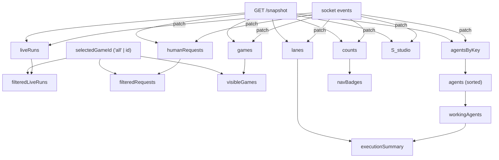

# Section 5 — Frontend Architecture (Angular 22, zoneless, Signals)

**Global rules**
- Every component is `standalone` (the default), uses `changeDetection: ChangeDetectionStrategy.OnPush`, `selector: 'rd-…'`, `input()`/`input.required()`/`output()`/`model()` (no decorators), `inject()` (no constructor DI), and the `@if`/`@for`/`@switch` control flow (with `track` on every `@for`).
- State lives in **signals**. RxJS is used only at I/O boundaries: HttpClient and socket streams. Convert with `toSignal`/`firstValueFrom`, and clean up with `takeUntilDestroyed`.
- No NgModules, no `zone.js`, no `@angular/animations` (CSS-only motion), no `[innerHTML]` except in `MarkdownViewComponent`, which binds sanitized HTML.
- Every API call goes through a `*-api.service.ts`. Components never touch `HttpClient` directly.

## 5.1 `app.config.ts`
```ts
export const appConfig: ApplicationConfig = {
  providers: [
    provideBrowserGlobalErrorListeners(),
    provideZonelessChangeDetection(),
    provideRouter(routes, withComponentInputBinding(), withViewTransitions(), withInMemoryScrolling({ scrollPositionRestoration: 'top' })),
    provideHttpClient(withFetch(), withInterceptors([authInterceptor, apiErrorInterceptor])),
    provideAppInitializer(() => inject(AuthStore).restoreSession()), // POST /auth/refresh silently; ignore 401
  ],
};
```

## 5.2 Routing Table (`app.routes.ts`)

| Path | Component (lazy `loadComponent`) | Guards | Title |
|---|---|---|---|
| `login` | `LoginPage` | `guestGuard` | Sign in · RobDev |
| `register` | `RegisterPage` | `guestGuard` | Create account · RobDev |
| `` (empty) | redirect → `/s/{firstMembership.studioSlug}/home` (via `defaultStudioRedirectGuard`) | `authGuard` | – |
| `s/:studioSlug` | `StudioShellComponent` (children below) | `authGuard`, `studioContextGuard` | – |
| ↳ `home` | `HomePage` | | Home |
| ↳ `lead` | `TeamPage` (data: `{ fixedAgent: 'lead' }`) | | Lead |
| ↳ `team` | `TeamPage` | | Team |
| ↳ `team/:agentKey` | `TeamPage` | | Team |
| ↳ `tasks` | `TasksPage` (query `?task=` opens the drawer) | | Tasks |
| ↳ `review` | `ReviewPage` (query `?tab=&status=&item=`) | | Review |
| ↳ `games` | `GamesPage` | | Games |
| ↳ `games/:gameSlug` | `GameDetailPage` | | Game |
| ↳ `pitches` | `PitchesPage` | | Pitches |
| ↳ `pitches/:pitchId` | `PitchesPage` | | Pitch |
| ↳ `market` | `MarketPage` (query `?sort=&genre=&q=`) | | Market |
| ↳ `library` | `LibraryPage` (query `?doc=<docId>&mode=view|split|edit`) | | Library |
| ↳ `settings` | `SettingsPage` (query `?tab=models|members`) | role ≥ ADMIN for the models tab (members tab read-only for others) | Settings |
| ↳ `` | redirect → `home` | | |
| `**` | redirect → `` | | |

Every route param, query param and route `data` binds straight into component `input()`s via `withComponentInputBinding()`. Example: `readonly agentKey = input<AgentKey | undefined>(); readonly fixedAgent = input<AgentKey | undefined>();`.

`studioContextGuard`:
1. Resolve `studioSlug` against `AuthStore.memberships()`. If there's no match, redirect to `/`.
2. `await StudioStoreService.activate(studioId)`. This fetches the snapshot, joins the socket room and sets `selectedGameId` from `localStorage['rd.selectedGame.<studioId>']` (if the game still exists) or `'all'`.
3. Return `true`. A failed snapshot shows a full-page error state with Retry.

## 5.3 Auth (`core/auth`)
```ts
@Injectable({ providedIn: 'root' })
export class AuthStore {
  private readonly api = inject(AuthApiService);
  private readonly router = inject(Router);
  readonly accessToken = signal<string | null>(null);
  readonly user = signal<UserDto | null>(null);
  readonly memberships = signal<MembershipDto[]>([]);
  readonly isAuthenticated = computed(() => this.accessToken() !== null);
  private refreshInFlight: Promise<boolean> | null = null;

  async restoreSession(): Promise<void> { await this.refresh(); }
  applySession(s: AuthSessionDto): void { this.accessToken.set(s.accessToken); this.user.set(s.user); this.memberships.set(s.memberships); }
  /** Single-flight refresh shared by interceptor + socket reconnect. */
  refresh(): Promise<boolean> {
    this.refreshInFlight ??= firstValueFrom(this.api.refresh())
      .then((s) => { this.applySession(s); return true; })
      .catch(() => { this.clear(); return false; })
      .finally(() => { this.refreshInFlight = null; });
    return this.refreshInFlight;
  }
  async login(body: LoginRequest): Promise<void> { this.applySession(await firstValueFrom(this.api.login(body))); }
  async register(body: RegisterRequest): Promise<void> { this.applySession(await firstValueFrom(this.api.register(body))); }
  async logout(): Promise<void> { await firstValueFrom(this.api.logout()).catch(() => undefined); this.clear(); await this.router.navigateByUrl('/login'); }
  clear(): void { this.accessToken.set(null); this.user.set(null); this.memberships.set([]); }
}
```
- **`authInterceptor`:** requests to `/api/*` (except `/api/auth/*` and `/api/media/*`) get `Authorization: Bearer <token>` and `withCredentials: true`. On `401`, call `await authStore.refresh()`. On success, retry the request **once** with the new token; on failure, navigate to `/login?returnUrl=…`.
- **`apiErrorInterceptor`:** maps `HttpErrorResponse.error as ApiErrorBody` to `ToastService.error(message)`, except `401` (handled above), `409 VERSION_CONFLICT` (the library handles it) and `404` on the GET of a detail route (the page renders "Not found").
- **Login/Register pages:** a centered 400px `surface(2,'xl')` card on `bg-0` with a radial violet glow behind it. Reactive Forms validate with the shared zod schemas through a `zodValidator(schema)` helper, which maps zod issues to `{ zod: message }` per control. Register has an optional "Studio name" field. Errors show inline (`.rd-field__error`). Submit shows a spinner. After login, navigate to `returnUrl` or `/`.

## 5.4 Real-time — `core/realtime/socket.service.ts`
```ts
@Injectable({ providedIn: 'root' })
export class SocketService {
  private readonly auth = inject(AuthStore);
  private socket: Socket<ServerToClientEvents, ClientToServerEvents> | null = null;
  readonly connection = signal<'disconnected' | 'connecting' | 'connected'>('disconnected');
  private readonly reconnected$ = new Subject<void>();
  readonly onReconnect$ = this.reconnected$.asObservable();

  connect(): void {
    if (this.socket) return;
    this.connection.set('connecting');
    this.socket = io(WS_NAMESPACE, {
      path: '/socket.io', transports: ['websocket'], withCredentials: true,
      auth: (cb) => cb({ token: this.auth.accessToken() }),       // evaluated on every (re)connect
      reconnectionDelay: 1000, reconnectionDelayMax: 10_000,
    });
    let everConnected = false;
    this.socket.on('connect', () => { this.connection.set('connected'); if (everConnected) this.reconnected$.next(); everConnected = true; });
    this.socket.on('disconnect', () => this.connection.set('disconnected'));
    this.socket.on('connect_error', async () => { await this.auth.refresh(); });   // token likely expired
  }
  disconnect(): void { this.socket?.disconnect(); this.socket = null; this.connection.set('disconnected'); }
  on<E extends keyof ServerToClientEvents>(event: E): Observable<Parameters<ServerToClientEvents[E]>[0]> {
    return new Observable((sub) => {
      const handler = ((payload: Parameters<ServerToClientEvents[E]>[0]) => sub.next(payload)) as never;
      this.socket!.on(event, handler);
      return () => { this.socket?.off(event, handler); };
    });
  }
  emitWithAck<E extends keyof ClientToServerEvents>(event: E, payload: Parameters<ClientToServerEvents[E]>[0]): Promise<unknown> {
    return new Promise((resolve, reject) => {
      (this.socket!.timeout(8000).emit as Function)(event, payload, (err: Error | null, res: { ok: boolean; data?: unknown; message?: string }) =>
        err ? reject(err) : res.ok ? resolve(res.data) : reject(new Error(res.message)));
    });
  }
}
```

## 5.5 Global Signal Store — `core/state/studio-store.service.ts`



```ts
@Injectable({ providedIn: 'root' })
export class StudioStoreService {
  private readonly api = inject(StudioApiService);
  private readonly socket = inject(SocketService);
  private readonly destroyRef = inject(DestroyRef);

  // ── state ─────────────────────────────────────────────
  readonly studio = signal<StudioDto | null>(null);
  readonly myRole = signal<MembershipRole>('VIEWER');
  readonly loadState = signal<'idle' | 'loading' | 'ready' | 'error'>('idle');
  readonly selectedGameId = signal<string | 'all'>('all');
  private readonly agentsByKey = signal<ReadonlyMap<AgentKey, AgentDto>>(new Map());
  readonly games = signal<GameDto[]>([]);
  readonly lanes = signal<StudioLaneDto[]>([]);
  readonly liveRuns = signal<LiveRunDto[]>([]);
  readonly humanRequests = signal<HumanRequestDto[]>([]);
  readonly counts = signal<StudioCountsDto>(EMPTY_COUNTS);
  readonly setup = signal<StudioSetupDto>({ hasAnyLlmConnection: false, unboundAgentKeys: [] });

  // ── derived ───────────────────────────────────────────
  readonly agents = computed(() => [...this.agentsByKey().values()].sort((a, b) => a.order - b.order));
  readonly workingAgents = computed(() => this.agents().filter((a) => a.status === 'WORKING'));
  readonly selectedGame = computed(() => { const id = this.selectedGameId(); return id === 'all' ? null : this.games().find((g) => g.id === id) ?? null; });
  readonly visibleGames = computed(() => { const g = this.selectedGame(); return g ? [g] : this.games(); });
  readonly filteredLiveRuns = computed(() => this.byGame(this.liveRuns(), (r) => r.gameId));
  readonly filteredRequests = computed(() => this.byGame(this.humanRequests(), (r) => r.gameId));
  readonly canEdit = computed(() => ROLE_RANK[this.myRole()] >= ROLE_RANK.PRODUCER);
  readonly isAdmin = computed(() => ROLE_RANK[this.myRole()] >= ROLE_RANK.ADMIN);
  readonly isPaused = computed(() => this.studio()?.isPaused ?? false);
  readonly navBadges = computed(() => ({
    lead: this.agentsByKey().get('lead')?.status === 'WAITING_ON_HUMAN' ? 1 : 0,
    team: this.workingAgents().length,
    tasks: this.counts().openTasks,
    review: this.counts().review.toReview,
  }));
  /** "2 agents working · Playtest has Studio" */
  readonly executionSummary = computed(() => {
    const n = this.workingAgents().length;
    const held = this.lanes().filter((l) => l.heldByAgentKey);
    const left = n === 0 ? 'All agents idle' : `${n} agent${n === 1 ? '' : 's'} working`;
    const right = held.length === 0 ? 'Studio free'
      : held.map((l) => `${AGENT_BY_KEY[l.heldByAgentKey!].name} has Studio`).join(' · ');
    return `${left} · ${right}`;
  });
  agent(key: AgentKey): Signal<AgentDto | undefined> { return computed(() => this.agentsByKey().get(key)); }

  private activeStudioId: string | null = null;
  private subscriptions: Subscription | null = null;

  async activate(studioId: string): Promise<void> {
    if (this.activeStudioId === studioId && this.loadState() === 'ready') return;
    this.deactivate();
    this.activeStudioId = studioId;
    this.loadState.set('loading');
    this.socket.connect();
    await this.hydrate(studioId);
    await this.socket.emitWithAck('studio:join', { studioId });
    this.subscriptions = this.wireEvents();
    const saved = localStorage.getItem(`rd.selectedGame.${studioId}`);
    this.selectedGameId.set(saved && this.games().some((g) => g.id === saved) ? saved : 'all');
  }
  selectGame(id: string | 'all'): void {
    this.selectedGameId.set(id);
    if (this.activeStudioId) localStorage.setItem(`rd.selectedGame.${this.activeStudioId}`, id);
  }
  private async hydrate(studioId: string): Promise<void> {
    try {
      const s = await firstValueFrom(this.api.snapshot(studioId));
      this.studio.set(s.studio); this.myRole.set(s.myRole);
      this.agentsByKey.set(new Map(s.agents.map((a) => [a.key, a])));
      this.games.set(s.games); this.lanes.set(s.lanes); this.liveRuns.set(s.liveRuns);
      this.humanRequests.set(s.humanRequests); this.counts.set(s.counts); this.setup.set(s.setup);
      this.loadState.set('ready');
    } catch (e) { this.loadState.set('error'); throw e; }
  }
  private wireEvents(): Subscription {
    const sub = new Subscription();
    const mine = <T extends { studioId: string }>(src: Observable<T>) => src.pipe(filter((e) => e.studioId === this.activeStudioId));
    sub.add(mine(this.socket.on('agent:status')).subscribe((e) => this.patchAgent(e.agentKey, {
      status: e.status, currentTaskId: e.currentTaskId, currentTaskTitle: e.currentTaskTitle, currentRunId: e.currentRunId,
      currentGameId: e.currentGameId, lastSnippet: e.lastSnippet, lastErrorCode: e.lastErrorCode, lastActivityAt: e.at })));
    sub.add(mine(this.socket.on('agent:activity')).subscribe((e) => {
      this.patchAgent(e.agentKey, { lastSnippet: e.snippet, lastActivityAt: e.at });
      this.liveRuns.update((runs) => runs.map((r) => (r.runId === e.runId ? { ...r, lastSnippet: e.snippet } : r)));
    }));
    sub.add(mine(this.socket.on('run:started')).subscribe((e) => { if (e.live) this.liveRuns.update((r) => [e.live!, ...r.filter((x) => x.runId !== e.live!.runId)]); }));
    sub.add(mine(this.socket.on('run:finished')).subscribe((e) => this.liveRuns.update((r) => r.filter((x) => x.runId !== e.run.id))));
    sub.add(mine(this.socket.on('studio:counts')).subscribe((e) => this.counts.set(e.counts)));
    sub.add(mine(this.socket.on('studio:paused')).subscribe((e) => this.studio.update((s) => (s ? { ...s, isPaused: e.isPaused, pausedAt: e.isPaused ? e.at : null } : s))));
    sub.add(mine(this.socket.on('lane:updated')).subscribe((e) => this.lanes.update((l) => l.map((x) => (x.id === e.lane.id ? e.lane : x)))));
    sub.add(mine(this.socket.on('game:updated')).subscribe((e) => this.games.update((g) => upsertById(g, e.game))));
    sub.add(mine(this.socket.on('human-request:updated')).subscribe((e) => this.humanRequests.update((list) =>
      e.request.status === 'OPEN' ? upsertById(list, e.request, 'prepend') : list.filter((x) => x.id !== e.request.id))));
    sub.add(this.socket.onReconnect$.subscribe(async () => {
      if (!this.activeStudioId) return;
      await this.socket.emitWithAck('studio:join', { studioId: this.activeStudioId });
      await this.hydrate(this.activeStudioId);   // authoritative resync after any gap
    }));
    return sub;
  }
  private patchAgent(key: AgentKey, patch: Partial<AgentDto>): void {
    this.agentsByKey.update((m) => { const cur = m.get(key); if (!cur) return m; const next = new Map(m); next.set(key, { ...cur, ...patch }); return next; });
  }
  private byGame<T>(items: T[], gameOf: (t: T) => string | null): T[] {
    const id = this.selectedGameId(); return id === 'all' ? items : items.filter((t) => gameOf(t) === id);
  }
  deactivate(): void {
    this.subscriptions?.unsubscribe(); this.subscriptions = null;
    if (this.activeStudioId) void this.socket.emitWithAck('studio:leave', { studioId: this.activeStudioId }).catch(() => undefined);
    this.activeStudioId = null; this.loadState.set('idle');
  }
}
```
`upsertById(list, item, mode = 'replace-or-append')` is a pure helper in `core/state/upsert.ts`, unit tested in `studio-store.service.spec.ts`.

### Feature stores (component-scoped, `providers: [XStore]` on the page component)

| Store | State signals | Key methods | Socket subscriptions |
|---|---|---|---|
| `AgentConsoleStore` | `agentKey`, `detail: AgentDetailDto`, `runs: AgentRunSummaryDto[]`, `selectedRunId`, `entries: RunLogEntryDto[]`, `streamingText: Map<entryId,string>`, `artifacts`, `messages: AgentMessageDto[]`, `isFollowingLive` | `select(key)`, `selectRun(id)`, `send(body)`, `cancelRun()`, `loadOlderMessages()` | `agent:log-chunk` (for the subscribed run), `run:started` (auto-follow when `isFollowingLive` and agent matches), `run:finished`, `agent:message` |
| `ReviewStore` | `tab`, `status`, `items`, `selectedId`, `detail`, `counts`, `busy` | `load()`, `open(id)`, `close()`, `verdict(v, feedback)`, `next()/prev()`, `upload(file, meta)` | `review:item`, `review:verdict`, `studio:counts` |
| `PitchesStore` | `pitches`, `selectedId`, `detail`, `editing` | `load()`, `select(id)`, `pick()`, `editAndApprove(patch)`, `requestChanges(feedback)`, `generate(opts)` | `pitch:updated` |
| `MarketStore` | `sort`, `genre`, `search`, `board: MarketLeaderboardDto`, `sortColumn`, `sortDir`, `runs`, `loading` | `load()`, `refresh()` (admin), `setSort(...)` | `market:ingested` (auto-reload when `status !== 'FAILED'`) |
| `LibraryStore` | `tree`, `docId`, `doc`, `draft`, `mode`, `saveState: 'saved'|'dirty'|'saving'|'conflict'|'error'`, `conflict: {currentVersion,currentMarkdown}|null`, `revisions` | `open(docId)`, `edit(text)`, `save()`, `resolveConflict('mine'|'theirs')`, `createDoc(folderId,title)`, `createFolder(...)` | `vault:document-updated` (if the open doc changed: clean → reload silently; dirty → set conflict) |

**`AgentConsoleStore` streaming algorithm:**
1. On `selectRun(runId)`: unsubscribe from the previous run room. Call `GET /runs/:id` and set `entries`. Call `run:subscribe`, which acks with `lastSeq`.
2. For each `agent:log-chunk` for this run:
   - `entry` present → upsert by `entry.id` and delete `streamingText[entry.id]`.
   - `delta` present → `streamingText[entryId] = (streamingText[entryId] ?? '') + delta`, and add a placeholder TEXT entry if the id is unknown.
3. The rendered entries are `computed(() => entries().map(e => streamingText().has(e.id) ? { ...e, content: e.content + streamingText().get(e.id) } : e))`.
4. Auto-scroll: `RunLogStreamComponent` uses an `effect()` that scrolls to the bottom after render when `isStuckToBottom` (the user is within 48px of the bottom). Scrolling up shows a floating "Jump to live ↓" button.

## 5.6 Component Tree & Contracts

```mermaid
flowchart TD
  App["AppComponent"] --> Shell["StudioShellComponent"]
  App --> Toast["ToastHostComponent"]
  Shell --> Sidebar["SidebarComponent"]
  Sidebar --> Switcher["StudioSwitcherComponent"]
  Sidebar --> NavLink["NavLinkComponent ×9"]
  Sidebar --> Matrix["AgentMatrixComponent"]
  Sidebar --> Exec["ExecutionWidgetComponent"]
  Shell --> Ctx["ContextBarComponent"]
  Ctx --> GameTabs["GameFilterTabsComponent"]
  Shell --> Palette["CommandPaletteComponent"]
  Shell --> AskDlg["AskDialogComponent"]
  Shell --> TaskDlg["NewTaskDialogComponent"]
  Shell --> Outlet["router-outlet"]
  Outlet --> Home["HomePage"] --> Greet["GreetingHeader"] & Prompt["PromptBar"] & Setup["SetupBanner"] & Needs["NeedsYouColumn"] & Live["LiveNowPanel"]
  Needs --> NCard["NeedsYouCard"]
  Live --> GCard["GameProgressCard"]
  Outlet --> Team["TeamPage"] --> AList["AgentList"] --> AItem["AgentListItem"]
  Team --> Console["AgentConsole"] --> RunPick["RunPicker"] & Stream["RunLogStream"] & Chat["AgentChatBar"]
  Stream --> Entry["LogEntry"] --> MD["MarkdownView"]
  Outlet --> Review["ReviewPage"] --> RGrid["ReviewGrid"] --> RCard["ReviewCard"]
  Review --> Drawer["DrawerComponent"] --> RDrawer["ReviewDrawer"] --> Strip["SmallPreviewStrip"] & Stage["StageDetail"]
  Outlet --> Market["MarketPage"] --> MTable["MarketTable"] --> Spark["Sparkline"] & Delta["Delta"]
  Market --> Ingest["IngestionStatus"]
  Outlet --> Pitches["PitchesPage"] --> PItem["PitchListItem"] & PDetail["PitchDetail"]
  PDetail --> Metric["MetricCallout"] & Banner["PitchBanner"] & Acc["Accordion"] & PEdit["PitchEditDialog"]
  Outlet --> Library["LibraryPage"] --> Tree["VaultTree"] --> TNode["VaultTreeNode (recursive)"]
  Library --> Editor["VaultEditor"] & Preview["VaultPreview"] & Tele["TelemetryBar"]
  Outlet --> Settings["SettingsPage"] --> Conns["ModelConnections"] & Bind["AgentModelBindings"] & Members["Members"]
```



### Contracts (signal inputs/outputs). Unlisted components inject the store and take no inputs.

| Component | Inputs | Outputs | Notes |
|---|---|---|---|
| `IconComponent` `rd-icon` | `name: input.required<IconName>()`, `size = input(16)` | – | inline SVG `viewBox="0 0 24 24"`, `stroke="currentColor"`, `stroke-width=1.75`, `fill="none"`, round caps/joins. `icons.ts` exports `ICONS: Record<IconName, string>` (path `d` strings). **Required names:** home, lead, team, tasks, review, games, pitches, market, library, settings, search, plus, pause, play, send, check, x, edit, chevron-right, chevron-down, chevron-left, external, upload, refresh, sparkles, alert-triangle, clock, folder, folder-open, file-text, grid, link, image, film, gamepad, trending-up, trending-down, bot, user, logout, keyboard, eye. Author the paths in the Lucide geometric style (24-grid, 2px safe area); Lucide geometry (ISC licence) may be transcribed, with the licence header in `icons.ts`. |
| `AgentAvatarComponent` | `agent: input.required<Pick<AgentDto,'name'|'glyph'|'color'|'status'>>()`, `size = input<'xs'|'sm'|'md'|'lg'>('md')` (20/28/36/48 px), `showStatus = input(true)` | – | rounded square (radius sm/md), status dot like the matrix |
| `StatusPillComponent` | `status: input.required<string>()`, `label = input<string>()` | – | host `[attr.data-status]`; default label = `STATUS_LABELS[status]` (WORKING, IDLE, WAITING, BLOCKED, PAUSED, ERROR, OFFLINE, QUEUED, RUNNING, NEEDS YOU, DONE, FAILED, CANCELLED, TO REVIEW, CHANGES ASKED, APPROVED, REJECTED, FIX FIRST, SHOULD FIX, NIT) |
| `CountBadgeComponent` | `count: input.required<number>()`, `tone = input<'neutral'|'accent'|'warning'>('neutral')` | – | hidden when 0; shows `99+` above 99 |
| `KbdComponent` | `keys: input.required<string[]>()` | – | renders `Ctrl` `K` chips; shows `⌘` instead of `Ctrl` on macOS (`navigator.platform`) |
| `TabsComponent<T>` | `tabs: input.required<{ id: T; label: string; count?: number }[]>()`, `active = model.required<T>()` | – | `role=tablist`, arrow-key navigation |
| `FilterPillsComponent<T>` | `options: input.required<{ id: T; label: string; count?: number }[]>()`, `value = model.required<T>()` | – | radio-group semantics |
| `AccordionComponent` | `title: input.required<string>()`, `open = model(false)`, `badge = input<string>()` | – | `<details>` with content projection |
| `ProgressBarComponent` | `value: input.required<number>()` (0–100), `accent = input<string>()` | – | `role=progressbar` with aria values |
| `DeltaComponent` | `value: input.required<number | null>()` | – | `+12.4%` (pos), `−3.1%` (neg, U+2212), `—` (null, tooltip "Collecting 7-day history"); arrow icon |
| `SparklineComponent` | `points: input.required<number[]>()`, `width = input(72)`, `height = input(20)` | – | SVG polyline; stroke `success` if last ≥ first else `danger`; empty if < 2 points |
| `MarkdownViewComponent` | `markdown: input.required<string>()`, `streaming = input(false)`, `resolveLink = input<(target: string) => string | null>()` | `wikilinkClick: output<string>()` | `computed` → `MarkdownService.render()`; binds `[innerHTML]` of the sanitized HTML (`SafeHtml` via `bypassSecurityTrustHtml` **only** after DOMPurify); delegated click handler for `a[data-wikilink]` |
| `DialogComponent` | `open = model(false)`, `title: input.required<string>()`, `width = input('520px')` | `closed: output<void>()` | native `<dialog>` with `showModal()`/`close()` driven by an `effect()`; Esc + backdrop click close it; focus trap is native |
| `DrawerComponent` | `open = model(false)`, `label: input.required<string>()` | `closed: output<void>()` | host class `is-open`; Esc closes; focus moves to the panel on open and back to the opener on close |
| `StudioSwitcherComponent` | – | – | button shows `robdev / Inclined Games studio` (`workspaceLabel / name`); menu lists memberships → navigate `/s/:slug/home`; "Create studio" opens a dialog (POST `/studios`) |
| `NavLinkComponent` | `icon: input.required<IconName>()`, `label: input.required<string>()`, `link: input.required<string[]>()`, `badge = input(0)`, `badgeTone = input<'neutral'|'accent'>('neutral')` | – | `routerLink` + `routerLinkActive` → `aria-current="page"` |
| `AgentMatrixComponent` | – | – | 15 cells + Team tile, see §3.5 |
| `ExecutionWidgetComponent` | – | – | 2 lines: `executionSummary()`, plus a connection dot ("Live" green / "Reconnecting…" amber); clicking goes to `/team` |
| `GameFilterTabsComponent` | – | – | tabs: `All games` + one per game (accent dot); writes `store.selectGame()` |
| `ContextBarComponent` | – | – | tabs + actions: `Ask` (ghost, opens AskDialog), `+ New task` (secondary), `Pause all`/`Resume all` (warning/success; ADMIN only; confirm dialog: "Pause all agents? Running work stops and resumes later.") |
| `CommandPaletteComponent` | – | – | opens on Ctrl/⌘+K or the sidebar search; 560px glass panel at the top 15 %; debounced (150 ms) `GET /search` plus static routes; ↑/↓/Enter/Esc; results grouped by type |
| `AskDialogComponent` | – | – | textarea + game select (defaults to `selectedGameId` unless `all`); submit → `/lead/ask` → navigate `/s/:slug/lead` |
| `NewTaskDialogComponent` | – | – | fields: agent (select with avatar), title, brief, game, priority, tags (comma); POST `/tasks`; toast "Task queued for {Agent}" |
| `GreetingHeaderComponent` | – | – | "Good morning/afternoon/evening, {firstName}" (05–12 / 12–18 / else) using `ClockService.now` (1-min ticking signal); subline date `Thursday, 22 October`; pills `{needsYou} need you` (warning), `{working} working` (success), `{queued} queued` (info) |
| `PromptBarComponent` | `placeholder = input('Ask the Lead anything, or say what you want done...')` | `submitted: output<string>()` | HomePage handles submit → `/lead/ask` with the selected game → toast + navigate to `/lead` |
| `SetupBannerComponent` | – | – | shown when `!setup.hasAnyLlmConnection` or `unboundAgentKeys.length > 0`: "Connect a model provider to wake your team" / "{n} agents have no model" → CTA `Settings → Models` |
| `NeedsYouColumnComponent` | – | – | header `NEEDS YOU` + count; `@for` over `filteredRequests()`; empty state "Nothing needs you right now." |
| `NeedsYouCardComponent` | `request: input.required<HumanRequestDto>()`, `game = input<GameDto | null>(null)` | `reply: output<{ id: string; body: string; optionId?: string }>()`, `done: output<string>()`, `details: output<HumanRequestDto>()` | kind label (`PICK THE NEXT GAME`, `TRY IT`, `DECISION`, `INFO`); agent avatar + "from {Agent} · {relative time}"; body via MarkdownView (clamped to 6 lines with "more"). **PICK_NEXT_GAME:** lists pitch titles plus a primary button "Choose a pitch" → `/pitches/{firstPitchId}`. **TRY_IT:** shows `v{buildVersion}`, buttons `Reply` (inline textarea expands), `Done` (success), `Details` (ghost → `/team/{agentKey}` with the task's run). **DECISION:** option buttons send `reply` with `optionId`. |
| `LiveNowPanelComponent` | – | – | section `LIVE NOW`: rows per `filteredLiveRuns()` (avatar, agent name, task title, snippet with streaming caret, elapsed "4m"); then section `WHERE EACH GAME IS`: `@for visibleGames()` → GameProgressCard; then `STUDIO LANES`: one row per lane "Lane A · Playtest · Anime Awakening RNG · 12m" or "Lane B · free" |
| `GameProgressCardComponent` | `game: input.required<GameDto>()` | `play: output<GameDto>()` | name + status pill; chips `v{latestPublishedVersion} published` / `v{latestSavedVersion} saved` (mono); progress bar + `{done}/{total} milestones · {currentStage}`; purple CTA `Play the newest build` (opens `playUrl` in a new tab; when `playUrl` is null: secondary button `Add Roblox place ID` → `/games/{slug}`) |
| `AgentListComponent` | `selected = input<AgentKey | null>(null)` | `select: output<AgentKey>()` | search box filters by name; groups: `WORKING`, `WAITING`, `TEAM` (rest) |
| `AgentListItemComponent` | `agent: input.required<AgentDto>()`, `selected = input(false)` | `select: output<AgentKey>()` | avatar, name, status pill, snippet (`lastSnippet ?? currentTaskTitle ?? title`), relative time of `lastActivityAt` |
| `AgentConsoleComponent` | `agentKey: input.required<AgentKey>()`, `wide = input(false)` (Lead) | – | header: avatar, name, title, modelLabel chip (or an "No model" warning chip linking to settings), status pill, `Cancel run` (when WORKING, PRODUCER+); RunPicker; RunLogStream; AgentChatBar |
| `RunPickerComponent` | `runs: input.required<AgentRunSummaryDto[]>()`, `selected = model<string | null>()`, `live = input<string | null>(null)` | – | horizontal chips: `● Live` (when live) then recent runs "Task title · 12m ago · ✓/✗" |
| `RunLogStreamComponent` | `entries: input.required<RunLogEntryDto[]>()`, `streamingEntryId = input<string | null>(null)`, `artifacts = input<RunArtifactDto[]>([])` | `wikilinkClick: output<string>()` | empty state for a run with no entries: "Waiting for the first token…" |
| `LogEntryComponent` | `entry: input.required<RunLogEntryDto>()`, `streaming = input(false)` | `wikilinkClick: output<string>()` | `@switch(kind)`: TEXT → MarkdownView; TOOL_CALL → `{tool label} · {compact args}`; TOOL_RESULT → `<details>` with JSON in `pre`; CONTEXT → doc chips (path · v · tokens · truncated badge); HANDOFF → "→ Delegated to {Agent}: {title}" with a link; ERROR → danger box; USAGE → muted "1,234 in · 5,678 out" |
| `AgentChatBarComponent` | `agentName: input.required<string>()`, `disabled = input(false)` | `send: output<string>()` | placeholder `Message {agentName}...`; Enter sends, Shift+Enter newlines; disabled for VIEWER |
| `ReviewGridComponent` | `items: input.required<ReviewItemDto[]>()`, `groupByGame = input(true)`, `selectedId = input<string | null>(null)` | `open: output<string>()` | groups by `gameName` ("Unassigned" last) |
| `ReviewCardComponent` | `item: input.required<ReviewItemDto>()`, `selected = input(false)` | `open: output<string>()` | IMAGES: 16:9 or 1:1 thumbnail (`object-fit: cover`), title, agent avatar, status pill, iteration "v2"; STAGES: title, build `v1467`, checklist progress, `FIX FIRST ×1` danger pill |
| `ReviewDrawerComponent` | `detail: input.required<ReviewItemDetailDto>()`, `canAct = input(false)`, `busy = input(false)` | `verdict: output<{ verdict: Verdict; feedback: string }>()`, `navigate: output<'next' | 'prev'>()` | header: title + status + close; hero media (img / `<video controls>` for TRAILER); meta line **`Made by Splash · 512×512 · 399 KB`** (`{agent} · {w}×{h} · {bytes|bytes}`); SmallPreviewStrip (images only); description; blockers list (Stage); verdict history; feedback textarea; footer buttons **`Approve [A]`** (success), **`Ask for changes [C]`** (warning), **`Reject [X]`** (danger). Approve is disabled with tooltip "Resolve FIX FIRST blockers first" when `openFixFirst > 0` on STAGE/PUBLISH. |
| `SmallPreviewStripComponent` | `src: input.required<string>()`, `aspect: input.required<'1:1' | '16:9'>()` | – | label `HOW IT READS SMALL`; three frames at 512/150/64 px |
| `StageDetailComponent` | `payload: input.required<StagePayload>()`, `blockers: input.required<BlockerDto[]>()`, `canEdit = input(false)` | `resolveBlocker: output<{ id: string; status: 'RESOLVED' | 'WAIVED' }>()` | checklist with done/undone icons; blockers sorted FIX_FIRST → NIT |
| `MarketTableComponent` | `rows: input.required<MarketRowDto[]>()`, `sortColumn = model<MarketColumn>('rank')`, `sortDir = model<'asc'|'desc'>('asc')` | `openGame: output<MarketRowDto>()` | columns: `#`, `Game` (icon + name + creator), `Genre`, `CCU` (compact `6.4K`), `7d Δ` (Delta), `Trend` (Sparkline), `Likes` (`85%`, coloured ≥ 85 % success, < 70 % warning), `Visits` (compact), `Favorites`; click header to sort client-side; row click → `https://www.roblox.com/games/{rootPlaceId}` in a new tab |
| `IngestionStatusComponent` | `board: input.required<MarketLeaderboardDto>()`, `runs = input<MarketIngestionRunDto[]>([])`, `canRefresh = input(false)` | `refresh: output<void>()` | "Live · updated 12m ago" (green dot), "Seed data · waiting for first live ingest" (muted), or stale/error banner "Live data stale since 14:02 — Roblox explore-api changed or is unreachable" (warning) |
| `PitchListItemComponent` | `pitch: input.required<PitchDto>()`, `selected = input(false)` | `select: output<string>()` | title, genre, status pill, first 2 metrics inline |
| `PitchDetailComponent` | `pitch: input.required<PitchDetailDto>()`, `canAct = input(false)`, `busy = input(false)` | `pick: output<void>()`, `editApprove: output<UpdatePitchRequest>()`, `requestChanges: output<string>()` | title (display) + logline + genre chip + `by Pulse · date`; metric callouts row; banners `WHAT CHANGED` / `HOW WE'RE DIFFERENT`; comparables chips; 6 accordions in `PITCH_SECTION_TITLES` order (first open); sticky actions `Pick this game` (primary), `Edit & approve` (secondary → PitchEditDialog), `Request changes` (ghost → dialog with feedback textarea). PICKED pitches show "Picked → {Game}" instead of actions. |
| `MetricCalloutComponent` | `metric: input.required<PitchMetric>()` | – | label uppercase (e.g. `TOP-EARNING RANK`), value (`#280`) |
| `PitchBannerComponent` | `kind: input.required<'changed' | 'different'>()`, `text: input.required<string>()` | – | |
| `PitchEditDialogComponent` | `pitch: input.required<PitchDetailDto>()`, `open = model(false)` | `save: output<UpdatePitchRequest>()` | fields for title, logline, whatChanged, howDifferent, 6 section textareas |
| `VaultTreeComponent` | `nodes: input.required<VaultTreeNodeDto[]>()`, `selectedDocId = input<string | null>(null)` | `openDoc: output<string>()`, `createDoc: output<{ folderId: string }>()`, `createFolder: output<{ parentId: string | null }>()` | filter box; expand state persisted in `localStorage['rd.vault.expanded']`; keyboard: ↑/↓ move, →/← expand/collapse, Enter opens |
| `VaultTreeNodeComponent` | `node: input.required<VaultTreeNodeDto>()`, `depth = input(0)`, `selectedDocId = input<string | null>(null)`, `expanded = input<ReadonlySet<string>>(new Set())` | `toggle: output<string>()`, `openDoc: output<string>()` | recursive; indent `depth × 14px`; folder/file icons; word count muted on the right |
| `VaultEditorComponent` | `text = model.required<string>()`, `title: input.required<string>()`, `saveState: input.required<SaveState>()`, `version = input(1)`, `readonly = input(false)`, `mode = model<'view' | 'split' | 'edit'>('split')` | `save: output<void>()` | textarea with `TabIndentDirective` (Tab inserts 2 spaces, Shift+Tab outdents), Ctrl/⌘+S → save; autosave after 2 s idle when dirty (handled by LibraryStore); conflict banner: "This doc changed elsewhere (v5). Keep mine · Use theirs" |
| `VaultPreviewComponent` | `markdown: input.required<string>()` | `wikilinkClick: output<string>()` | MarkdownView in `.rd-prose`; ASCII blocks render in `pre.rd-ascii` |
| `TelemetryBarComponent` | `markdown: input.required<string>()`, `doc: input.required<VaultDocumentDto | null>()` | `openDoc: output<string>()` | `words = computed(() => countWords(markdown()))`, `chars = computed(() => countChars(markdown()))` (live while typing); backlinks count with a popover list (click → openDoc); linked agents as xs avatars (tooltip source + priority); right side `v{version} · updated {relative} by {label}` |
| `ModelConnectionsComponent` | – | – | table of connections: provider, label, key `••••1234`, status (verified time / error), bound agents count; actions Test, Edit, Disable, Delete; "Add connection" opens ConnectionFormDialog |
| `ConnectionFormDialogComponent` | `connection = input<LlmConnectionDto | null>(null)`, `open = model(false)` | `saved: output<LlmConnectionDto>()` | provider select (6), label (prefilled with `PROVIDER_LABEL`), base URL (shown for OLLAMA (default `http://localhost:11434/v1`) and OPENAI_COMPATIBLE; optional override for others), API key (password field; hidden for OLLAMA; "leave blank to keep" when editing); Save → POST/PATCH, then auto Test |
| `AgentModelBindingsComponent` | – | – | 15 rows: avatar, name, connection select, model select (loaded via `GET /connections/:id/models` and cached per connection; searchable `<input list>` datalist with free text allowed), temperature (0–2, step 0.1), max tokens; Splash has an extra image connection + image model; "Apply to all" copies the first row's connection/model to every agent; each change PATCHes immediately (debounced 400 ms) |
| `MembersComponent` | – | – | list of members with role selects (ADMIN+), Add by email, Remove |

**Tasks & Games views (compact specs):**
- **`TasksPage`:** a toolbar with status filter pills (`Open` = OPEN_TASK_STATUSES, `Done`, `Failed`, `All`), an agent select and the global game filter. The table has columns Status pill · Title · Agent (avatar+name) · Game · Priority · Updated (relative). Infinite scroll uses the cursor. Clicking a row opens `TaskDetailDrawerComponent` (`?task=`), which shows the brief (Markdown), dependencies, subtasks, runs (→ team console link), and Cancel/Retry/Edit actions per status.
- **`GamesPage`:** an `auto-fill-grid(300px)` of GameProgressCards plus a "New game" dialog.
- **`GameDetailPage`:** a header (name, genre, status select, accent colour, Roblox universe/place ID inputs, PRODUCER+), milestones (checkbox list → PATCH), builds timeline (version, kind chip, notes, mobile pass A/B pills, by agent/user, date) with a "Record build" form, and links to filtered Review/Tasks.

## 5.7 Keyboard Shortcuts (`HotkeysService`)

| Keys | Scope | Action |
|---|---|---|
| `Ctrl/⌘ + K` | global | open the command palette |
| `G` then `H`/`L`/`T`/`R`/`P`/`M`/`B` | global (not typing) | go to Home / Lead / Team / Review / Pitches / Market / Library |
| `N` | global (not typing) | new task dialog |
| `A` / `C` / `X` | review drawer open, focus not in a text field | Approve / focus feedback for Ask-for-changes (a second `C` or Ctrl+Enter submits) / Reject |
| `J` / `K` | review page | next / previous item |
| `Esc` | dialogs, drawer, palette | close |
| `Ctrl/⌘ + S` | library editor | save now |
| `Ctrl/⌘ + Enter` | chat bar, prompt bar, feedback textarea | submit |

"Typing" means `document.activeElement` is an `input`, `textarea`, `select` or `[contenteditable]`. `HotkeysService.register(combo, handler, { scope, when })` returns an unregister fn that components call in `DestroyRef.onDestroy`.

## 5.8 Markdown Rendering (`core/markdown/markdown.service.ts`)
- `marked` v18 instance: `new Marked({ gfm: true, breaks: false })` with these extensions:
  1. **Wikilink inline extension** (`name: 'wikilink'`, start `[[`, tokenizer regex identical to the shared `WIKILINK`). It renders `<a class="rd-wikilink" data-wikilink="{target}" href="/s/{slug}/library?doc={id}">{alias ?? target}</a>`, or `rd-wikilink--missing` when `resolveLink(target)` returns null.
  2. **Code renderer:** lang `ascii` → `<pre class="rd-ascii" data-lang="ascii"><code>{escaped}</code></pre>`. Lang `luau`/`lua` → `<pre data-lang="luau"><code>{LuauHighlighter.highlight(code)}</code></pre>`. Other langs → escaped, with `data-lang`.
  3. **Swatch extension:** the inline pattern `rgb(R, G, B)` inside table cells → prepends `<span class="rd-swatch" style="background:rgb(R,G,B)"></span>`. Validate 0–255 before emitting `style`.
- Sanitize with `DOMPurify.sanitize(html, { ADD_ATTR: ['data-wikilink', 'data-lang', 'target'], FORBID_TAGS: ['style', 'iframe', 'form'], ALLOWED_URI_REGEXP: /^(?:https?:|\/|#)/i })`. Re-allow `style` **only** on `.rd-swatch` spans, via a `uponSanitizeAttribute` hook that keeps `style` when the value matches `/^background:rgb\(\d{1,3},\d{1,3},\d{1,3}\)$/`.
- Streaming: when `streaming=true`, an unterminated trailing ``` fence is temporarily closed before parsing, so partial code renders as a code block. The component also adds the `.rd-streaming-caret` class to its last block.
- **`LuauHighlighter.highlight(src)`:** a single-pass tokenizer producing escaped HTML spans:
  - comments `--[[ ]]`/`--` → `tok-com`
  - strings `"…"`, `'…'`, `` `…` `` (interpolated), `[[…]]` → `tok-str`
  - numbers (hex, decimal, `_` separators) → `tok-num`
  - keywords `and break continue do else elseif end export false for function if in local nil not or repeat return then true type typeof until while` → `tok-kw`
  - Roblox globals `game workspace script Instance Vector3 Vector2 CFrame Color3 UDim UDim2 Enum task math string table os require tick wait spawn TweenInfo RaycastParams` → `tok-glob`
  - identifiers followed by `(` → `tok-fn`
  - operators → `tok-op`
  
  Covered by unit tests (keyword vs identifier boundaries, nested long comments, escaped quotes).

## 5.9 UX States & Copy (all views)
- **Loading:** `.rd-skeleton` blocks shaped like the final content. Never use a full-screen spinner after the first snapshot.
- **Empty states** (`EmptyStateComponent` with icon + title + body + optional CTA):
  - Review: "Nothing to review" / "Splash and Reviewer will drop work here."
  - Pitches: "No pitches yet" + `Ask Pulse for pitches`
  - Market: "No market data yet" + Refresh (admin)
  - Library doc not selected: "Pick a document from the vault."
  - Team console with no runs: "{Agent} hasn't run yet. Send a message to give them work."
- **Errors:** inline danger box with Retry. Toasts for mutations.
- **Optimistic updates:** verdicts (status flips immediately, reverting on error) and human-request Done. Everything else waits for the server response.
- **Accessibility:** every icon-only button has `aria-label`. The pill colour is never the only signal; a text label is always present. Focus rings come from `focus-ring`. Live regions: the team stream container has `aria-live="polite"` **off while streaming** (to avoid chatter) and announces "Run finished" on completion.

## 5.10 Frontend Tests (vitest via `ng test`)
`studio-store.service.spec.ts` (hydrate, event patching, game filter, executionSummary strings), `markdown.service.spec.ts` (wikilinks resolved/missing, ascii block, sanitization strips `<script>`, swatch), `luau-highlighter.spec.ts`, `relative-time.pipe.spec.ts`, `compact-number.pipe.spec.ts` (`6400 → 6.4K`, `1250000 → 1.3M`), `review-drawer.component.spec.ts` (A/C/X hotkeys emit verdicts; Approve is disabled with FIX_FIRST).
